# Modelo de dados (DER) — SIGAuto

> **Fonte:** os scripts de `database/` (01 → 33), lidos como DDL. **Não** é uma
> transcrição do diagrama da especificação: quando os dois divergirem, **o schema
> é a verdade**, e a divergência está registrada na última seção deste arquivo.
> A migração 29 foi aplicada e reaplicada com sucesso no Supabase efêmero. Isso
> valida o schema local; a aplicação em produção continua pendente de rollout.
> A migração 30 restringe o histórico do chatbot; sua validação local é registrada
> separadamente abaixo e não declara aplicação em produção.
> A migração 31 estende a proteção de leitura ao histórico do Painel IA.
> A migração 32 cria o armazenamento persistente e a RPC restrita para o limite
> de tentativas do fluxo de login do backend. A chave anon ainda permite acesso
> direto ao grant de senha do Supabase Auth, fora desse limite da aplicação.
> A migração 33 registra transições de status observadas e calcula a duração de
> cada etapa desde sua primeira observação; não estima estados históricos.
>
> Mexeu no schema? Acrescente uma nova migração numerada e **atualize este
> arquivo no mesmo commit**.

## Diagrama

```mermaid
erDiagram
    usuario      |o--o|  funcionario          : "1:1 opcional"
    cliente      ||--o|  endereco             : "1:1 opcional"
    cliente      ||--o{  veiculo              : possui
    veiculo      ||--o{  ordem_servico        : gera
    usuario      ||--o{  ordem_servico        : registrou
    funcionario  |o--o{  ordem_servico        : "mecanico / atendente"
    ordem_servico ||--o{ os_servico           : contem
    ordem_servico ||--o{ os_peca              : contem
    ordem_servico ||--o{ os_comissao          : "snapshot de comissao"
    funcionario  |o--o{ os_comissao           : recebe
    servico_catalogo |o--o{ os_servico        : referencia
    item_estoque |o--o{  os_peca              : referencia
    item_estoque ||--o{  movimentacao_estoque : movimenta
    ordem_servico |o--o{ movimentacao_estoque : "saida vinculada"
    ordem_servico ||--o{ os_baixa_estoque     : controla
    item_estoque ||--o{  os_baixa_estoque     : baixado
    usuario      ||--o{  movimentacao_estoque : lancou
    usuario      ||--o{  mensagem_chatbot     : conversou
    usuario      |o--o{  recomendacao_ia      : destinatario
    ordem_servico |o--o{ recomendacao_ia      : analisada
    usuario      |o--o{  log_auditoria        : agiu
    ordem_servico ||--o{ historico_status_os  : transiciona

    configuracao_oficina {
        smallint id PK "singleton, valor fixo 1"
        varchar nome_fantasia "NOT NULL"
        varchar razao_social
        varchar cnpj "NOT NULL, UNIQUE, 14 digitos"
        varchar telefone
        varchar email
        varchar cep "8 digitos"
        varchar logradouro
        varchar numero
        varchar complemento
        varchar bairro
        varchar cidade
        varchar uf "CHECK nas 27 UFs"
        text logo_path "path relativo sem espacos externos, barra invertida, URL, Base64 ou travessia"
        varchar texto_rodape "maximo 300 caracteres"
        timestamptz criado_em
        timestamptz atualizado_em
    }
    usuario {
        uuid id PK "FK para auth.users, ON DELETE CASCADE"
        varchar nome
        varchar email UK
        enum perfil "perfil_usuario, default atendente"
        varchar telefone
        boolean ativo
    }
    funcionario {
        uuid id PK
        varchar nome
        enum cargo "cargo_funcionario, default atendente"
        decimal comissao_percentual "CHECK 0..100"
        boolean comissao_sobre_servicos
        boolean comissao_sobre_pecas
        uuid id_usuario FK "UNIQUE, ON DELETE SET NULL"
        boolean ativo
    }
    cliente {
        uuid id PK
        varchar nome
        enum tipo_pessoa "fisica ou juridica"
        varchar cpf_cnpj UK "sem mascara"
        varchar telefone "NOT NULL"
        varchar email
        boolean ativo
    }
    endereco {
        uuid id PK
        uuid id_cliente FK "UNIQUE, ON DELETE CASCADE"
        char cep "8 digitos, CHECK de formato"
        varchar logradouro
        varchar numero "texto, aceita S/N"
        varchar complemento
        varchar bairro
        varchar cidade
        char uf "CHECK na lista de UFs"
        varchar ponto_referencia
    }
    veiculo {
        uuid id PK
        uuid id_cliente FK "NOT NULL"
        varchar placa UK "AAA-9999 ou AAA9A99"
        varchar modelo
        varchar marca
        smallint ano "CHECK 1950 ate ano atual +1"
        varchar cor
        int km_atual
        text observacoes
        boolean ativo
    }
    os_servico {
        uuid id PK
        uuid id_os FK "NOT NULL, ON DELETE CASCADE"
        uuid id_servico FK "ON DELETE SET NULL"
        varchar descricao "NOT NULL"
        numeric quantidade "CHECK maior que zero"
        decimal valor_unitario "CHECK maior ou igual a zero"
    }
    os_peca {
        uuid id PK
        uuid id_os FK "NOT NULL, ON DELETE CASCADE"
        uuid id_item FK "ON DELETE SET NULL"
        varchar descricao "NOT NULL"
        numeric quantidade "CHECK maior que zero"
        decimal valor_unitario "CHECK maior ou igual a zero"
    }
    os_comissao {
        uuid id PK
        uuid id_os FK "NOT NULL, ON DELETE CASCADE"
        varchar papel "mecanico ou atendente, UNIQUE por OS"
        uuid id_funcionario FK "ON DELETE SET NULL, INDEX desde a 29"
        varchar nome "snapshot"
        decimal percentual "CHECK 0..100"
        boolean sobre_servicos
        boolean sobre_pecas
        decimal base_servicos
        decimal base_pecas
        decimal valor
    }
    ordem_servico {
        uuid id PK
        serial numero_os UK "sequencial do banco"
        uuid id_veiculo FK "NOT NULL"
        uuid id_usuario FK "NOT NULL, quem registrou"
        uuid id_mecanico FK "para funcionario desde a 11"
        uuid id_atendente FK "para funcionario desde a 11"
        text descricao "NOT NULL (min 10 caracteres e RN15, validada na tela; sem CHECK no banco)"
        text diagnostico
        enum status "status_os, default aberta"
        varchar prioridade "CHECK baixa/normal/alta/urgente"
        timestamptz data_abertura
        timestamptz data_encerramento
        int km_entrada
        decimal valor_total
        decimal valor_servicos
        decimal valor_pecas
        decimal valor_comissao_mecanico "resumo do snapshot"
        decimal valor_comissao_atendente "resumo do snapshot"
        text observacoes
        varchar desconto_tipo "pct ou valor"
        decimal desconto_valor "abatimento monetario"
        decimal desconto_percentual "nullable, CHECK 0..100"
        text observacoes_finais
        varchar forma_pagamento
    }
    historico_status_os {
        bigint id PK
        uuid id_os FK "NOT NULL, sem cascade"
        enum status_anterior "status_os, NULL somente na criacao"
        enum status_novo "status_os, NOT NULL"
        timestamptz ocorrido_em "clock_timestamp"
        uuid id_autor "auth.uid, pode ser NULL em operacao de sistema"
    }
    servico_catalogo {
        uuid id PK
        varchar nome
        text descricao
        decimal preco "valor base"
        boolean ativo
    }
    item_estoque {
        uuid id PK
        varchar codigo UK
        varchar nome
        varchar unidade "CHECK UN/PC/LT/MT/KG/CX"
        numeric quantidade "CHECK maior ou igual a zero"
        numeric qtd_minima "CHECK maior que zero"
        decimal custo "NULL=nao informado, 0=custo zero; CHECK custo IS NULL OR >= 0; migracao 15"
        decimal preco_unit "preco de venda; CHECK preco_unit IS NULL OR >= 0 desde a 17"
        text descricao "descricao livre da peca"
        boolean ativo
    }
    movimentacao_estoque {
        uuid id PK
        uuid id_item FK "NOT NULL"
        uuid id_os FK "nullable, so em saidas"
        uuid id_usuario FK "NOT NULL"
        enum tipo "entrada/saida/ajuste"
        numeric quantidade "CHECK maior que zero"
        varchar motivo "exibido no historico"
        varchar origem "manual ou os"
        timestamptz data_hora
    }
    os_baixa_estoque {
        uuid id_os PK,FK
        uuid id_item PK,FK "INDEX adicional desde a 29"
        numeric quantidade_baixada "estado idempotente"
        timestamptz atualizado_em
    }
    mensagem_chatbot {
        uuid id PK
        uuid id_usuario FK "NOT NULL"
        text conteudo
        varchar remetente "CHECK usuario/chatbot"
        timestamptz criado_em
    }
    recomendacao_ia {
        uuid id PK
        uuid id_os FK
        uuid id_usuario FK
        varchar tipo
        text conteudo "NOT NULL removido pela migracao 09; o controller nao preenche"
        decimal confianca "0.0000 a 1.0000; vem do modelo, nunca calculada localmente"
        jsonb dados_analisados
        jsonb recomendacoes
    }
    log_auditoria {
        uuid id PK
        uuid id_usuario FK
        varchar acao "NOT NULL"
        varchar tabela
        uuid id_registro
        jsonb dados_antes
        jsonb dados_depois
        varchar ip_origem
    }
```

## Tipos enumerados

| Tipo | Valores |
| --- | --- |
| `perfil_usuario` | `gestor`, `atendente`, `mecanico` |
| `cargo_funcionario` | `gestor`, `atendente`, `mecanico` |
| `status_os` | `aberta`, `em_andamento`, `aguardando_peca`, `concluida`, `cancelada` |
| `tipo_movimentacao` | `entrada`, `saida`, `ajuste` |
| `tipo_pessoa` | `fisica`, `juridica` |

## Views

`login_tentativa` guarda apenas HMAC-SHA256 do e-mail normalizado, contador,
prazo de bloqueio e instante da última atividade. A RPC `registrar_tentativa_login`
é acessível somente ao backend com `service_role`; não guarda e-mail em claro e
remove hashes inativos após 30 dias. O bloqueio é aplicado no fluxo Express. Como
a anon key e o endpoint Supabase Auth são públicos, chamadas diretas ao grant de
senha não passam por este contador.

`duracao_etapa_os` expõe uma linha por transição observada, usando `LEAD` para
calcular o fim e a duração da etapa; a etapa atual mede até o instante da consulta.
Os eventos começam na migração 33 e não existe backfill de estados anteriores.
RLS da tabela de histórico permite leitura somente quando a OS relacionada é
visível ao usuário; a tabela não aceita DML direto dos papéis `anon` e
`authenticated`.

`item_estoque_publico` = `item_estoque` **sem a coluna `custo`** (id, codigo, nome, descricao, unidade, quantidade, qtd_minima, preco_unit, ativo, criado_em, atualizado_em).

Criada na migração **19** e **reinstalada pela 28**, quando o custo de aquisição (e a margem derivada dele) passou a ser dado exclusivo do gestor: a `pol_estoque_atendente_select` liberava a tabela inteira, e um `GET /rest/v1/item_estoque?select=custo` com JWT de atendente devolvia o custo de todo o estoque sem passar pela tela. A migração removeu essa policy — a **tabela** `item_estoque` só é legível por gestor — e os demais perfis leem esta view. Mesmo desenho de `funcionario_publico`: `security_invoker` desligado (lê com os direitos do dono, o RLS de `item_estoque` **não** se aplica a quem consulta pela view), por isso o `REVOKE ALL ... FROM PUBLIC, anon` sai na mesma migração, junto do `GRANT SELECT` a `authenticated`. Efeito colateral desejado: o perfil `mecanico`, que nunca teve policy em `item_estoque` (tela de peças vazia), passa a enxergar o estoque sem custo.

A view traz `WHERE fn_perfil_usuario_atual() IS NOT NULL`: como ela ignora o RLS, sem esse predicado qualquer portador de JWT válido — conta desativada, conta sem linha em `usuario`, conta criada por auto-cadastro — leria o catálogo inteiro.

**Esconder a leitura não bastava.** As policies de escrita do atendente (`pol_estoque_atendente_insert/update`) autorizam a **linha inteira**, e RLS não tem recorte de coluna; `GRANT` por coluna também não separa gestor de atendente, que compartilham a role `authenticated`. Um `PATCH /rest/v1/item_estoque?id=eq.<uuid>` com `{"custo": null}` apagava o custo que o atendente não pode nem ver. Por isso a 19 cria o trigger `trg_item_estoque_guard_custo` (`fn_guard_custo_gestor`, `BEFORE INSERT OR UPDATE`): quem não é gestor tem `NEW.custo` substituído por `OLD.custo` (ou pela sentinela de "não informado" no INSERT). O controle de coluna é do trigger, não da policy.

A **28** reinstala a view, a função e o trigger, porque nenhum dos três existia no banco publicado embora o `DROP POLICY` da 19 tivesse sido aplicado — ver a divergência 8. Ela difere da 19 em um ponto: a sentinela do INSERT por não gestor é escolhida pela **nulidade real** da coluna (`NULL` se anulável, `0` se `NOT NULL`), em vez de `NULL` fixo. Com a coluna `NOT NULL`, `NEW.custo := NULL` viraria violação de restrição no INSERT, e o atendente receberia erro de `NOT NULL` em vez de simplesmente não conseguir gravar o custo.

Leem a view: `ListaEstoque.jsx` (quando o perfil não é gestor), `Sidebar.jsx` (alertas de estoque baixo) e `AtualizarOS.jsx` (peças da O.S.), todos com fallback para a tabela em bancos pré-19. `Relatorios.jsx` continua na tabela: é tela de gestor. As escritas (`INSERT`/`UPDATE`) seguem na tabela, e o atendente continua podendo gravar — por isso `ListaEstoque.jsx` **omite `custo` do payload** quando o perfil não é gestor: o formulário nunca carregou o valor, e enviá-lo gravaria `NULL` por cima do custo real.

`funcionario_publico` = `id, nome, cargo, id_usuario, ativo` de `funcionario`, **sem os campos de comissão**.

Criada na migração 12, quando a leitura direta de `funcionario` passou a ser restrita a gestor + o próprio. Os seletores de mecânico e atendente leem esta view, com `GRANT SELECT` a `authenticated`. Tem `security_invoker` **desligado** por design (a migração 14 manteve isso de propósito), e a consequência precisa estar escrita: a view lê `funcionario` com os privilégios do **dono**, então **o RLS de `funcionario` não se aplica a quem consulta pela view** — o único controle que resta é o `GRANT`.

A 12 emitiu apenas `GRANT SELECT ... TO authenticated`, nunca um `REVOKE`, e objeto novo em `public` nasce com o default privilege do Supabase, que inclui `anon`. A migração **16** fecha isso com `REVOKE ALL ... FROM PUBLIC, anon` explícito.

**O `REVOKE` da 16 não bastava, e a 28 terminou o serviço.** `REVOKE ... FROM PUBLIC` **não** apaga concessão nominal a `authenticated` — são entradas distintas de ACL — e o default privilege do Supabase concede `ALL` a `anon, authenticated, service_role`. Constatado em 16/10/2026: `authenticated` tinha `INSERT`, `UPDATE` e `DELETE` em `funcionario_publico`, `item_estoque_publico` e `historico_movimentacao_estoque`. Como estas views têm `security_invoker` desligado, **escrita por elas também ignora o RLS da tabela-base**. `funcionario_publico` é auto-atualizável (`is_updatable = YES`: um único `FROM`, colunas que são referências diretas) e expõe `id_usuario`, então um mecânico autenticado fazia `PATCH /rest/v1/funcionario_publico?id=eq.<uuid>` com `{"id_usuario": "<o próprio auth.uid()>"}` e passava a satisfazer `funcionario.id_usuario = auth.uid()` nas policies de `os_comissao` e em `pol_cliente_mecanico_select` — comissão alheia e CPF/CNPJ de todos os clientes, sem nunca tocar em `funcionario`. `historico_movimentacao_estoque` tem `LEFT JOIN` e por isso não é atualizável, mas o grant indevido saiu junto. A 28 revoga das três views de `PUBLIC, anon, authenticated, service_role` e reconcede só `SELECT`, com pós-condição que falha a transação se `authenticated` mantiver `INSERT`/`UPDATE`/`DELETE` em qualquer uma. **View nova que ignora RLS precisa de `REVOKE` nominal de `authenticated`, não só de `PUBLIC` e `anon`.** Não troque para `security_invoker = true`: o RLS voltaria a valer e a view devolveria só gestor + o próprio, esvaziando os seletores — exatamente o que a 12 quis evitar.

Se `funcionario_publico` não estiver disponível durante um deploy, o frontend mantém os demais dados carregados e usa temporariamente a leitura direta de `funcionario`, limitada pelo RLS.

`historico_movimentacao_estoque` projeta os movimentos com código/nome/unidade do item, número da OS e somente o **nome** do responsável. A migração 22 a criou porque o embed direto em `usuario(nome)` respeitava `pol_usuario_self_select`: um atendente não conseguia resolver o nome de outro usuário. A view exige perfil ativo gestor/atendente, tem `REVOKE` de `PUBLIC`/`anon` e não expõe e-mail, telefone ou perfil.

## Cadastro de conta e perfil

O perfil **não** vem do cadastro, e a interface também não o adivinha: `AuthContext.carregarPerfil` devolve `null` quando a leitura de `usuario` falha, a linha não existe ou `ativo = false` — antes devolvia `'gestor'`, um fail-open que abria as rotas de gestor na tela (o banco sempre recusou, mas a tela de estoque chegava a enviar `custo` com o formulário vazio).

O perfil **não** vem do cadastro. Desde a migração 20, `fn_handle_new_auth_user` (trigger em `auth.users`) grava sempre `perfil = 'mecanico'` e `ativo = false`. A rota administrativa protegida por gestor cria a conta já confirmada e ativa `usuario` + `funcionario`; signup direto, mesmo habilitado por engano no painel, não obtém acesso às policies.

Até a migração **19** o trigger copiava `raw_user_meta_data->>'perfil'` — metadado escolhido por quem se cadastra. Com a chave `anon` que está no bundle do frontend, um `POST /auth/v1/signup` com `"data": {"perfil": "gestor"}` criava conta gestor e passava em todas as policies do projeto (estoque, oficina, `funcionario` com comissão, `cliente` com CPF/CNPJ). Os três e-mails fixos de demonstração (`gestor@sigauto.com` e os outros dois) concediam perfil pela mesma lógica e também deixaram de conceder: contas de demo precisam ser promovidas por um gestor. O `ON CONFLICT` do trigger não toca mais em `perfil`, para não rebaixar um gestor legítimo num reenvio.

⚠️ **Reexecutar script antigo reabre estes buracos.** `02_rls_policies.sql:222` recria `pol_estoque_atendente_select`; `01_schema.sql:67-107` recria o trigger que deriva perfil de `raw_user_meta_data` e dos e-mails de demonstração, e o backfill que faz o mesmo; `18_configuracao_oficina.sql:107-110` recria a leitura da oficina com `USING (TRUE)` — e o rodapé da 18 manda rodar o arquivo duas vezes. A 19 se defende do caso da 18 criando a policy com **nome próprio** (`pol_configuracao_oficina_select_ativo`), que o `DROP POLICY IF EXISTS` da 18 não acerta, e removendo a antiga. Para `01` e `02` não há defesa automática: **não os reexecute em banco já provisionado.**

## Configuração da oficina e logotipo

`configuracao_oficina` representa a única oficina atendida pela instalação. A migração 18 a define como **singleton**, com `id SMALLINT` fixo em `1` e restrição que impede uma segunda linha. O endereço fica estruturado na própria entidade porque pertence ao único cadastro da instalação; não há relação com `endereco`, que continua sendo a entidade 1:1 exclusiva de `cliente`.

O contrato de acesso da tabela é:

| Papel | Leitura | Escrita |
| --- | --- | --- |
| `authenticated` | `SELECT`, necessário para emitir a O.S. | Nenhuma para atendente e mecânico |
| Gestor autenticado | `SELECT` | `INSERT`, `UPDATE` e `DELETE` |
| `anon` | Nenhuma | Nenhuma |

O logotipo fica no bucket privado `logos-oficina` do Supabase Storage, limitado a **2 MiB** e aos MIME types `image/png`, `image/jpeg` e `image/webp`. A tabela guarda somente `logo_path`; espaços externos, URL assinada, conteúdo Base64, caminho absoluto, barra invertida e travessia com `..` são recusados pelo `CHECK`, sempre sobre o valor aparado. Usuários autenticados podem ler o objeto para emitir a ordem de serviço, enquanto upload, substituição e remoção são exclusivos do gestor. Além das policies permissivas próprias, quatro policies `AS RESTRICTIVE TO PUBLIC` protegem o bucket por comando: elas retornam `TRUE` para qualquer outro bucket e, em `logos-oficina`, exigem autenticação para leitura e perfil gestor para escrita. Assim, policies permissivas preexistentes não abrem esse bucket; outros buckets e o `service_role` com `BYPASSRLS` permanecem inalterados. **Storage não é uma entidade relacional** e, por isso, o bucket não aparece no diagrama Mermaid.

## Decisões de modelagem que não são óbvias

- **`funcionario` ≠ `usuario`.** `usuario` é a conta de acesso (espelha `auth.users`); `funcionario` é o colaborador, com cargo e regra de comissão. A relação é 1:1 **opcional** (`funcionario.id_usuario` UNIQUE, `ON DELETE SET NULL`): nem todo funcionário tem login, e apagar o login não apaga o colaborador.
- **A OS aponta para os dois lados.** `id_usuario` → `usuario` (quem **registrou**, para auditoria); `id_mecanico` e `id_atendente` → `funcionario` (quem **executou**, para comissão). Estas duas FKs foram reapontadas de `usuario` para `funcionario` na migração 11.
- **`endereco` em tabela própria, 1:1 com `cliente`.** Não virou coluna em `cliente` porque é opcional e com ciclo de vida próprio: a maioria dos clientes de balcão nunca informa, e sete colunas nulas sujariam a entidade principal.
- **`os_servico` e `os_peca` guardam `descricao` própria**, e a FK para o catálogo é `SET NULL`. Assim o item lançado na OS sobrevive à inativação do serviço ou da peça de origem — o histórico não se reescreve.
- **`movimentacao_estoque.id_os` identifica a origem operacional.** Movimentos manuais normalmente não têm OS; baixas automáticas e estornos de cancelamento mantêm o vínculo. Desde a migração 29, somente gestor pode lançar `tipo = 'ajuste'`; atendente continua autorizado a lançar entrada/saída manual com autoria e motivo.
- **Conclusão e cancelamento são transações próprias.** `finalizar_ordem_servico` calcula a diferença entre `os_peca` e `os_baixa_estoque`, captura as comissões, cria movimentos e conclui a OS na mesma transação. `cancelar_ordem_servico`, criado na migração 29, bloqueia a O.S., estorna exatamente a quantidade ainda registrada em `os_baixa_estoque`, zera esse estado e muda o status na mesma transação. Os dois caminhos são idempotentes; repetir cancelamento não cria segundo estorno. A migração 22 registra como baseline as peças das OS já concluídas, evitando dupla baixa histórica.
- **Canceladas históricas não recebem backfill automático.** Uma O.S. cancelada antes da migração 29 pode manter baixa registrada. O schema não permite distinguir defeito antigo de conciliação física feita fora do sistema; esses casos exigem revisão manual antes de chamar o RPC ou lançar movimento compensatório.
- **O cabeçalho da O.S. tem guard de coluna desde a migração 29.** `id_usuario` é imutável; as comissões escalares só podem ser sincronizadas por `fn_snapshot_comissoes_os`; mecânico altera apenas `diagnostico`, `observacoes` e status operacionais; atendente só reabre uma O.S. encerrada alterando `status`. A comparação por JSONB faz coluna futura nascer bloqueada para esses perfis.
- **Nada é excluído, tudo é inativado** (RN05): `ativo BOOLEAN` em `cliente`, `veiculo`, `usuario`, `funcionario`, `servico_catalogo` e `item_estoque`. A OS não tem `ativo` — ela é **cancelada** pelo `status`.
- **`atualizado_em` é mantido por trigger** (`fn_set_atualizado_em`), não pela aplicação. Não grave esse campo manualmente.
- **`item_estoque.quantidade` só muda pelo ledger.** `fn_update_estoque_quantidade` aplica cada `movimentacao_estoque`, e `fn_guard_saldo_estoque` recusa alteração direta. Correções geram movimento compensatório; linhas do histórico não são editadas nem apagadas por usuários da aplicação.
- **A migração 27 garante o vínculo ledger → saldo.** Ela bloqueia novas movimentações durante o reparo, reconcilia os movimentos automáticos somente quando detecta que `trg_movimentacao_atualiza_estoque` estava ausente, recria o trigger e restaura `historico_movimentacao_estoque`. Em reaplicações o trigger já existe, portanto os movimentos não são descontados novamente; a pós-condição aborta se ele terminar ausente ou desativado.
- **O endereço é normalizado pelo banco** (`fn_normaliza_endereco`, `13_endereco_cliente.sql:87`): `cep` fica só com dígitos e `uf` em maiúsculas, em todo INSERT/UPDATE, **antes** dos CHECKs. A aplicação não precisa normalizar.
- **`usuario` nasce sozinho, mas inativo**, por trigger (`fn_handle_new_auth_user`, redefinido na migração 20). Somente a rota administrativa autenticada ativa a conta e sincroniza o `funcionario` correspondente.
- **Autoedição não altera autorização.** A forma final de `pol_usuario_self_update`, na migração 29, exige conta ativa e preserva os valores anteriores de `perfil` e `ativo`; desativar uma conta impede que ela se reative com o próprio JWT.
- **`criado_em` / `atualizado_em` são omitidos do diagrama** nas entidades existentes, por convenção — exceto onde a data **é** o dado, não metadado (`mensagem_chatbot.criado_em`, `movimentacao_estoque.data_hora`). `configuracao_oficina` explicita os dois metadados para registrar o contrato completo da migração 18.
- **A margem do estoque não é coluna.** `item_estoque` guarda `custo` e `preco_unit`; a margem é derivada e calculada na tela (`ListaEstoque.jsx`). Não crie coluna para ela.
- **`configuracao_oficina` é singleton e não representa multiempresa.** Existe no máximo uma linha por instalação. `nome_fantasia` e `cnpj` são obrigatórios; os demais dados identificam a oficina no documento da ordem de serviço.
- **`configuracao_oficina.logo_path` não contém a imagem nem uma URL.** É apenas o caminho do objeto no bucket privado `logos-oficina`; a aplicação resolve o acesso quando monta o documento.
- **A migração 18 não cria função privilegiada.** Ela reutiliza `fn_set_atualizado_em()` no trigger da configuração e `fn_perfil_usuario_atual()` nas policies; nenhuma nova função `SECURITY DEFINER` é introduzida.
- **O desconto e as observações finais são dados próprios da OS.** A migração 21 preserva `desconto_tipo`, o valor monetário efetivamente abatido, o percentual quando informado e `observacoes_finais`. O PDF só deriva o abatimento de OS históricas anteriores à migração.
- **O snapshot de comissão é relacional.** `os_comissao` preserva nome, regra, bases e valor aplicados a cada papel; por isso a remoção do JSON `comissao_detalhes` não muda silenciosamente relatórios antigos.

## Funções, triggers e quem pode executar

Toda função `SECURITY DEFINER` **ignora o RLS por construção** — ela roda com os privilégios de quem a definiu. Como a chave `anon` está no bundle do frontend, `EXECUTE` aberto nessas funções é leitura ou escrita de dados do negócio **sem login**, por RPC do PostgREST. As migrações 14 e 16 fecharam os grants então conhecidos; a 29 substitui a verificação incremental por uma allowlist global.

Esta tabela é o contrato. **Função nova `SECURITY DEFINER` entra aqui no mesmo commit**, com `EXECUTE` revogado e `search_path` fixado.

| Função | Tipo | `EXECUTE` | Revogado em |
| --- | --- | --- | --- |
| `fn_perfil_usuario_atual()` | consulta | **`authenticated`** — as policies de RLS dependem dela | `anon` na 14 |
| `get_dashboard_stats()` | consulta | ninguém (só `service_role`) | 14 |
| `get_relatorio_faturamento(ts, ts)` | consulta | ninguém | 14 |
| `get_servicos_frequentes()` | consulta | ninguém | 14 |
| `get_estoque_critico()` | consulta | ninguém | 14 |
| `fn_registra_log_auditoria(...)` | procedimento | ninguém | 14 |
| `fn_handle_new_auth_user()` | trigger | ninguém | 14 |
| `fn_update_estoque_quantidade()` | trigger | ninguém | 14 |
| `get_relatorio_atendimentos(ts, ts)` | consulta | ninguém | **16** |
| `get_clientes_frequentes()` | consulta | ninguém | **16** |
| `get_historico_veiculo(uuid)` | consulta | ninguém | **16** |
| `fn_guard_saldo_estoque()` | trigger | ninguém | **22** |
| `fn_guard_atualizacao_os()` | trigger | ninguém | **29** |
| `fn_guard_finalizacao_os()` | trigger | ninguém | **22**, redefinida pela **29** |
| `finalizar_ordem_servico(...)` | procedimento transacional | **`authenticated`**, com autorização interna para gestor/atendente | `PUBLIC` e `anon` na **22** |
| `fn_snapshot_comissoes_os(...)` | procedimento interno | ninguém | **23**, redefinida pela **29** |
| `cancelar_ordem_servico(uuid)` | procedimento transacional | **`authenticated`**, com autorização interna para gestor/atendente | `PUBLIC` e `anon` na **29** |
| `salvar_ordem_servico_com_itens(...)` | procedimento transacional | **`authenticated`**, com autorização interna por perfil e sem autoria/comissões na allowlist | `PUBLIC` e `anon` na **23**, redefinida pela **29** |
| `criar_ordem_servico_com_itens(...)` | procedimento transacional | **`authenticated`**, restrito internamente a gestor/atendente | `PUBLIC` e `anon` na **23** |
| `salvar_cliente_com_endereco(...)` | procedimento transacional | **`authenticated`**, restrito internamente a gestor/atendente | `PUBLIC` e `anon` na **23** |
| `fn_guard_custo_gestor()` | trigger | ninguém | **19**, reinstalada pela **28** |

São **21** funções `SECURITY DEFINER` no projeto (contando redefinições uma vez). A migração 29 revoga `PUBLIC` e `anon` de todas as funções da aplicação, fixa `search_path = public, pg_catalog` e concede `authenticated` somente a esta allowlist de seis assinaturas: `fn_perfil_usuario_atual`, `finalizar_ordem_servico`, `salvar_ordem_servico_com_itens`, `criar_ordem_servico_com_itens`, `salvar_cliente_com_endereco` e `cancelar_ordem_servico`. As cinco operações de negócio fazem autorização interna fail-closed; a função de perfil é helper das policies.

**Duas funções que NÃO são `SECURITY DEFINER`** — e não devem se tornar:

| Função | Tipo | Observação |
| --- | --- | --- |
| `fn_set_atualizado_em()` | trigger, **INVOKER** | só mexe em `NEW`; não precisa de privilégio elevado |
| `fn_normaliza_endereco()` | trigger, **INVOKER** | só mexe em `NEW.cep` / `NEW.uf`. A 16 revoga o `EXECUTE` dela por **higiene de grant**, não porque fosse um buraco de RLS. ⚠️ **Não acrescente `SECURITY DEFINER` aqui** — seria elevar privilégio de um gatilho de escrita sem nenhum ganho |

Revogar `EXECUTE` de função de trigger **não** impede o trigger de disparar — mas não pelo motivo que parece intuitivo: o privilégio da função de trigger é verificado **em `CREATE TRIGGER`** e **não é reavaliado a cada disparo** (comportamento firmado no conserto da CVE-2012-0866). O dono da função mantém `EXECUTE` implícito, então recriar o gatilho como `postgres` também continua funcionando.

A pós-condição efetiva é a da migração 29. Ela falha a transação se existir `SECURITY DEFINER` da aplicação executável por `PUBLIC`/`anon`, se `authenticated` executar função fora da allowlist, se alguma função privilegiada estiver sem `search_path` fixo, se `anon` ler view própria de `public` ou se `authenticated` escrever em view que ignora RLS. Objetos de extensão são excluídos. A pós-condição antiga da 16 não conhece os RPCs das migrações 22, 23 e 29; por isso a 16 não deve ser reaplicada isoladamente em banco provisionado.

## Migração 29 e rollout

`29_hardening_os_usuario_estoque.sql` foi aplicada e reaplicada com sucesso no Supabase efêmero, junto de `hardening_29_test.sql`. A segunda execução valida a idempotência no estado local testado; **produção ainda não está declarada migrada**.

O rollout precisa manter banco e frontend compatíveis:

1. Faça backup e levante O.S. já canceladas com `os_baixa_estoque.quantidade_baixada > 0` para revisão manual.
2. Aplique a migração 29 antes do frontend novo. O RPC `salvar_ordem_servico_com_itens` ignora os três campos antigos para tolerar o cliente anterior; em sentido contrário, o frontend novo chama `cancelar_ordem_servico`, que não existe antes da 29.
3. Execute `rls_matrix_test.sql`, `estoque_os_test.sql` e `hardening_29_test.sql` no banco de destino ou em clone fiel.
4. Publique frontend e backend do lote e valide salvar, finalizar, reabrir e cancelar O.S. com os três perfis.
5. Concilie cada cancelada histórica antes de qualquer estorno. A migração não altera essas linhas automaticamente.

## Migração 30: histórico do chatbot e mudança de perfil

`mensagem_chatbot` mantém a estrutura da migração 01: `id UUID` PK com geração
automática; `id_usuario UUID NOT NULL` FK para `usuario(id)`, sem `ON DELETE`
explícito (ação padrão `NO ACTION`); `conteudo TEXT NOT NULL`;
`remetente VARCHAR(20) NOT NULL` limitado a `usuario`/`chatbot`; e
`criado_em TIMESTAMPTZ NOT NULL DEFAULT now()`. A relação continua sendo
`usuario` 1:N `mensagem_chatbot`; índices em `id_usuario` e `criado_em` já existem.
Não há coluna que identifique o perfil vigente na geração de uma mensagem.

A policy antiga `pol_chatbot_self_select` permitia ao titular reler o próprio
histórico mesmo depois de perder o perfil gestor. Como uma conversa antiga pode
conter faturamento, filtrar somente o contexto de novas perguntas não basta para
cumprir a restrição financeira da RN39. A migração 30 exige perfil gestor na leitura
e acrescenta policy `AS RESTRICTIVE` de `SELECT`: uma policy permissiva futura não
pode liberar a leitura a não gestores. A policy de gestor da 02 continua permitindo
a gestores ler a tabela; a API aplica adicionalmente `id_usuario = req.user.id`,
entregando somente o histórico do próprio gestor. O `service_role` continua
ignorando RLS e depende das verificações explícitas do controller.

`GET /api/v1/chatbot/historico` passa a retornar `403/HISTORICO_RESTRITO` para
atendente/mecânico. Enviar perguntas e manter a conversa atual continua permitido
nos assuntos autorizados. O fallback para mensagens persistidas só ocorre para
gestor; troca de usuário/perfil reinicia o componente da conversa. A migração
não apaga dados, não altera cardinalidades e não cria função `SECURITY DEFINER`.

Rollout: aplique a 30 depois da 29 e publique o backend/frontend compatíveis;
valide gestor, não gestores e uma conta rebaixada por API e por consulta direta
com JWT. Não reaplique a 02 para restaurar o acesso antigo. **Produção não recebeu
a migração nesta correção. Aplicação e reaplicação locais da 30 passaram; as quatro
suítes SQL passaram na rodada que precedeu a migração 31.** A aplicação isolada da
API deixa o caminho direto pelo Supabase aberto.

## Migração 31: histórico gerencial do Painel IA

A leitura direta de `recomendacao_ia` tinha um caminho equivalente: a policy
permissiva `pol_recom_usuario_select`, da migração 02, autorizava `id_usuario =
auth.uid()` ou vínculo com OS registrada pelo usuário. Assim, ocultar a tela e
proteger as rotas com `requireRole('gestor')` não impedia autor/responsável pela OS
de ler dados gerenciais pelo PostgREST, inclusive após rebaixamento de perfil.

`31_historico_painel_ia_gestor.sql` adiciona `pol_recom_leitura_gestor`, policy
`AS RESTRICTIVE FOR SELECT TO authenticated`, exigindo o perfil gestor atual.
As policies permissivas antigas deixam de conceder leitura isoladamente; uma nova
policy permissiva também fica sujeita ao gate. A migração não apaga análises, não
altera atributos/cardinalidades nem cria função privilegiada. O histórico do painel
continua gerencial, enquanto a API do chatbot continua limitada ao próprio titular.

A 31 é um script separado porque a 30 já estava aplicada no banco local quando a
exposição do painel foi encontrada. A CI aplica 30 e 31 e executa a suíte
`database/tests/chatbot_financeiro_test.sql`, que cobre as duas tabelas. A aplicação
e reaplicação locais da 31 passaram, assim como a nova execução das quatro suítes
SQL com o teste estendido das duas tabelas; **produção não recebeu 30 nem 31**.
O rollout deve incluir ambas, na ordem, e validar leitura por gestor, atendente,
mecânico e ex-gestor diretamente pelo Supabase, além dos bloqueios HTTP.

## Remoção das colunas legadas

As rotinas de compatibilidade foram retiradas do frontend antes dos `DROP COLUMN`:

| Coluna removida | Substituída por | Migração de remoção | Proteção contra perda |
| --- | --- | --- | --- |
| `ordem_servico.servicos_itens` | `os_servico` | 24 | repete o backfill e compara o multiconjunto JSON com as linhas relacionais antes do DROP |
| `ordem_servico.pecas_itens` | `os_peca` | 24 | repete o backfill e compara o multiconjunto JSON com as linhas relacionais antes do DROP |
| `ordem_servico.comissao_detalhes` | `os_comissao` | 24, após criação/backfill na 23 | aborta se houver snapshot JSON sem equivalente relacional |
| `usuario.comissao_percentual`, `comissao_sobre_*` | `funcionario.comissao_*` | 24 | cria o funcionário ausente antes do `DROP` |
| `cliente.endereco` | `endereco` | 25 | preserva texto restante em `ponto_referencia`, valida conteúdo significativo e só então remove |

A migração 20 antecipa a preservação do endereço textual para o frontend novo já enxergá-lo durante o rollout; a 25 repete a operação e a pós-condição antes do `DROP`. Todos os scripts continuam idempotentes depois da remoção.

## Divergências entre os requisitos e o schema

| # | O requisito especifica | Situação |
| --- | --- | --- |
| 1 | **RF09 / RN35:** `item_estoque` com custo unitário, preço de venda e margem calculada a partir dos dois | ✅ **Resolvido pela migração 15.** Até a 14 não existia coluna de custo, embora `ListaEstoque.jsx` já enviasse `custo` no payload e lesse `item.custo` — o custo nunca era persistido e o PostgREST rejeitava a coluna. A `15_custo_item_estoque.sql` adicionou `item_estoque.custo` **anulável**: `NULL` = não informado (o Quadro 28 marca o campo como Obrigatório = Não), `0` = custo zero. A margem segue derivada, calculada na tela, e é `—` nos três casos em que não dá para calcular: custo nulo, preço nulo, ou custo zero (divisão por zero). |
| 4 | **RN38:** resposta local de contingência quando a IA do chatbot não responde | ⚠️ **Divergência deliberada, decidida pelo responsável do projeto.** O sistema **não tem mais fallback local**. O roteador de respostas fixas (`utils/chatbot.js`) foi removido; se as tentativas e os modelos falharem, o chatbot informa indisponibilidade, sem fabricar resposta local. A antiga divergência de RN42 foi resolvida: o Painel IA também informa indisponibilidade e não fabrica análise, recomendação ou número. |
| 5 | **Quadro 13 / RN15:** descrição da OS com mínimo de 10 caracteres | ⚠️ **Só na aplicação.** Não existe `CHECK` de comprimento nos scripts 01–31; a validação vive na tela. Registrado para ninguém remover a validação do frontend supondo que o banco protege. |
| 2 | **RF10 / Quadro 35:** histórico de movimentações com motivo e responsável | ✅ **Resolvido.** `movimentacao_estoque` armazena motivo, usuário, OS e origem; a tela de estoque lista os 100 movimentos mais recentes. A migração 22 torna o ledger append-only para usuários da aplicação. |
| 3 | **Escopo excluído:** trilha de auditoria por operação | ✅ Coerente. `log_auditoria` existe e está completa, e o requisito diz que "a estrutura de dados foi mantida para versões futuras". Registrado aqui para ninguém concluir que a tabela está órfã por engano. |
| 6 | **RN03:** o mecânico visualiza os dados do cliente da OS atribuída a ele | ✅ **Resolvido pela migração 20.** A policy agora liga `ordem_servico.id_mecanico` a `funcionario.id` e compara `funcionario.id_usuario` com `auth.uid()`. A matriz de RLS calcula e confere o conjunto exato de clientes visíveis ao mecânico. |
| 7 | **RF05 / RN20 / RN21:** o encerramento grava desconto, observações finais e baixa as peças | ✅ **Resolvido pelas migrações 21 e 22.** Os campos próprios são persistidos e `finalizar_ordem_servico` valida saldo, gera movimentos, grava os totais e conclui a OS atomicamente. O PDF usa os valores persistidos; a derivação permanece apenas para registros históricos anteriores à 21. |
| 8 | **O schema versionado divergia do banco publicado** nas migrações 15 e 19 | ⚠️ **Divergência de aplicação, não de especificação.** Constatado em 16/10/2026 no projeto `fkwsvneijhwmaayeulcs`: (a) a **15** nunca foi aplicada — `item_estoque.custo` existe, mas como `NOT NULL DEFAULT 0`, enquanto a 15 exige anulável e tem pós-condição que **aborta** se estiver `NOT NULL`; a coluna foi criada à mão. Consequência: `NULL` (não informado) e `0` (custo zero) ficam fundidos, o que a 15 recusa de propósito. **Não convertido:** decidir quais zeros são "não informado" é adivinhação e perde dado. (b) a **19** ficou pela metade — o `DROP POLICY` de `pol_estoque_atendente_select` foi aplicado, mas a view `item_estoque_publico`, a função `fn_guard_custo_gestor` e o trigger `trg_item_estoque_guard_custo` não existiam. Isso deixava a tela de estoque **vazia para o atendente** (sem policy de `SELECT` e sem view, o fallback do frontend lê a tabela e o RLS filtra linha sem devolver erro) e o `custo` **gravável por quem não pode lê-lo**. A migração **28** reinstala os três objetos, com pós-condição que falha a transação. O `fn_handle_new_auth_user` da 19 — a parte crítica, que fecha o escalonamento de perfil — estava de pé. |
| 9 | **RF05 / Quadro de Visualizar PDF:** "se a nova guia for bloqueada, o sistema baixa o mesmo PDF" | ⚠️ **Divergência de especificação, aberta em 17/10/2026.** Não existe mais nova guia nem download involuntário: `window.open` saiu do caminho do documento, porque o bloqueio de pop-ups do site (ligado por padrão no Safari do iPhone) matava a guia e a tela baixava um arquivo que o usuário não pediu. O PDF abre num visualizador dentro da própria página, com Baixar PDF, Imprimir e Fechar. O texto do DERS ainda descreve o comportamento antigo em três pontos (`docs/REQUISITOS.md` linhas 1111, 1157 e 1184) e precisa ser corrigido no `.docx`, seguido de `python docs/importar-ders.py`. |
| 10 | **RF07 / RN25:** relatório calculado "para o tipo e o período selecionados" | ⚠️ **Divergência de especificação, aberta em 17/10/2026.** A tela passou a ter um terceiro seletor, por funcionário, que vale para todos os tipos derivados de O.S. e para comissões. Não contradiz a RN25 — o CSV continua reproduzindo exatamente o relatório exibido —, mas a regra não menciona o filtro. Texto a ajustar no `.docx` e reimportar. |
| 11 | **Schema local versus produção:** cancelamento transacional e hardenings A-05–A-10 | ⚠️ **Divergência de implantação, aberta em 18/10/2026.** A migração 29 cria `cancelar_ordem_servico`, guards, policies, índices e a allowlist global de `SECURITY DEFINER`; aplicação e reaplicação passaram no Supabase efêmero. O frontend local já chama o novo RPC. Produção só pode ser declarada coerente depois do rollout coordenado e dos três testes SQL no destino. Canceladas históricas ficam fora do backfill e exigem conciliação manual. |
| 12 | **RF08 / RN29:** cinco falhas consecutivas bloqueiam novas tentativas por 15 minutos no navegador utilizado | ✅ O fluxo oficial agora autentica pelo backend e persiste o limite em `login_tentativa`; a UI consulta o prazo no servidor após recarga. A migração 32 não impede chamadas diretas ao grant de senha do Supabase Auth, pois a chave anon e o endpoint são públicos. A aplicação do script no ambiente de destino e os controles nativos do provedor ainda precisam ser verificados. |
| 13 | **Duração por etapa da OS:** o DERS vigente diz que não se deve inferir tempo por status sem histórico | ⚠️ A migração 33 registra transições observadas e a view `duracao_etapa_os` calcula o tempo por etapa. Não há backfill, então dados anteriores à migração permanecem sem duração. O DERS fonte `.docx` precisa ser atualizado e reimportado antes de declarar conformidade com a nova regra. |
| 13 | **RF08 / RN29:** bloqueio após cinco falhas por 15 minutos | ✅ O fluxo de login da aplicação consulta e atualiza `login_tentativa` por RPC do backend, com chave HMAC do e-mail e estado persistente após recarga. Limite: chamadas diretas ao grant de senha do Supabase Auth não passam pelo Express, pois a URL e a chave anon são públicas. A implantação da migração 32 e a confirmação dos controles nativos do provedor ainda são necessárias; não se afirma bloqueio contra chamadas externas à aplicação. |
| 14 | **Histórico operacional por status da OS:** medir duração de cada etapa | ⚠️ O DERS vigente declara que o sistema não deve inferir duração por etapa porque não há histórico de transições. A solicitação de instrumentação foi implementada na migração 33 com `historico_status_os` e `duracao_etapa_os`; durações anteriores à aplicação não são reconstruídas. Atualizar o documento fonte `.docx` e reimportar os requisitos antes de declarar conformidade acadêmica. |

Lição da divergência 8: **não assuma que o número do script mais alto aplicado implica que os anteriores foram.** Antes de depender de um objeto de migração antiga, confira no catálogo (`to_regclass`, `pg_trigger`, `pg_policy`) em vez de confiar na numeração. A 27 e a 28 nasceram as duas de objetos que o schema versionado prometia e o banco não tinha.
