# Modelo de dados (DER) — SIGAuto

> **Fonte:** os scripts de `database/` (01 → 18), lidos como DDL. **Não** é uma
> transcrição da Figura 26 do DERS: quando o diagrama do documento e o schema
> divergirem, **o schema é a verdade**, e a divergência está registrada na última
> seção deste arquivo.
>
> Mexeu no schema? Acrescente a migração (`database/18_configuracao_oficina.sql`) e **atualize este
> arquivo no mesmo commit**.

## Diagrama

```mermaid
erDiagram
    usuario      |o--o|  funcionario          : "1:1 opcional"
    cliente      ||--o|  endereco             : "1:1 opcional"
    cliente      ||--o{  veiculo              : possui
    veiculo      ||--o{  ordem_servico        : gera
    usuario      ||--o{  ordem_servico        : registrou
    funcionario  |o--o{  ordem_servico        : "mecanico / atendente"
    ordem_servico ||--o{ os_servico           : contem
    ordem_servico ||--o{ os_peca              : contem
    servico_catalogo |o--o{ os_servico        : referencia
    item_estoque |o--o{  os_peca              : referencia
    item_estoque ||--o{  movimentacao_estoque : movimenta
    ordem_servico |o--o{ movimentacao_estoque : "saida vinculada"
    usuario      ||--o{  movimentacao_estoque : lancou
    usuario      ||--o{  mensagem_chatbot     : conversou
    usuario      |o--o{  recomendacao_ia      : destinatario
    ordem_servico |o--o{ recomendacao_ia      : analisada
    usuario      |o--o{  log_auditoria        : agiu

    configuracao_oficina {
        smallint id PK "singleton, valor fixo 1"
        varchar nome_fantasia "NOT NULL"
        varchar razao_social
        varchar cnpj "NOT NULL, UNIQUE, 14 digitos"
        varchar telefone
        varchar email
        varchar cep "8 digitos"
        varchar logradouro
        varchar numero
        varchar complemento
        varchar bairro
        varchar cidade
        varchar uf "CHECK nas 27 UFs"
        text logo_path "path relativo sem espacos externos, barra invertida, URL, Base64 ou travessia"
        varchar texto_rodape "maximo 300 caracteres"
        timestamptz criado_em
        timestamptz atualizado_em
    }
    usuario {
        uuid id PK "FK para auth.users, ON DELETE CASCADE"
        varchar nome
        varchar email UK
        enum perfil "perfil_usuario, default atendente"
        varchar telefone
        decimal comissao_percentual "LEGADO - Fase 2 da migracao 11"
        boolean comissao_sobre_servicos "LEGADO"
        boolean comissao_sobre_pecas "LEGADO"
        boolean ativo
    }
    funcionario {
        uuid id PK
        varchar nome
        enum cargo "cargo_funcionario, default atendente"
        decimal comissao_percentual "CHECK 0..100"
        boolean comissao_sobre_servicos
        boolean comissao_sobre_pecas
        uuid id_usuario FK "UNIQUE, ON DELETE SET NULL"
        boolean ativo
    }
    cliente {
        uuid id PK
        varchar nome
        enum tipo_pessoa "fisica ou juridica"
        varchar cpf_cnpj UK "sem mascara"
        varchar telefone "NOT NULL"
        varchar email
        varchar endereco "LEGADO - Fase 2 da migracao 13"
        boolean ativo
    }
    endereco {
        uuid id PK
        uuid id_cliente FK "UNIQUE, ON DELETE CASCADE"
        char cep "8 digitos, CHECK de formato"
        varchar logradouro
        varchar numero "texto, aceita S/N"
        varchar complemento
        varchar bairro
        varchar cidade
        char uf "CHECK na lista de UFs"
        varchar ponto_referencia
    }
    veiculo {
        uuid id PK
        uuid id_cliente FK "NOT NULL"
        varchar placa UK "AAA-9999 ou AAA9A99"
        varchar modelo
        varchar marca
        smallint ano "CHECK 1950 ate ano atual +1"
        varchar cor
        int km_atual
        text observacoes
        boolean ativo
    }
    os_servico {
        uuid id PK
        uuid id_os FK "NOT NULL, ON DELETE CASCADE"
        uuid id_servico FK "ON DELETE SET NULL"
        varchar descricao "NOT NULL"
        numeric quantidade "CHECK maior que zero"
        decimal valor_unitario "CHECK maior ou igual a zero"
    }
    os_peca {
        uuid id PK
        uuid id_os FK "NOT NULL, ON DELETE CASCADE"
        uuid id_item FK "ON DELETE SET NULL"
        varchar descricao "NOT NULL"
        numeric quantidade "CHECK maior que zero"
        decimal valor_unitario "CHECK maior ou igual a zero"
    }
    ordem_servico {
        uuid id PK
        serial numero_os UK "sequencial do banco"
        uuid id_veiculo FK "NOT NULL"
        uuid id_usuario FK "NOT NULL, quem registrou"
        uuid id_mecanico FK "para funcionario desde a 11"
        uuid id_atendente FK "para funcionario desde a 11"
        text descricao "NOT NULL (min 10 caracteres e RN15, validada na tela; sem CHECK no banco)"
        text diagnostico
        enum status "status_os, default aberta"
        varchar prioridade "CHECK baixa/normal/alta/urgente"
        timestamptz data_abertura
        timestamptz data_encerramento
        int km_entrada
        decimal valor_total
        decimal valor_servicos
        decimal valor_pecas
        decimal valor_comissao_mecanico "existe, mas pickOSFields nunca envia; Relatorios recalcula"
        decimal valor_comissao_atendente "existe, mas pickOSFields nunca envia; Relatorios recalcula"
        text observacoes
        jsonb comissao_detalhes "LEGADO - Fase 2 da 11"
        jsonb servicos_itens "LEGADO - Fase 2 da 11"
        jsonb pecas_itens "LEGADO - Fase 2 da 11"
        varchar forma_pagamento
    }
    servico_catalogo {
        uuid id PK
        varchar nome
        text descricao
        decimal preco "valor base"
        boolean ativo
    }
    item_estoque {
        uuid id PK
        varchar codigo UK
        varchar nome
        varchar unidade "CHECK UN/PC/LT/MT/KG/CX"
        int quantidade "CHECK maior ou igual a zero"
        int qtd_minima "CHECK maior que zero"
        decimal custo "NULL=nao informado, 0=custo zero; CHECK custo IS NULL OR >= 0; migracao 15"
        decimal preco_unit "preco de venda; CHECK preco_unit IS NULL OR >= 0 desde a 16"
        text descricao "descricao livre da peca"
        boolean ativo
    }
    movimentacao_estoque {
        uuid id PK
        uuid id_item FK "NOT NULL"
        uuid id_os FK "nullable, so em saidas"
        uuid id_usuario FK "NOT NULL"
        enum tipo "entrada/saida/ajuste"
        int quantidade "CHECK maior que zero"
        varchar motivo "gravado, sem tela de historico"
        timestamptz data_hora
    }
    mensagem_chatbot {
        uuid id PK
        uuid id_usuario FK "NOT NULL"
        text conteudo
        varchar remetente "CHECK usuario/chatbot"
        timestamptz criado_em
    }
    recomendacao_ia {
        uuid id PK
        uuid id_os FK
        uuid id_usuario FK
        varchar tipo
        text conteudo "NOT NULL removido pela migracao 09; o controller nao preenche"
        decimal confianca "0.0000 a 1.0000; vem do modelo, nunca calculada localmente"
        jsonb dados_analisados
        jsonb recomendacoes
    }
    log_auditoria {
        uuid id PK
        uuid id_usuario FK
        varchar acao "NOT NULL"
        varchar tabela
        uuid id_registro
        jsonb dados_antes
        jsonb dados_depois
        varchar ip_origem
    }
```

## Tipos enumerados

| Tipo | Valores |
| --- | --- |
| `perfil_usuario` | `gestor`, `atendente`, `mecanico` |
| `cargo_funcionario` | `gestor`, `atendente`, `mecanico` |
| `status_os` | `aberta`, `em_andamento`, `aguardando_peca`, `concluida`, `cancelada` |
| `tipo_movimentacao` | `entrada`, `saida`, `ajuste` |
| `tipo_pessoa` | `fisica`, `juridica` |

## Views

`item_estoque_publico` = `item_estoque` **sem a coluna `custo`** (id, codigo, nome, descricao, unidade, quantidade, qtd_minima, preco_unit, ativo, criado_em, atualizado_em).

Criada na migração **19**, quando o custo de aquisição (e a margem derivada dele) passou a ser dado exclusivo do gestor: a `pol_estoque_atendente_select` liberava a tabela inteira, e um `GET /rest/v1/item_estoque?select=custo` com JWT de atendente devolvia o custo de todo o estoque sem passar pela tela. A migração removeu essa policy — a **tabela** `item_estoque` só é legível por gestor — e os demais perfis leem esta view. Mesmo desenho de `funcionario_publico`: `security_invoker` desligado (lê com os direitos do dono, o RLS de `item_estoque` **não** se aplica a quem consulta pela view), por isso o `REVOKE ALL ... FROM PUBLIC, anon` sai na mesma migração, junto do `GRANT SELECT` a `authenticated`. Efeito colateral desejado: o perfil `mecanico`, que nunca teve policy em `item_estoque` (tela de peças vazia), passa a enxergar o estoque sem custo.

A view traz `WHERE fn_perfil_usuario_atual() IS NOT NULL`: como ela ignora o RLS, sem esse predicado qualquer portador de JWT válido — conta desativada, conta sem linha em `usuario`, conta criada por auto-cadastro — leria o catálogo inteiro.

**Esconder a leitura não bastava.** As policies de escrita do atendente (`pol_estoque_atendente_insert/update`) autorizam a **linha inteira**, e RLS não tem recorte de coluna; `GRANT` por coluna também não separa gestor de atendente, que compartilham a role `authenticated`. Um `PATCH /rest/v1/item_estoque?id=eq.<uuid>` com `{"custo": null}` apagava o custo que o atendente não pode nem ver. Por isso a 19 cria o trigger `trg_item_estoque_guard_custo` (`fn_guard_custo_gestor`, `BEFORE INSERT OR UPDATE`): quem não é gestor tem `NEW.custo` substituído por `OLD.custo` (ou `NULL` no INSERT). O controle de coluna é do trigger, não da policy.

Leem a view: `ListaEstoque.jsx` (quando o perfil não é gestor), `Sidebar.jsx` (alertas de estoque baixo) e `AtualizarOS.jsx` (peças da O.S.), todos com fallback para a tabela em bancos pré-19. `Relatorios.jsx` continua na tabela: é tela de gestor. As escritas (`INSERT`/`UPDATE`) seguem na tabela, e o atendente continua podendo gravar — por isso `ListaEstoque.jsx` **omite `custo` do payload** quando o perfil não é gestor: o formulário nunca carregou o valor, e enviá-lo gravaria `NULL` por cima do custo real.

`funcionario_publico` = `id, nome, cargo, id_usuario, ativo` de `funcionario`, **sem os campos de comissão**.

Criada na migração 12, quando a leitura direta de `funcionario` passou a ser restrita a gestor + o próprio. Os seletores de mecânico e atendente leem esta view, com `GRANT SELECT` a `authenticated`. Tem `security_invoker` **desligado** por design (a migração 14 manteve isso de propósito), e a consequência precisa estar escrita: a view lê `funcionario` com os privilégios do **dono**, então **o RLS de `funcionario` não se aplica a quem consulta pela view** — o único controle que resta é o `GRANT`.

A 12 emitiu apenas `GRANT SELECT ... TO authenticated`, nunca um `REVOKE`, e objeto novo em `public` nasce com o default privilege do Supabase, que inclui `anon`. A migração **16** fecha isso com `REVOKE ALL ... FROM PUBLIC, anon` explícito. Não troque para `security_invoker = true`: o RLS voltaria a valer e a view devolveria só gestor + o próprio, esvaziando os seletores — exatamente o que a 12 quis evitar.

## Cadastro de conta e perfil

O perfil **não** vem do cadastro, e a interface também não o adivinha: `AuthContext.carregarPerfil` devolve `null` quando a leitura de `usuario` falha, a linha não existe ou `ativo = false` — antes devolvia `'gestor'`, um fail-open que abria as rotas de gestor na tela (o banco sempre recusou, mas a tela de estoque chegava a enviar `custo` com o formulário vazio).

O perfil **não** vem do cadastro. `fn_handle_new_auth_user` (trigger em `auth.users`) grava sempre `perfil = 'mecanico'`; promover é `UPDATE` em `usuario`, permitido só a gestor (`pol_usuario_gestor_all`), que é o que a tela de Usuários faz logo depois do `signUp`.

Até a migração **19** o trigger copiava `raw_user_meta_data->>'perfil'` — metadado escolhido por quem se cadastra. Com a chave `anon` que está no bundle do frontend, um `POST /auth/v1/signup` com `"data": {"perfil": "gestor"}` criava conta gestor e passava em todas as policies do projeto (estoque, oficina, `funcionario` com comissão, `cliente` com CPF/CNPJ). Os três e-mails fixos de demonstração (`gestor@sigauto.com` e os outros dois) concediam perfil pela mesma lógica e também deixaram de conceder: contas de demo precisam ser promovidas por um gestor. O `ON CONFLICT` do trigger não toca mais em `perfil`, para não rebaixar um gestor legítimo num reenvio.

⚠️ **Reexecutar script antigo reabre estes buracos.** `02_rls_policies.sql:222` recria `pol_estoque_atendente_select`; `01_schema.sql:67-107` recria o trigger que deriva perfil de `raw_user_meta_data` e dos e-mails de demonstração, e o backfill que faz o mesmo; `18_configuracao_oficina.sql:107-110` recria a leitura da oficina com `USING (TRUE)` — e o rodapé da 18 manda rodar o arquivo duas vezes. A 19 se defende do caso da 18 criando a policy com **nome próprio** (`pol_configuracao_oficina_select_ativo`), que o `DROP POLICY IF EXISTS` da 18 não acerta, e removendo a antiga. Para `01` e `02` não há defesa automática: **não os reexecute em banco já provisionado.**

## Configuração da oficina e logotipo

`configuracao_oficina` representa a única oficina atendida pela instalação. A migração 18 a define como **singleton**, com `id SMALLINT` fixo em `1` e restrição que impede uma segunda linha. O endereço fica estruturado na própria entidade porque pertence ao único cadastro da instalação; não há relação com `endereco`, que continua sendo a entidade 1:1 exclusiva de `cliente`.

O contrato de acesso da tabela é:

| Papel | Leitura | Escrita |
| --- | --- | --- |
| `authenticated` | `SELECT`, necessário para emitir a O.S. | Nenhuma para atendente e mecânico |
| Gestor autenticado | `SELECT` | `INSERT`, `UPDATE` e `DELETE` |
| `anon` | Nenhuma | Nenhuma |

O logotipo fica no bucket privado `logos-oficina` do Supabase Storage, limitado a **2 MiB** e aos MIME types `image/png`, `image/jpeg` e `image/webp`. A tabela guarda somente `logo_path`; espaços externos, URL assinada, conteúdo Base64, caminho absoluto, barra invertida e travessia com `..` são recusados pelo `CHECK`, sempre sobre o valor aparado. Usuários autenticados podem ler o objeto para emitir a ordem de serviço, enquanto upload, substituição e remoção são exclusivos do gestor. Além das policies permissivas próprias, quatro policies `AS RESTRICTIVE TO PUBLIC` protegem o bucket por comando: elas retornam `TRUE` para qualquer outro bucket e, em `logos-oficina`, exigem autenticação para leitura e perfil gestor para escrita. Assim, policies permissivas preexistentes não abrem esse bucket; outros buckets e o `service_role` com `BYPASSRLS` permanecem inalterados. **Storage não é uma entidade relacional** e, por isso, o bucket não aparece no diagrama Mermaid.

## Decisões de modelagem que não são óbvias

- **`funcionario` ≠ `usuario`.** `usuario` é a conta de acesso (espelha `auth.users`); `funcionario` é o colaborador, com cargo e regra de comissão. A relação é 1:1 **opcional** (`funcionario.id_usuario` UNIQUE, `ON DELETE SET NULL`): nem todo funcionário tem login, e apagar o login não apaga o colaborador.
- **A OS aponta para os dois lados.** `id_usuario` → `usuario` (quem **registrou**, para auditoria); `id_mecanico` e `id_atendente` → `funcionario` (quem **executou**, para comissão). Estas duas FKs foram reapontadas de `usuario` para `funcionario` na migração 11.
- **`endereco` em tabela própria, 1:1 com `cliente`.** Não virou coluna em `cliente` porque é opcional e com ciclo de vida próprio: a maioria dos clientes de balcão nunca informa, e sete colunas nulas sujariam a entidade principal.
- **`os_servico` e `os_peca` guardam `descricao` própria**, e a FK para o catálogo é `SET NULL`. Assim o item lançado na OS sobrevive à inativação do serviço ou da peça de origem — o histórico não se reescreve.
- **`movimentacao_estoque.id_os` é nulo** em entradas e ajustes; só saídas vinculam a uma OS.
- **Peça lançada na OS não baixa o estoque automaticamente.** É decisão de escopo (ver escopo excluído em [REQUISITOS.md](REQUISITOS.md)); o saldo é ajustado pelo RF10.
- **Nada é excluído, tudo é inativado** (RN05): `ativo BOOLEAN` em `cliente`, `veiculo`, `usuario`, `funcionario`, `servico_catalogo` e `item_estoque`. A OS não tem `ativo` — ela é **cancelada** pelo `status`.
- **`atualizado_em` é mantido por trigger** (`fn_set_atualizado_em`), não pela aplicação. Não grave esse campo manualmente.
- **`item_estoque.quantidade` também é mantido por trigger** (`fn_update_estoque_quantidade`, `03_functions.sql:273`, trigger em `:328`): cada `movimentacao_estoque` ajusta o saldo. Gravar `quantidade` na mão junto com uma movimentação **conta duas vezes**.
- **O endereço é normalizado pelo banco** (`fn_normaliza_endereco`, `13_endereco_cliente.sql:87`): `cep` fica só com dígitos e `uf` em maiúsculas, em todo INSERT/UPDATE, **antes** dos CHECKs. A aplicação não precisa normalizar.
- **`usuario` nasce sozinho** por trigger (`fn_handle_new_auth_user`, `01_schema.sql:67`): criar a conta no painel Authentication do Supabase insere a linha em `usuario`, com perfil derivado de `raw_user_meta_data` ou do e-mail, e o `ON CONFLICT DO UPDATE` reativa `ativo = true`.
- **`criado_em` / `atualizado_em` são omitidos do diagrama** nas entidades existentes, por convenção — exceto onde a data **é** o dado, não metadado (`mensagem_chatbot.criado_em`, `movimentacao_estoque.data_hora`). `configuracao_oficina` explicita os dois metadados para registrar o contrato completo da migração 18.
- **A margem do estoque não é coluna.** `item_estoque` guarda `custo` e `preco_unit`; a margem é derivada e calculada na tela (`ListaEstoque.jsx`). Não crie coluna para ela.
- **`configuracao_oficina` é singleton e não representa multiempresa.** Existe no máximo uma linha por instalação. `nome_fantasia` e `cnpj` são obrigatórios; os demais dados identificam a oficina no documento da ordem de serviço.
- **`configuracao_oficina.logo_path` não contém a imagem nem uma URL.** É apenas o caminho do objeto no bucket privado `logos-oficina`; a aplicação resolve o acesso quando monta o documento.
- **A migração 18 não cria função privilegiada.** Ela reutiliza `fn_set_atualizado_em()` no trigger da configuração e `fn_perfil_usuario_atual()` nas policies; nenhuma nova função `SECURITY DEFINER` é introduzida.

## Funções, triggers e quem pode executar

Toda função `SECURITY DEFINER` **ignora o RLS por construção** — ela roda com os privilégios de quem a definiu. Como a chave `anon` está no bundle do frontend, `EXECUTE` aberto nessas funções é leitura de dados do negócio **sem login**, por RPC do PostgREST. Foi o achado crítico da migração 14, e a 16 fechou as quatro que sobraram.

Esta tabela é o contrato. **Função nova `SECURITY DEFINER` entra aqui no mesmo commit**, com `EXECUTE` revogado e `search_path` fixado.

| Função | Tipo | `EXECUTE` | Revogado em |
| --- | --- | --- | --- |
| `fn_perfil_usuario_atual()` | consulta | **`authenticated`** — as policies de RLS dependem dela | `anon` na 14 |
| `get_dashboard_stats()` | consulta | ninguém (só `service_role`) | 14 |
| `get_relatorio_faturamento(ts, ts)` | consulta | ninguém | 14 |
| `get_servicos_frequentes()` | consulta | ninguém | 14 |
| `get_estoque_critico()` | consulta | ninguém | 14 |
| `fn_registra_log_auditoria(...)` | procedimento | ninguém | 14 |
| `fn_handle_new_auth_user()` | trigger | ninguém | 14 |
| `fn_update_estoque_quantidade()` | trigger | ninguém | 14 |
| `get_relatorio_atendimentos(ts, ts)` | consulta | ninguém | **16** |
| `get_clientes_frequentes()` | consulta | ninguém | **16** |
| `get_historico_veiculo(uuid)` | consulta | ninguém | **16** |

São **11** funções `SECURITY DEFINER` no projeto (contando `fn_perfil_usuario_atual` uma vez, redefinida no `07`). A 14 cobriu 8; as três acima ficaram e foram fechadas pela 16.

**Duas funções que NÃO são `SECURITY DEFINER`** — e não devem se tornar:

| Função | Tipo | Observação |
| --- | --- | --- |
| `fn_set_atualizado_em()` | trigger, **INVOKER** | só mexe em `NEW`; não precisa de privilégio elevado |
| `fn_normaliza_endereco()` | trigger, **INVOKER** | só mexe em `NEW.cep` / `NEW.uf`. A 16 revoga o `EXECUTE` dela por **higiene de grant**, não porque fosse um buraco de RLS. ⚠️ **Não acrescente `SECURITY DEFINER` aqui** — seria elevar privilégio de um gatilho de escrita sem nenhum ganho |

Revogar `EXECUTE` de função de trigger **não** impede o trigger de disparar — mas não pelo motivo que parece intuitivo: o privilégio da função de trigger é verificado **em `CREATE TRIGGER`** e **não é reavaliado a cada disparo** (comportamento firmado no conserto da CVE-2012-0866). O dono da função mantém `EXECUTE` implícito, então recriar o gatilho como `postgres` também continua funcionando.

A migração 16 termina com uma pós-condição que **falha a transação** se qualquer `SECURITY DEFINER` de `public` estiver executável por `anon`, se alguma além de `fn_perfil_usuario_atual` estiver executável por `authenticated`, ou se alguma **view sem `security_invoker`** estiver legível por `anon` — view assim lê as tabelas com o privilégio do dono e passa por cima do RLS, que é o mesmo buraco por outra porta. Objetos de extensão são excluídos do filtro, para que uma extensão instalada em `public` não aborte a transação e desfaça os `REVOKE`.

## Colunas legadas ainda no banco

O banco tem o formato novo **e** o antigo convivendo: as duas limpezas de "Fase 2" seguem comentadas no fim das migrações, porque o frontend ainda lê as colunas antigas como fallback.

| Coluna legada | Substituída por | Fase 2 em | Ainda lida em |
| --- | --- | --- | --- |
| `ordem_servico.servicos_itens` (JSONB) | `os_servico` | migração 11 | `useDatabase.js:65` |
| `ordem_servico.pecas_itens` (JSONB) | `os_peca` | migração 11 | `useDatabase.js:66` |
| `ordem_servico.comissao_detalhes` | `funcionario` + cálculo | migração 11 | `Relatorios.jsx:172` — **com precedência** sobre o recálculo |
| `usuario.comissao_percentual`, `comissao_sobre_*` | `funcionario.comissao_*` | migração 11 | — |
| `cliente.endereco` (texto livre) | `endereco` | migração 13 | `useDatabase.js:91`, `Clientes.jsx` |

Antes de propor qualquer `DROP` dessas colunas: tire o fallback do código primeiro, em commit separado, e confirme que nenhum registro depende dele.

⚠️ **Atenção ao `comissao_detalhes`.** `Relatorios.jsx:172` faz `os.comissao_detalhes || calculatedComissoes`: a coluna legada **vence** o cálculo atual. Aplicar a Fase 2 da 11 não quebra a tela — faz os relatórios de comissão das OS antigas trocarem silenciosamente o snapshot gravado pelo recálculo, com valores diferentes dos já impressos. **Não quebra, muda número**, que é pior. Do lado da **escrita** a Fase 2 é segura: `pickOSFields` (`useDatabase.js:122-141`) não envia `comissao_detalhes`, `servicos_itens` nem `pecas_itens` ao PostgREST.

## Divergências entre o DERS e o schema

| # | O DERS especifica | Situação |
| --- | --- | --- |
| 1 | **RF09 / RN35:** `item_estoque` com custo unitário, preço de venda e margem calculada a partir dos dois | ✅ **Resolvido pela migração 15.** Até a 14 não existia coluna de custo, embora `ListaEstoque.jsx` já enviasse `custo` no payload e lesse `item.custo` — o custo nunca era persistido e o PostgREST rejeitava a coluna. A `15_custo_item_estoque.sql` adicionou `item_estoque.custo` **anulável**: `NULL` = não informado (o Quadro 28 marca o campo como Obrigatório = Não), `0` = custo zero. A margem segue derivada, calculada na tela, e é `—` nos três casos em que não dá para calcular: custo nulo, preço nulo, ou custo zero (divisão por zero). |
| 4 | **RN38:** resposta local de contingência quando a IA do chatbot não responde | ⚠️ **Divergência deliberada, decidida pelo responsável do projeto.** O sistema **não tem mais fallback local**. O roteador de respostas fixas (`utils/chatbot.js`) foi removido; se as tentativas e os modelos falharem, o chatbot informa indisponibilidade, sem fabricar resposta local. A antiga divergência de RN42 foi resolvida no DERS: o Painel IA também informa indisponibilidade e não fabrica análise, recomendação ou número. |
| 5 | **Quadro 13 / RN15:** descrição da OS com mínimo de 10 caracteres | ⚠️ **Só na aplicação.** Não existe `CHECK` de comprimento em nenhum dos 16 scripts; a validação vive na tela. Registrado para ninguém remover a validação do frontend supondo que o banco protege. |
| 2 | **RF10 / Quadro 35:** "o motivo informado não é armazenado" | ⚠️ **Erro de redação do DERS.** `movimentacao_estoque.motivo VARCHAR(100)` existe e é gravado. O que não existe é a **tela de histórico** das movimentações. O Quadro 35 deveria dizer "não é exibido". |
| 3 | **Escopo excluído:** trilha de auditoria por operação | ✅ Coerente. `log_auditoria` existe e está completa, e o DERS diz que "a estrutura de dados foi mantida para versões futuras". Registrado aqui para ninguém concluir que a tabela está órfã por engano. |
| 6 | **RN03:** o mecânico visualiza os dados do cliente da OS atribuída a ele | ❌ **Bug latente no banco, não corrigido.** `pol_cliente_mecanico_select` (`08_comissoes_os.sql:33-46`) compara `os.id_mecanico = auth.uid()`. Depois da migração 11, `id_mecanico` aponta para `funcionario.id`, não para `auth.users.id` — a comparação **nunca casa** e o mecânico não vê cliente nenhum. A 11 corrigiu as policies análogas de `ordem_servico` e `veiculo` (`11:189-216`) e deixou a de `cliente` para trás; o comentário de `13_endereco_cliente.sql:144-147` registra o problema de passagem, ao escrever a policy de `endereco` já na forma correta. **Conserto pertence a uma migração própria**, com teste de RLS, porque mexer em policy de leitura de cliente merece revisão isolada. |
| 7 | **RF05 (fluxo principal, passo 7) / RN21:** o encerramento "grava valores, desconto, forma de pagamento, observações e data e hora de encerramento" | ❌ **Desconto e observações finais não são persistidos.** `ordem_servico` não tem coluna de desconto (nem tipo, nem valor, nem percentual) nem `observacoes_finais` — conferido nos scripts e no banco remoto em 14/10/2026. `EncerrarOS.jsx` envia `desconto_tipo`, `desconto_valor`, `desconto_percentual` e `observacoes_finais`, mas `pickOSFields` (`useDatabase.js`) os descarta antes do update; só `valor_total` (o valor **final**, já com desconto) e `observacoes` chegam ao banco. **Consequência no PDF da OS:** para uma OS concluída, `utils/osPdf.js` deriva o desconto como `subtotal dos itens − valor_total` e o exibe **sem percentual**; o percentual só aparece no documento emitido na própria tela de encerramento, que ainda o tem em memória. O valor final impresso é sempre o persistido. Persistir o desconto exige migração própria (colunas + backfill a partir de `valor_servicos + valor_pecas − valor_total`) e ajuste em `pickOSFields` — fica para decisão do responsável. |
