# Requisitos — SIGAuto

> ⚠️ **ARQUIVO GERADO. NÃO EDITE À MÃO.**
>
> A fonte da verdade dos requisitos é o **DERS em `.docx`**, versionado aqui ao
> lado: [`Desenvolvimento_DERS_BrunoGabrielGuimaraes.docx`](Desenvolvimento_DERS_BrunoGabrielGuimaraes.docx).
> Ele é a entrega acadêmica do TFC — UniRV 2026. Este arquivo é derivado dele, e
> existe para que o código, os testes e os agentes de IA possam ler os requisitos
> sem abrir o Word.
>
> **Mudou um requisito?** Edite o `.docx` **que está nesta pasta** (não uma cópia
> em `Downloads`, que ficaria fora do versionamento) e regenere este arquivo:
>
> ```
> pip install python-docx
> python docs/importar-ders.py
> ```
>
> Qualquer edição feita direto aqui é perdida na próxima importação.
>
> **A numeração original do DERS foi preservada** (2.2, 2.7.1, RF01, RN01…) para
> que a referência cruzada com o documento impresso continue valendo.
>
> **Seções omitidas** por não guiarem código, e que seguem só no `.docx`:
> 1 (Introdução), 2.1 (Os interessados), 2.5 (Estimativas de custo, prazo e
> cronograma), 3.2–3.5 (Arquitetura, gerência, linguagens, persistência — descritos
> no [CLAUDE.md](../CLAUDE.md)) e 4 (Avaliação — ver
> [VALIDACAO_VERIFICACAO.md](VALIDACAO_VERIFICACAO.md)).

## O que NÃO vem daqui

Dois documentos do repositório têm fonte própria, porque só o código pode
verificá-los. Quando o DERS discordar deles, **eles ganham**:

| Arquivo | Fonte | Por quê |
| --- | --- | --- |
| [DER.md](DER.md) | `database/*.sql` | só o schema sabe o que o banco tem; a Figura 26 do DERS é imagem e não se mantém sozinha |
| [VALIDACAO_VERIFICACAO.md](VALIDACAO_VERIFICACAO.md) | o código e as suítes | só rodando os testes se sabe quantos são, e só lendo o código se sabe onde cada RF está |

As divergências já apuradas entre o DERS e o código estão listadas em
[DER.md](DER.md), na última seção.

## Sumário

- [2.2 Restrições obrigatórias](#22-restrições-obrigatórias)
- [2.3 Nomeando convenções e definições](#23-nomeando-convenções-e-definições) — glossário
- [2.4 Fatos e suposições relevantes](#24-fatos-e-suposições-relevantes) — **regras de negócio RN01–RN50**
- [2.6 O escopo do trabalho](#26-o-escopo-do-trabalho) — **escopo incluído e excluído**
- [2.7 Requisitos funcionais](#27-requisitos-funcionais) — **RF01–RF15**
- [2.8 Requisitos não funcionais](#28-requisitos-não-funcionais)
- [2.9 Especificação técnica](#29-especificação-técnica)
- [3.1 Alterações em relação à especificação inicial](#31-requisitos-funcionais)

### Os requisitos funcionais, em uma linha cada

| RF | Nome | RN aplicáveis |
| --- | --- | --- |
| RF01 | Manter clientes | RN06, RN07 |
| RF02 | Manter veículos | RN01, RN11, RN12, RN13 |
| RF03 | Abrir ordem de serviço | RN02, RN09, RN14, RN15, RN16 |
| RF04 | Atualizar ordem de serviço | RN17, RN18, RN22 |
| RF05 | Encerrar ordem de serviço | RN18, RN19, RN20, RN21, RN22 |
| RF06 | Consultar histórico | RN23, RN24 |
| RF07 | Emitir relatórios | RN25, RN26 |
| RF08 | Autenticar usuários | RN03, RN10, RN27, RN28, RN29, RN30 |
| RF09 | Manter estoque | RN31, RN32, RN34, RN35, RN36 |
| RF10 | Movimentar estoque | RN32, RN33 |
| RF11 | Responder via chatbot | RN37, RN38, RN39, RN44 |
| RF12 | Gerar recomendações da IA | RN08, RN40, RN41, RN42, RN43, RN44 |
| RF13 | Manter serviços | RN45, RN46 |
| RF14 | Manter usuários | RN50 |
| RF15 | Manter funcionários | RN47, RN48, RN49 |

> ⚠️ **RF12 é "Gerar recomendações da IA" e RF13 é "Manter serviços".** A matriz de
> rastreabilidade trazia os dois trocados; corrigido conforme este documento.

---

### 2.2 RESTRIÇÕES OBRIGATÓRIAS

Esta seção descreve as restrições obrigatórias que direcionam a solução técnica do SIGAuto, indicando, para cada uma, a tecnologia ou abordagem adotada, a razão da escolha e o critério verificável de ajuste.

A interface deve ser uma aplicação web de página única desenvolvida em React 19 com Vite, acessada pelo navegador, sem necessidade de instalação. Essa escolha favorece a componentização e o reúso de código, a evolução incremental da interface e o acesso a partir de qualquer computador da oficina. Como critério de ajuste, as telas devem funcionar nos navegadores Google Chrome e Microsoft Edge, e o empacotamento de produção deve ser concluído sem erros.

A persistência, a autenticação e a API de dados devem ser providas pelo Supabase, que reúne o PostgreSQL gerenciado, o Supabase Auth e o PostgREST, acessado diretamente pelo frontend com a chave pública. A plataforma elimina a manutenção de servidor próprio, oferece integridade relacional e autenticação nativa e dispõe de plano gratuito compatível com o contexto acadêmico. O critério de ajuste exige que todas as tabelas tenham RLS habilitado, com políticas por perfil, e que nenhuma chave administrativa esteja presente no código executado no navegador.

As funções que exigem credenciais secretas devem ser executadas por um serviço em Node.js com Express, publicado como função serverless na Vercel, uma vez que a chave do modelo de linguagem e a chave administrativa do banco não podem ser expostas no navegador. Como critério de ajuste, as rotas do chatbot e da inteligência artificial devem exigir JWT válido de usuário ativo e aplicar limite de requisições.

O processamento de linguagem natural deve utilizar o Google Gemini, no modelo gemini-flash-lite-latest, por meio do SDK oficial, em razão da baixa latência, do custo reduzido e da qualidade das respostas em português. A indisponibilidade do modelo não pode interromper os demais módulos, que devem contar com resposta de contingência.

A inteligência artificial deve atuar exclusivamente como apoio consultivo à decisão, pois a decisão final sobre a operação da oficina cabe ao gestor. Por esse motivo, todas as recomendações devem exibir aviso de caráter consultivo, e nenhuma delas pode alterar dados automaticamente.

Por fim, o código deve ser versionado em Git, hospedado no GitHub e submetido à integração contínua, garantindo a rastreabilidade das alterações e a verificação automática da qualidade. Como critério de ajuste, cada envio e cada pull request devem executar análise estática, empacotamento e testes automatizados.

### 2.3 NOMEANDO CONVENÇÕES E DEFINIÇÕES

Esta seção apresenta os termos, siglas e definições utilizados no projeto e nos requisitos do SIGAuto, com o objetivo de garantir a compreensão inequívoca dos termos técnicos e operacionais e evitar ambiguidades na interpretação dos requisitos. As definições constam no Quadro 3.

Quadro 3 – Termos e siglas do projeto SIGAuto


| Termo / Sigla | Definição |
| --- | --- |
| API | Application Programming Interface – conjunto de rotas HTTP pelas quais o frontend se comunica com o Supabase (PostgREST) e com o serviço de IA em Node.js. |
| BaaS | Backend as a Service – modelo em que banco de dados, autenticação e API são fornecidos como serviço gerenciado, papel exercido pelo Supabase. |
| Backend | Serviço em Node.js com Express, executado como função serverless, responsável pela comunicação com o modelo de linguagem e pelo acesso administrativo ao banco para o chatbot e a IA. |
| Chatbot | Assistente conversacional disponível em todas as telas, destinado a suporte operacional e a consultas rápidas pelos usuários autenticados. |
| Comissão | Valor devido a um funcionário em uma ordem de serviço, calculado pelo percentual cadastrado sobre os serviços, as peças ou ambos. |
| Consumidor | Cadastro genérico de cliente utilizado em atendimentos sem identificação do cliente. |
| CRUD | Create, Read, Update, Delete – operações básicas de inclusão, consulta, alteração e exclusão de dados. |
| DERS | Documento de Especificação de Requisitos de Software. |
| Estoque | Conjunto de peças, insumos e materiais da oficina, controlados por código, unidade, quantidade atual, quantidade mínima, custo e preço de venda. |
| Frontend | Camada com a qual o usuário interage, composta pela aplicação de página única em React. |
| Funcionário | Colaborador da oficina, com cargo e regra de comissão, que pode ou não possuir conta de acesso; distinto de usuário. |
| Gestor | Perfil com permissões completas, incluindo relatórios, painel da IA, funcionários e usuários. |
| Gemini | Família de modelos de linguagem do Google utilizada pelo chatbot e pelo painel de recomendações. |
| Inativação | Operação que torna um cadastro indisponível para novas operações sem excluir os dados históricos associados. |
| JWT | JSON Web Token – credencial emitida pelo Supabase Auth na autenticação e enviada em cada requisição. |
| LGPD | Lei Geral de Proteção de Dados Pessoais (Lei nº 13.709/2018). |
| OS (Ordem de Serviço) | Registro de um atendimento, com cliente, veículo, queixa, diagnóstico, serviços, peças, equipe, valores, forma de pagamento e status. |
| RF / RN / RNF | Requisito funcional, regra de negócio e requisito não funcional, respectivamente. |
| RLS | Row Level Security – mecanismo do PostgreSQL que restringe as linhas acessíveis a cada usuário por meio de políticas. |
| Serverless | Modelo de execução em que o código é executado sob demanda pela plataforma de hospedagem, sem servidor dedicado. |
| Supabase | Plataforma que fornece PostgreSQL gerenciado, autenticação, API REST automática (PostgREST) e RLS. |
| Usuário | Pessoa com conta de acesso, identificada pelo perfil de gestor, atendente ou mecânico, cadastrada pelo gestor. |
| ViaCEP | Serviço público de consulta de endereços a partir do CEP. |

Fonte: elaborado pelo autor (2026).

### 2.4 FATOS E SUPOSIÇÕES RELEVANTES

Esta seção reúne os fatos que influenciam o produto e as regras de negócio que orientam o comportamento do sistema.


#### 2.4.1 Fatos relevantes

A construção do SIGAuto é guiada pelos seguintes fatos contextuais e técnicos:

•	O sistema é utilizado por três perfis de usuários: gestor, atendente e mecânico.

•	As oficinas automotivas geram continuamente dados sobre atendimentos, peças, mão de obra e recorrência de serviços, mas raramente os transformam em informação gerencial estruturada.

•	O controle de estoque, quando inexistente ou precário, é fonte frequente de atrasos e custos inesperados, especialmente na reposição emergencial de peças.

•	Nem todo colaborador da oficina precisa de acesso ao sistema, mas todos podem participar das ordens de serviço e receber comissão, o que justifica o cadastro de funcionários separado do cadastro de usuários.

•	O volume de dados gerado por oficinas de pequeno porte é compatível com o plano gratuito do Supabase, sem exigir infraestrutura de grande porte.

•	O histórico de serviços possui valor estratégico para recomendações de manutenção preventiva e para o acompanhamento do relacionamento com o cliente.

•	O sistema é acessado predominantemente por computadores desktop no ambiente da oficina; o acesso por dispositivos móveis ocorre pelo navegador.


#### 2.4.2 Regras de negócio

As regras de negócio orientam o comportamento esperado do sistema e garantem a integridade das operações. As regras RN01 a RN10 reúnem as restrições gerais aplicáveis ao sistema, enquanto as regras RN11 a RN50 detalham as restrições específicas dos módulos. Cada regra é referenciada nos requisitos funcionais aplicáveis.

**Regras gerais do sistema**

•	RN01: todo veículo deve estar vinculado a um cliente cadastrado; somente clientes ativos são apresentados para seleção.

•	RN02: toda ordem de serviço deve estar associada a um veículo e ao usuário que a registrou.

•	RN03: os perfis possuem níveis de acesso distintos: o gestor tem acesso total; o atendente acessa a visão geral, as ordens de serviço, o histórico e os cadastros de clientes, veículos, serviços e estoque; o mecânico consulta o histórico e visualiza e atualiza apenas as ordens de serviço em que figura como mecânico responsável.

•	RN04: cada registro armazena a data e a hora de criação e da última alteração, atualizadas automaticamente pelo banco de dados.

•	RN05: clientes, veículos, serviços, funcionários e usuários não são excluídos definitivamente, mas inativados, preservando o histórico associado; ordens de serviço não são excluídas, mas canceladas.

•	RN06: não é permitido cadastrar dois clientes com o mesmo CPF ou CNPJ.

•	RN07: CPF e CNPJ devem ser validados pelo dígito verificador, e o e-mail pelo formato, antes da gravação.

•	RN08: as recomendações geradas pela inteligência artificial possuem caráter exclusivamente consultivo; nenhuma ação sobre os dados operacionais é executada automaticamente com base nelas.

•	RN09: o número da ordem de serviço é gerado automaticamente pelo banco de dados, de forma sequencial, e não pode ser editado pelo usuário.

•	RN10: o acesso aos dados é controlado pelas políticas de segurança em nível de linha (RLS) do banco, conforme o perfil do usuário autenticado.

**Regras específicas — Veículos (RF02)**

•	RN11: não é permitido cadastrar dois veículos com a mesma placa.

•	RN12: a placa deve seguir o formato antigo (AAA-9999) ou o formato Mercosul (AAA9A99).

•	RN13: o ano do veículo deve estar entre 1950 e o ano corrente acrescido de um ano.

**Regras específicas — Ordens de serviço (RF03, RF04, RF05)**

•	RN14: a ordem de serviço é aberta para um cliente e um veículo pertencente a esse cliente; atendimentos sem identificação do cliente utilizam o cadastro genérico Consumidor.

•	RN15: toda ordem de serviço deve possuir a descrição da queixa com, no mínimo, 10 caracteres.

•	RN16: toda ordem de serviço inicia com o status Aberta.

•	RN17: os status válidos da ordem de serviço são Aberta, Em andamento, Aguardando peça, Concluída e Cancelada.

•	RN18: ordens de serviço com status Concluída ou Cancelada ficam bloqueadas para alteração de itens, equipe e valores; qualquer alteração exige a reabertura, confirmada pelo usuário, que retorna o status para Em andamento.

•	RN19: somente usuários com perfil de gestor ou atendente acessam a tela de encerramento da ordem de serviço.

•	RN20: o encerramento exige a seleção da forma de pagamento e registra, na mesma transação, a data e a hora de conclusão, o tipo e o valor do desconto, as observações finais e as movimentações automáticas das peças vinculadas ao estoque.

•	RN21: o valor final da ordem de serviço corresponde ao subtotal de serviços e peças deduzido do desconto, informado em percentual ou em valor fixo, não podendo resultar em valor negativo.

•	RN22: o total de serviços e o total de peças correspondem à soma de quantidade multiplicada pelo valor unitário de cada item; as comissões são calculadas conforme o percentual e a base definidos no cadastro do funcionário.

•	RN23: as ordens de serviço encerradas permanecem disponíveis no histórico para consulta.

**Regras específicas — Histórico e relatórios (RF06, RF07)**

•	RN24: a consulta por período considera as ordens de serviço cuja data de abertura esteja dentro do intervalo informado, inclusive as datas limite.

•	RN25: os relatórios são calculados a partir dos dados efetivamente registrados, e a exportação em CSV reproduz o relatório exibido para o tipo e o período selecionados.

•	RN26: os relatórios, o painel de inteligência artificial e os cadastros de funcionários e de usuários são exclusivos do perfil gestor.

**Regras específicas — Autenticação de usuários (RF08)**

•	RN27: usuários inativos não podem utilizar o sistema: a API recusa suas requisições e as políticas RLS não retornam dados a eles.

•	RN28: em caso de falha no login, o sistema exibe mensagem genérica de credenciais inválidas, sem indicar qual campo está incorreto.

•	RN29: após cinco tentativas consecutivas de login sem sucesso, novas tentativas ficam bloqueadas por 15 minutos no navegador utilizado.

•	RN30: a solicitação de recuperação de senha não informa se o e-mail está ou não cadastrado.

**Regras específicas — Estoque (RF09, RF10)**

•	RN31: não é permitido cadastrar dois itens de estoque com o mesmo código.

•	RN32: a quantidade atual do item não pode ser negativa, e a quantidade mínima deve ser maior que zero.

•	RN33: não é permitido registrar saída manual ou baixa automática de peça com quantidade superior ao saldo disponível; a insuficiência de qualquer item cancela integralmente o encerramento da ordem de serviço.

•	RN34: toda entrada, saída, ajuste ou baixa automática deve permanecer no histórico com data, quantidade, motivo, usuário responsável e ordem de serviço, quando aplicável; itens com saldo menor ou igual ao mínimo geram alerta.

•	RN35: a margem do item é calculada automaticamente a partir do custo unitário e do preço de venda informados.

•	RN36: as unidades de medida permitidas são UN, PC, LT, MT, KG e CX.

**Regras específicas — ****Chatbot**** e inteligência artificial (RF11, RF12)**

•	RN37: as perguntas e as respostas processadas pelo modelo de linguagem são registradas por usuário.

•	RN38: a indisponibilidade do modelo de linguagem não impede o uso do chatbot, que passa a responder com orientações locais pré-definidas.

•	RN39: o contexto enviado ao modelo é recortado conforme o perfil de quem pergunta: dados financeiros apenas para o gestor e dados de cadastro apenas para gestor e atendente.

•	RN40: as métricas do painel analítico são calculadas pelo sistema; o modelo de linguagem é responsável apenas pelo resumo e pela redação das recomendações.

•	RN41: cada recomendação exibida informa claramente que se trata de sugestão consultiva, que requer aprovação do gestor.

•	RN42: a falha do módulo de inteligência artificial não compromete os demais módulos; após esgotar as tentativas e os modelos alternativos, o painel informa que a inteligência artificial está indisponível e nenhuma análise, recomendação ou número é fabricado localmente.

•	RN43: os dados enviados ao modelo de linguagem provêm exclusivamente dos registros existentes no sistema.

•	RN44: as rotas do chatbot e da inteligência artificial aceitam no máximo 10 requisições por minuto.

**Regras específicas — Serviços (RF13)**

•	RN45: todo serviço deve possuir nome e preço base.

•	RN46: serviços removidos do catálogo são inativados, e apenas serviços ativos podem ser incluídos em ordens de serviço.

**Regras específicas — Usuários e funcionários (RF14, RF15)**

•	RN47: o percentual de comissão do funcionário deve estar entre 0 e 100 e pode incidir sobre os serviços, sobre as peças ou sobre ambos.

•	RN48: cada funcionário pode estar vinculado a, no máximo, um usuário do sistema, e cada usuário a, no máximo, um funcionário.

•	RN49: as regras de comissão são visíveis apenas ao gestor e ao próprio funcionário.

•	RN50: a senha inicial de um novo usuário deve ter, no mínimo, 8 caracteres, e o e-mail não pode ser alterado após o cadastro.

### 2.6 O ESCOPO DO TRABALHO

Esta seção descreve a situação atual das oficinas e delimita o que está incluído e excluído do escopo desta versão do SIGAuto.


#### 2.6.1 A situação atual

Na situação atual de muitas oficinas de pequeno e médio porte, o fluxo de atendimento inicia com o registro informal da queixa do cliente, seguido de anotações dispersas sobre diagnóstico, peças e serviços. O controle realizado por papel, cadernetas ou planilhas desconexas gera problemas que impactam diretamente a qualidade do serviço e a gestão do negócio. As principais limitações operacionais identificadas são:

•	dificuldade no controle dos atendimentos abertos, em andamento e concluídos, sem visibilidade centralizada do status de cada ordem de serviço;

•	ausência de histórico rastreável de serviços por cliente e por veículo, o que impede a análise de recorrências e o planejamento de manutenções preventivas;

•	risco elevado de perda de informações, seja por extravio de documentos físicos, falha de dispositivos ou erro humano;

•	falta de visibilidade sobre o estoque de peças e insumos, resultando em desabastecimentos, compras emergenciais e perdas financeiras;

•	impossibilidade de gerar relatórios gerenciais confiáveis, como faturamento por período, serviços mais executados, clientes mais frequentes e comissões da equipe.


#### 2.6.2 Escopo incluído

O SIGAuto centraliza e digitaliza os processos operacionais da oficina. Fazem parte do escopo desta versão:

•	cadastro de clientes pessoa física e jurídica, com endereço estruturado e preenchimento pelo CEP;

•	cadastro de veículos vinculados a clientes;

•	abertura, atualização, encerramento, cancelamento e reabertura de ordens de serviço, com serviços, peças, desconto, forma de pagamento e emissão do resumo em PDF;

•	catálogo de serviços da oficina;

•	controle de estoque de peças e insumos, com entradas, saídas, ajustes, baixa automática das peças da ordem de serviço, histórico de movimentações e alertas de reposição;

•	cadastro de funcionários com regras de comissão e cálculo das comissões por ordem de serviço;

•	tela de visão geral da operação e histórico de atendimentos com filtros por texto, status e período;

•	relatórios gerenciais com exportação em CSV;

•	chatbot para suporte e consultas operacionais e painel de recomendações da inteligência artificial;

•	autenticação com controle de acesso por perfil e gerenciamento de usuários pelo gestor.


#### 2.6.3 Escopo excluído

Os seguintes elementos estão fora do escopo desta versão do SIGAuto:

•	emissão de notas fiscais eletrônicas (NF-e ou NFS-e);

•	controle contábil e módulo financeiro com contas a pagar e a receber;

•	trilha de auditoria por operação, cuja estrutura de dados foi mantida para versões futuras;

•	integração com fornecedores ou marketplaces de peças;

•	aplicativo móvel nativo, portal de autoatendimento para clientes finais e integração com rastreamento veicular;

•	folha de pagamento e controle de ponto dos funcionários.

### 2.7 REQUISITOS FUNCIONAIS

Esta seção apresenta os requisitos funcionais do SIGAuto, que especificam o comportamento esperado do sistema frente às ações dos usuários. Para facilitar a leitura, as fichas de todos os requisitos, no formato Volere, são apresentadas em sequência, e, em seguida, cada requisito é especificado com a descrição, os atores, os fluxos de eventos, as pré-condições e pós-condições, os critérios de aceite, os campos da tela, os pontos de extensão e o protótipo da tela. As regras de negócio aplicáveis estão reunidas na seção 2.4.2.

A prioridade dos requisitos segue a classificação: essencial, quando o sistema não entra em funcionamento sem o requisito; importante, quando o sistema funciona de forma insatisfatória sem ele; e desejável, quando o sistema funciona satisfatoriamente sem ele, mas a funcionalidade agrega valor.

As fichas dos requisitos RF01 a RF15 são apresentadas do Quadro 4 ao Quadro 18.

Quadro 4 – Ficha do requisito RF01 – Manter clientes


| Requisito nº | 01 | Manter clientes | Manter clientes | Manter clientes | Manter clientes |
| --- | --- | --- | --- | --- | --- |
| Descrição | Permite cadastrar, consultar, editar e inativar clientes pessoa física ou jurídica, com endereço estruturado, validação dos campos obrigatórios e verificação de duplicidade de CPF/CNPJ. | Permite cadastrar, consultar, editar e inativar clientes pessoa física ou jurídica, com endereço estruturado, validação dos campos obrigatórios e verificação de duplicidade de CPF/CNPJ. | Permite cadastrar, consultar, editar e inativar clientes pessoa física ou jurídica, com endereço estruturado, validação dos campos obrigatórios e verificação de duplicidade de CPF/CNPJ. | Permite cadastrar, consultar, editar e inativar clientes pessoa física ou jurídica, com endereço estruturado, validação dos campos obrigatórios e verificação de duplicidade de CPF/CNPJ. | Permite cadastrar, consultar, editar e inativar clientes pessoa física ou jurídica, com endereço estruturado, validação dos campos obrigatórios e verificação de duplicidade de CPF/CNPJ. |
| Prioridade | Essencial | Dependências | RF08 | Conflitos | Nenhum |
| Material de apoio | Diagrama de Casos de Uso | Diagrama de Casos de Uso | Diagrama de Casos de Uso | Diagrama de Casos de Uso | Diagrama de Casos de Uso |

Fonte: elaborado pelo autor (2026).

Quadro 5 – Ficha do requisito RF02 – Manter veículos


| Requisito nº | 02 | Manter veículos | Manter veículos | Manter veículos | Manter veículos |
| --- | --- | --- | --- | --- | --- |
| Descrição | Permite cadastrar, consultar, editar e inativar veículos vinculados a clientes, controlando placa, marca, modelo, ano e cor. | Permite cadastrar, consultar, editar e inativar veículos vinculados a clientes, controlando placa, marca, modelo, ano e cor. | Permite cadastrar, consultar, editar e inativar veículos vinculados a clientes, controlando placa, marca, modelo, ano e cor. | Permite cadastrar, consultar, editar e inativar veículos vinculados a clientes, controlando placa, marca, modelo, ano e cor. | Permite cadastrar, consultar, editar e inativar veículos vinculados a clientes, controlando placa, marca, modelo, ano e cor. |
| Prioridade | Essencial | Dependências | RF01, RF08 | Conflitos | Nenhum |
| Material de apoio | Diagrama de Casos de Uso | Diagrama de Casos de Uso | Diagrama de Casos de Uso | Diagrama de Casos de Uso | Diagrama de Casos de Uso |

Fonte: elaborado pelo autor (2026).

Quadro 6 – Ficha do requisito RF03 – Abrir ordem de serviço


| Requisito nº | 03 | Abrir ordem de serviço | Abrir ordem de serviço | Abrir ordem de serviço | Abrir ordem de serviço |
| --- | --- | --- | --- | --- | --- |
| Descrição | Permite iniciar uma ordem de serviço vinculando cliente, veículo, queixa, equipe responsável e prioridade, com número sequencial gerado automaticamente. | Permite iniciar uma ordem de serviço vinculando cliente, veículo, queixa, equipe responsável e prioridade, com número sequencial gerado automaticamente. | Permite iniciar uma ordem de serviço vinculando cliente, veículo, queixa, equipe responsável e prioridade, com número sequencial gerado automaticamente. | Permite iniciar uma ordem de serviço vinculando cliente, veículo, queixa, equipe responsável e prioridade, com número sequencial gerado automaticamente. | Permite iniciar uma ordem de serviço vinculando cliente, veículo, queixa, equipe responsável e prioridade, com número sequencial gerado automaticamente. |
| Prioridade | Essencial | Dependências | RF01, RF02, RF08, RF15 | Conflitos | Nenhum |
| Material de apoio | Diagrama de Sequência; Diagrama de Casos de Uso | Diagrama de Sequência; Diagrama de Casos de Uso | Diagrama de Sequência; Diagrama de Casos de Uso | Diagrama de Sequência; Diagrama de Casos de Uso | Diagrama de Sequência; Diagrama de Casos de Uso |

Fonte: elaborado pelo autor (2026).

Quadro 7 – Ficha do requisito RF04 – Atualizar ordem de serviço


| Requisito nº | 04 | Atualizar ordem de serviço | Atualizar ordem de serviço | Atualizar ordem de serviço | Atualizar ordem de serviço |
| --- | --- | --- | --- | --- | --- |
| Descrição | Mantém o acompanhamento operacional e técnico da ordem de serviço, com registro de serviços e peças, diagnóstico, observações, equipe, forma de pagamento e status. | Mantém o acompanhamento operacional e técnico da ordem de serviço, com registro de serviços e peças, diagnóstico, observações, equipe, forma de pagamento e status. | Mantém o acompanhamento operacional e técnico da ordem de serviço, com registro de serviços e peças, diagnóstico, observações, equipe, forma de pagamento e status. | Mantém o acompanhamento operacional e técnico da ordem de serviço, com registro de serviços e peças, diagnóstico, observações, equipe, forma de pagamento e status. | Mantém o acompanhamento operacional e técnico da ordem de serviço, com registro de serviços e peças, diagnóstico, observações, equipe, forma de pagamento e status. |
| Prioridade | Essencial | Dependências | RF03, RF08, RF09, RF13 | Conflitos | Nenhum |
| Material de apoio | Diagrama de Casos de Uso | Diagrama de Casos de Uso | Diagrama de Casos de Uso | Diagrama de Casos de Uso | Diagrama de Casos de Uso |

Fonte: elaborado pelo autor (2026).

Quadro 8 – Ficha do requisito RF05 – Encerrar ordem de serviço


| Requisito nº | 05 | Encerrar ordem de serviço | Encerrar ordem de serviço | Encerrar ordem de serviço | Encerrar ordem de serviço |
| --- | --- | --- | --- | --- | --- |
| Descrição | Permite concluir formalmente a ordem de serviço, aplicando desconto, registrando forma de pagamento, valor final, observações e data de encerramento. Inclui o cadastro único da oficina e a emissão ou impressão do documento personalizado da ordem de serviço em qualquer status. | Permite concluir formalmente a ordem de serviço, aplicando desconto, registrando forma de pagamento, valor final, observações e data de encerramento. Inclui o cadastro único da oficina e a emissão ou impressão do documento personalizado da ordem de serviço em qualquer status. | Permite concluir formalmente a ordem de serviço, aplicando desconto, registrando forma de pagamento, valor final, observações e data de encerramento. Inclui o cadastro único da oficina e a emissão ou impressão do documento personalizado da ordem de serviço em qualquer status. | Permite concluir formalmente a ordem de serviço, aplicando desconto, registrando forma de pagamento, valor final, observações e data de encerramento. Inclui o cadastro único da oficina e a emissão ou impressão do documento personalizado da ordem de serviço em qualquer status. | Permite concluir formalmente a ordem de serviço, aplicando desconto, registrando forma de pagamento, valor final, observações e data de encerramento. Inclui o cadastro único da oficina e a emissão ou impressão do documento personalizado da ordem de serviço em qualquer status. |
| Prioridade | Essencial | Dependências | RF04, RF08 | Conflitos | Nenhum |
| Material de apoio | Diagrama de Casos de Uso | Diagrama de Casos de Uso | Diagrama de Casos de Uso | Diagrama de Casos de Uso | Diagrama de Casos de Uso |

Fonte: elaborado pelo autor (2026).

Quadro 9 – Ficha do requisito RF06 – Consultar histórico


| Requisito nº | 06 | Consultar histórico | Consultar histórico | Consultar histórico | Consultar histórico |
| --- | --- | --- | --- | --- | --- |
| Descrição | Permite pesquisar o histórico de ordens de serviço por cliente, placa, número, status e período, com visualização do detalhe de cada atendimento. | Permite pesquisar o histórico de ordens de serviço por cliente, placa, número, status e período, com visualização do detalhe de cada atendimento. | Permite pesquisar o histórico de ordens de serviço por cliente, placa, número, status e período, com visualização do detalhe de cada atendimento. | Permite pesquisar o histórico de ordens de serviço por cliente, placa, número, status e período, com visualização do detalhe de cada atendimento. | Permite pesquisar o histórico de ordens de serviço por cliente, placa, número, status e período, com visualização do detalhe de cada atendimento. |
| Prioridade | Essencial | Dependências | RF03, RF08 | Conflitos | Nenhum |
| Material de apoio | Diagrama de Casos de Uso | Diagrama de Casos de Uso | Diagrama de Casos de Uso | Diagrama de Casos de Uso | Diagrama de Casos de Uso |

Fonte: elaborado pelo autor (2026).

Quadro 10 – Ficha do requisito RF07 – Emitir relatórios


| Requisito nº | 07 | Emitir relatórios | Emitir relatórios | Emitir relatórios | Emitir relatórios |
| --- | --- | --- | --- | --- | --- |
| Descrição | Permite ao gestor gerar relatórios de faturamento, atendimentos, estoque, serviços frequentes, clientes frequentes e comissões por período, com exportação em CSV. | Permite ao gestor gerar relatórios de faturamento, atendimentos, estoque, serviços frequentes, clientes frequentes e comissões por período, com exportação em CSV. | Permite ao gestor gerar relatórios de faturamento, atendimentos, estoque, serviços frequentes, clientes frequentes e comissões por período, com exportação em CSV. | Permite ao gestor gerar relatórios de faturamento, atendimentos, estoque, serviços frequentes, clientes frequentes e comissões por período, com exportação em CSV. | Permite ao gestor gerar relatórios de faturamento, atendimentos, estoque, serviços frequentes, clientes frequentes e comissões por período, com exportação em CSV. |
| Prioridade | Importante | Dependências | RF05, RF08, RF09, RF15 | Conflitos | Nenhum |
| Material de apoio | Diagrama de Casos de Uso | Diagrama de Casos de Uso | Diagrama de Casos de Uso | Diagrama de Casos de Uso | Diagrama de Casos de Uso |

Fonte: elaborado pelo autor (2026).

Quadro 11 – Ficha do requisito RF08 – Autenticar usuários


| Requisito nº | 08 | Autenticar usuários | Autenticar usuários | Autenticar usuários | Autenticar usuários |
| --- | --- | --- | --- | --- | --- |
| Descrição | Permite o acesso ao sistema mediante e-mail e senha, com carregamento do perfil, bloqueio temporário após tentativas sem sucesso e recuperação de senha por e-mail. | Permite o acesso ao sistema mediante e-mail e senha, com carregamento do perfil, bloqueio temporário após tentativas sem sucesso e recuperação de senha por e-mail. | Permite o acesso ao sistema mediante e-mail e senha, com carregamento do perfil, bloqueio temporário após tentativas sem sucesso e recuperação de senha por e-mail. | Permite o acesso ao sistema mediante e-mail e senha, com carregamento do perfil, bloqueio temporário após tentativas sem sucesso e recuperação de senha por e-mail. | Permite o acesso ao sistema mediante e-mail e senha, com carregamento do perfil, bloqueio temporário após tentativas sem sucesso e recuperação de senha por e-mail. |
| Prioridade | Essencial | Dependências | RF14 | Conflitos | Nenhum |
| Material de apoio | Diagrama de Sequência; Diagrama de Casos de Uso | Diagrama de Sequência; Diagrama de Casos de Uso | Diagrama de Sequência; Diagrama de Casos de Uso | Diagrama de Sequência; Diagrama de Casos de Uso | Diagrama de Sequência; Diagrama de Casos de Uso |

Fonte: elaborado pelo autor (2026).

Quadro 12 – Ficha do requisito RF09 – Manter estoque


| Requisito nº | 09 | Manter estoque | Manter estoque | Manter estoque | Manter estoque |
| --- | --- | --- | --- | --- | --- |
| Descrição | Permite cadastrar, consultar e editar itens de estoque, com código único, unidade, quantidade mínima, custo, preço de venda, margem e alerta de reposição. | Permite cadastrar, consultar e editar itens de estoque, com código único, unidade, quantidade mínima, custo, preço de venda, margem e alerta de reposição. | Permite cadastrar, consultar e editar itens de estoque, com código único, unidade, quantidade mínima, custo, preço de venda, margem e alerta de reposição. | Permite cadastrar, consultar e editar itens de estoque, com código único, unidade, quantidade mínima, custo, preço de venda, margem e alerta de reposição. | Permite cadastrar, consultar e editar itens de estoque, com código único, unidade, quantidade mínima, custo, preço de venda, margem e alerta de reposição. |
| Prioridade | Essencial | Dependências | RF08 | Conflitos | Nenhum |
| Material de apoio | Diagrama de Casos de Uso | Diagrama de Casos de Uso | Diagrama de Casos de Uso | Diagrama de Casos de Uso | Diagrama de Casos de Uso |

Fonte: elaborado pelo autor (2026).

Quadro 13 – Ficha do requisito RF10 – Movimentar estoque


| Requisito nº | 10 | Movimentar estoque | Movimentar estoque | Movimentar estoque | Movimentar estoque |
| --- | --- | --- | --- | --- | --- |
| Descrição | Permite registrar entradas, saídas, ajustes e baixas automáticas das peças da ordem de serviço, com validação de saldo e histórico de motivo, usuário responsável e O.S. | Permite registrar entradas, saídas, ajustes e baixas automáticas das peças da ordem de serviço, com validação de saldo e histórico de motivo, usuário responsável e O.S. | Permite registrar entradas, saídas, ajustes e baixas automáticas das peças da ordem de serviço, com validação de saldo e histórico de motivo, usuário responsável e O.S. | Permite registrar entradas, saídas, ajustes e baixas automáticas das peças da ordem de serviço, com validação de saldo e histórico de motivo, usuário responsável e O.S. | Permite registrar entradas, saídas, ajustes e baixas automáticas das peças da ordem de serviço, com validação de saldo e histórico de motivo, usuário responsável e O.S. |
| Prioridade | Essencial | Dependências | RF04, RF08, RF09 | Conflitos | Nenhum |
| Material de apoio | Diagrama de Casos de Uso | Diagrama de Casos de Uso | Diagrama de Casos de Uso | Diagrama de Casos de Uso | Diagrama de Casos de Uso |

Fonte: elaborado pelo autor (2026).

Quadro 14 – Ficha do requisito RF11 – Responder via chatbot


| Requisito nº | 11 | Responder via chatbot | Responder via chatbot | Responder via chatbot | Responder via chatbot |
| --- | --- | --- | --- | --- | --- |
| Descrição | Disponibiliza um assistente conversacional em todas as telas para orientar o uso do sistema e responder consultas sobre os dados da oficina, respeitando o perfil do usuário. | Disponibiliza um assistente conversacional em todas as telas para orientar o uso do sistema e responder consultas sobre os dados da oficina, respeitando o perfil do usuário. | Disponibiliza um assistente conversacional em todas as telas para orientar o uso do sistema e responder consultas sobre os dados da oficina, respeitando o perfil do usuário. | Disponibiliza um assistente conversacional em todas as telas para orientar o uso do sistema e responder consultas sobre os dados da oficina, respeitando o perfil do usuário. | Disponibiliza um assistente conversacional em todas as telas para orientar o uso do sistema e responder consultas sobre os dados da oficina, respeitando o perfil do usuário. |
| Prioridade | Desejável | Dependências | RF08 | Conflitos | Nenhum |
| Material de apoio | Diagrama de Casos de Uso | Diagrama de Casos de Uso | Diagrama de Casos de Uso | Diagrama de Casos de Uso | Diagrama de Casos de Uso |

Fonte: elaborado pelo autor (2026).

Quadro 15 – Ficha do requisito RF12 – Gerar recomendações da IA


| Requisito nº | 12 | Gerar recomendações da IA | Gerar recomendações da IA | Gerar recomendações da IA | Gerar recomendações da IA |
| --- | --- | --- | --- | --- | --- |
| Descrição | Permite ao gestor analisar estoque inteligente, produtividade das ordens de serviço e a comparação dos últimos 90 dias com os 90 dias anteriores, com métricas calculadas pelo sistema e recomendações consultivas e explicáveis redigidas pelo modelo de linguagem. | Permite ao gestor analisar estoque inteligente, produtividade das ordens de serviço e a comparação dos últimos 90 dias com os 90 dias anteriores, com métricas calculadas pelo sistema e recomendações consultivas e explicáveis redigidas pelo modelo de linguagem. | Permite ao gestor analisar estoque inteligente, produtividade das ordens de serviço e a comparação dos últimos 90 dias com os 90 dias anteriores, com métricas calculadas pelo sistema e recomendações consultivas e explicáveis redigidas pelo modelo de linguagem. | Permite ao gestor analisar estoque inteligente, produtividade das ordens de serviço e a comparação dos últimos 90 dias com os 90 dias anteriores, com métricas calculadas pelo sistema e recomendações consultivas e explicáveis redigidas pelo modelo de linguagem. | Permite ao gestor analisar estoque inteligente, produtividade das ordens de serviço e a comparação dos últimos 90 dias com os 90 dias anteriores, com métricas calculadas pelo sistema e recomendações consultivas e explicáveis redigidas pelo modelo de linguagem. |
| Prioridade | Importante | Dependências | RF03, RF08, RF09 | Conflitos | Nenhum |
| Material de apoio | Diagrama de Sequência; Diagrama de Casos de Uso | Diagrama de Sequência; Diagrama de Casos de Uso | Diagrama de Sequência; Diagrama de Casos de Uso | Diagrama de Sequência; Diagrama de Casos de Uso | Diagrama de Sequência; Diagrama de Casos de Uso |

Fonte: elaborado pelo autor (2026).

Quadro 16 – Ficha do requisito RF13 – Manter serviços


| Requisito nº | 13 | Manter serviços | Manter serviços | Manter serviços | Manter serviços |
| --- | --- | --- | --- | --- | --- |
| Descrição | Permite cadastrar, consultar, editar e inativar os serviços do catálogo da oficina, com nome, descrição e preço base. | Permite cadastrar, consultar, editar e inativar os serviços do catálogo da oficina, com nome, descrição e preço base. | Permite cadastrar, consultar, editar e inativar os serviços do catálogo da oficina, com nome, descrição e preço base. | Permite cadastrar, consultar, editar e inativar os serviços do catálogo da oficina, com nome, descrição e preço base. | Permite cadastrar, consultar, editar e inativar os serviços do catálogo da oficina, com nome, descrição e preço base. |
| Prioridade | Importante | Dependências | RF08 | Conflitos | Nenhum |
| Material de apoio | Diagrama de Casos de Uso | Diagrama de Casos de Uso | Diagrama de Casos de Uso | Diagrama de Casos de Uso | Diagrama de Casos de Uso |

Fonte: elaborado pelo autor (2026).

Quadro 17 – Ficha do requisito RF14 – Manter usuários


| Requisito nº | 14 | Manter usuários | Manter usuários | Manter usuários | Manter usuários |
| --- | --- | --- | --- | --- | --- |
| Descrição | Permite ao gestor cadastrar, consultar, editar e inativar os usuários que acessam o sistema, definindo o perfil de acesso. | Permite ao gestor cadastrar, consultar, editar e inativar os usuários que acessam o sistema, definindo o perfil de acesso. | Permite ao gestor cadastrar, consultar, editar e inativar os usuários que acessam o sistema, definindo o perfil de acesso. | Permite ao gestor cadastrar, consultar, editar e inativar os usuários que acessam o sistema, definindo o perfil de acesso. | Permite ao gestor cadastrar, consultar, editar e inativar os usuários que acessam o sistema, definindo o perfil de acesso. |
| Prioridade | Importante | Dependências | RF08 | Conflitos | Nenhum |
| Material de apoio | Diagrama de Casos de Uso | Diagrama de Casos de Uso | Diagrama de Casos de Uso | Diagrama de Casos de Uso | Diagrama de Casos de Uso |

Fonte: elaborado pelo autor (2026).

Quadro 18 – Ficha do requisito RF15 – Manter funcionários


| Requisito nº | 15 | Manter funcionários | Manter funcionários | Manter funcionários | Manter funcionários |
| --- | --- | --- | --- | --- | --- |
| Descrição | Permite ao gestor cadastrar, consultar, editar e inativar os funcionários da oficina, com cargo, vínculo opcional a um usuário e regra de comissão. | Permite ao gestor cadastrar, consultar, editar e inativar os funcionários da oficina, com cargo, vínculo opcional a um usuário e regra de comissão. | Permite ao gestor cadastrar, consultar, editar e inativar os funcionários da oficina, com cargo, vínculo opcional a um usuário e regra de comissão. | Permite ao gestor cadastrar, consultar, editar e inativar os funcionários da oficina, com cargo, vínculo opcional a um usuário e regra de comissão. | Permite ao gestor cadastrar, consultar, editar e inativar os funcionários da oficina, com cargo, vínculo opcional a um usuário e regra de comissão. |
| Prioridade | Importante | Dependências | RF08, RF14 | Conflitos | Nenhum |
| Material de apoio | Diagrama de Casos de Uso | Diagrama de Casos de Uso | Diagrama de Casos de Uso | Diagrama de Casos de Uso | Diagrama de Casos de Uso |

Fonte: elaborado pelo autor (2026).


#### 2.7.1 RF01 – Manter clientes

A especificação a seguir detalha o requisito RF01, cuja ficha consta no Quadro 4.


##### 2.7.1.1 Breve descrição

Realiza o cadastro, a consulta, a edição e a inativação de clientes, garantindo a validação dos dados obrigatórios, a unicidade do CPF/CNPJ e a preservação do histórico vinculado ao cliente. O endereço é registrado de forma estruturada, com preenchimento automático a partir do CEP.


##### 2.7.1.2 Atores

•	Gestor

•	Atendente


##### 2.7.1.3 Fluxos de eventos

Os fluxos de eventos do RF01 compreendem o fluxo básico, os fluxos alternativos e os fluxos de exceção, descritos a seguir.


###### 2.7.1.3.1 Fluxo básico

1.	O usuário acessa o módulo Clientes no menu lateral.

2.	O sistema exibe a listagem de clientes ativos, com nome, contato, veículos vinculados e ações disponíveis, além do campo de pesquisa.

3.	O usuário seleciona a opção de cadastro de novo cliente.

4.	O sistema apresenta o formulário de cadastro.

5.	O usuário informa nome completo, tipo de pessoa, CPF ou CNPJ, e-mail e telefone e, opcionalmente, o endereço.

6.	Ao ser informado um CEP válido, o sistema consulta o serviço ViaCEP e preenche logradouro, bairro, cidade e UF.

7.	O usuário confirma o cadastro.

8.	O sistema valida os campos obrigatórios, o dígito verificador do CPF/CNPJ e o formato do e-mail.

9.	O sistema grava o cliente e o respectivo endereço no banco de dados e atualiza a listagem.


###### 2.7.1.3.2 Fluxos alternativos

•	**Editar cliente**: o usuário aciona a opção Editar na linha do cliente, altera os dados no formulário e confirma; o sistema aplica as mesmas validações do cadastro e atualiza o registro.

•	**Pesquisar cliente**: o usuário digita no campo de pesquisa; o sistema filtra a listagem por nome, e-mail, telefone, CPF/CNPJ ou endereço.

•	**Inativar cliente**: o usuário aciona a opção de exclusão e confirma a operação; o sistema inativa o cadastro, que deixa de ser listado e de ser oferecido em novas ordens de serviço, mantendo o histórico.

•	**CEP não localizado**: quando o ViaCEP não retorna o endereço, o sistema exibe a mensagem “CEP não encontrado. Preencha manualmente.” e mantém os campos editáveis.


###### 2.7.1.3.3 Fluxos de exceção

•	**Campos obrigatórios ausentes**: o formulário não é submetido e o navegador indica o campo obrigatório não preenchido.

•	**CPF/CNPJ inválido**: o sistema exibe a mensagem “CPF inválido. Confira o número informado.” (ou “CNPJ inválido...”, para pessoa jurídica) e não grava o registro.

•	**E-mail inválido**: o sistema exibe a mensagem “E-mail inválido.” e não grava o registro.

•	**CPF/CNPJ duplicado**: a restrição de unicidade do banco de dados rejeita a gravação, e o cadastro não é persistido.


##### 2.7.1.4 Pré-condições

•	O usuário deve estar autenticado no sistema.

•	O usuário deve possuir perfil de gestor ou atendente.


##### 2.7.1.5 Pós-condições

•	O cliente é incluído, atualizado ou inativado.

•	O endereço estruturado fica vinculado ao cliente em relação um para um.

•	Clientes inativos deixam de ser oferecidos em novas ordens de serviço, mas seu histórico permanece preservado.


##### 2.7.1.6 Critérios de aceite

•	O sistema deve permitir o cadastro de cliente com CPF ou CNPJ válido e único.

•	O sistema deve bloquear CPF ou CNPJ com dígito verificador inválido.

•	O sistema deve preencher o endereço automaticamente a partir de um CEP válido.

•	O sistema deve permitir editar e inativar clientes, retirando os inativos da listagem.

•	O sistema deve permitir pesquisar clientes por nome, contato, documento ou endereço.


##### 2.7.1.7 Campos da tela

O Quadro 19 apresenta os campos, as informações exibidas e as ações disponíveis na tela do RF01.

Quadro 19 – Campos da tela do RF01 – Manter clientes


| Campo | Valor padrão | Domínio de valores | Tipo | Obrigatório | Validação |
| --- | --- | --- | --- | --- | --- |
| Nome completo | – | Texto com até 120 caracteres | Texto | Sim | Não pode ficar em branco. |
| Tipo de pessoa | Pessoa Física | Pessoa Física ou Pessoa Jurídica | Seleção | Sim | Define se o documento é CPF ou CNPJ. |
| CPF/CNPJ | – | 11 dígitos (CPF) ou 14 dígitos (CNPJ), com máscara | Texto | Sim | Dígito verificador; unicidade no banco de dados. |
| E-mail de contato | – | Formato usuario@dominio | Texto | Sim | Formato válido de e-mail. |
| Telefone celular | – | DDD e 8 ou 9 dígitos, com máscara | Texto | Sim | Preenchimento obrigatório. |
| CEP | – | 8 dígitos | Texto | Não | Quando válido, aciona a consulta ao ViaCEP. |
| Logradouro | – | Texto com até 150 caracteres | Texto | Não | – |
| Número | – | Texto com até 15 caracteres (aceita S/N) | Texto | Não | – |
| Complemento | – | Texto com até 80 caracteres | Texto | Não | – |
| Bairro | – | Texto com até 80 caracteres | Texto | Não | – |
| Cidade | – | Texto com até 80 caracteres | Texto | Não | – |
| UF | – | Siglas das 27 unidades federativas | Seleção | Não | Aceita apenas siglas válidas. |
| Ponto de referência | – | Texto com até 120 caracteres | Texto | Não | – |

Fonte: elaborado pelo autor (2026).


##### 2.7.1.8 Pontos de extensão

•	Consulta dos veículos vinculados ao cliente na própria listagem.

•	Consulta do histórico de ordens de serviço do cliente.

•	Relatório de clientes mais frequentes (RF07).


##### 2.7.1.9 Protótipo

A Figura 2 apresenta a tela do RF01 implementada no sistema.

Figura 2 – Protótipo da tela Manter clientes

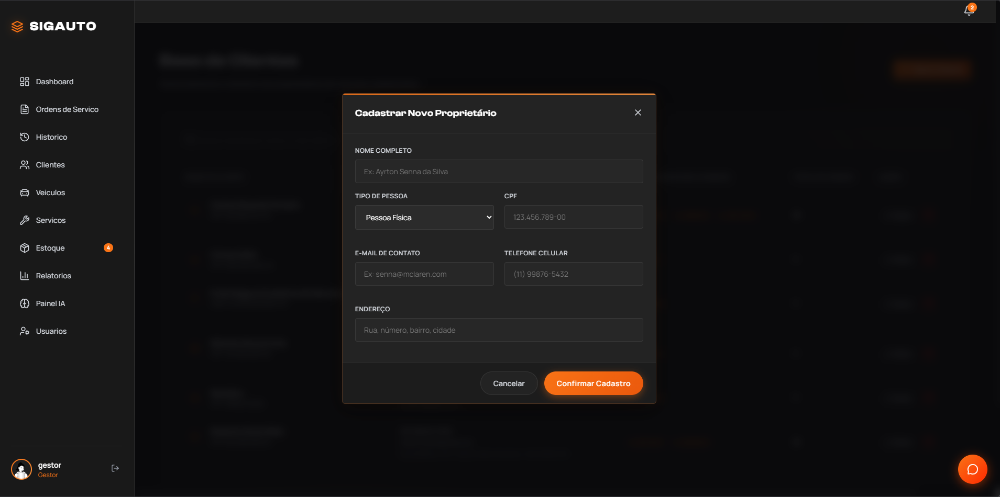

Fonte: elaborado pelo autor (2026).


#### 2.7.2 RF02 – Manter veículos

A especificação a seguir detalha o requisito RF02, cuja ficha consta no Quadro 5.


##### 2.7.2.1 Breve descrição

Realiza o cadastro, a consulta, a edição e a inativação de veículos, garantindo que cada veículo esteja vinculado a um proprietário, possua placa válida e única e fique disponível para novas ordens de serviço.


##### 2.7.2.2 Atores

•	Gestor

•	Atendente


##### 2.7.2.3 Fluxos de eventos

Os fluxos de eventos do RF02 compreendem o fluxo básico, os fluxos alternativos e os fluxos de exceção, descritos a seguir.


###### 2.7.2.3.1 Fluxo básico

1.	O usuário acessa o módulo Veículos no menu lateral.

2.	O sistema exibe a listagem de veículos ativos, com modelo e marca, placa, ano e cor, proprietário e ações disponíveis.

3.	O usuário seleciona a opção Adicionar Veículo.

4.	O sistema apresenta o formulário de cadastro.

5.	O usuário seleciona o proprietário e informa placa, marca, modelo, ano, cor e, opcionalmente, uma observação.

6.	O usuário confirma o cadastro.

7.	O sistema verifica se há proprietário selecionado, valida o formato da placa e verifica se a placa já está cadastrada.

8.	O sistema grava o veículo no banco de dados e atualiza a listagem.


###### 2.7.2.3.2 Fluxos alternativos

•	**Editar veículo**: o usuário aciona a opção Editar, altera os dados e confirma; o sistema aplica as mesmas validações do cadastro e atualiza o registro.

•	**Pesquisar veículo**: o sistema filtra a listagem por marca, modelo, placa, observação ou nome do proprietário.

•	**Inativar veículo**: o usuário aciona a opção de exclusão e confirma; o sistema inativa o veículo, que deixa de ser oferecido em novas ordens de serviço.


###### 2.7.2.3.3 Fluxos de exceção

•	**Proprietário não informado**: o sistema exibe a mensagem “Associe um proprietário ao veículo.” e não grava o registro.

•	**Placa inválida**: o sistema exibe a mensagem “Placa inválida. Use o formato Mercosul (ABC1D23) ou antigo (ABC-1234).”.

•	**Placa duplicada**: o sistema informa que a placa já está cadastrada, indicando o cliente proprietário, e não grava o registro.

•	**Ano fora do intervalo**: a restrição de verificação do banco de dados rejeita a gravação, e o veículo não é persistido.


##### 2.7.2.4 Pré-condições

•	O usuário deve estar autenticado com perfil de gestor ou atendente.

•	O cliente proprietário deve estar cadastrado e ativo.


##### 2.7.2.5 Pós-condições

•	O veículo é incluído, atualizado ou inativado.

•	O veículo permanece vinculado ao cliente proprietário.

•	Veículos ativos ficam disponíveis para abertura de ordens de serviço.


##### 2.7.2.6 Critérios de aceite

•	O sistema deve permitir cadastrar veículo com placa válida e única vinculado a um cliente.

•	O sistema deve impedir o cadastro sem proprietário, com placa inválida ou com placa duplicada.

•	O sistema deve permitir editar e inativar veículos.


##### 2.7.2.7 Campos da tela

O Quadro 20 apresenta os campos, as informações exibidas e as ações disponíveis na tela do RF02.

Quadro 20 – Campos da tela do RF02 – Manter veículos


| Campo | Valor padrão | Domínio de valores | Tipo | Obrigatório | Validação |
| --- | --- | --- | --- | --- | --- |
| Proprietário | – | Clientes ativos | Seleção | Sim | Deve haver cliente selecionado. |
| Placa do veículo | – | AAA-9999 ou AAA9A99 | Texto | Sim | Formato válido; unicidade no banco de dados. |
| Marca | – | Texto com até 50 caracteres | Texto | Sim | Não pode ficar em branco. |
| Modelo | – | Texto com até 80 caracteres | Texto | Sim | Não pode ficar em branco. |
| Ano | – | 1950 até o ano corrente + 1 | Numérico | Sim | Restrição de intervalo no banco de dados. |
| Cor | – | Texto com até 30 caracteres | Texto | Sim | Não pode ficar em branco. |
| Observação | – | Texto livre | Área de texto | Não | – |

Fonte: elaborado pelo autor (2026).


##### 2.7.2.8 Pontos de extensão

•	Cadastro rápido do veículo durante a abertura da ordem de serviço (RF03).

•	Busca do cliente pela placa do veículo na abertura da ordem de serviço.

•	Registro da quilometragem de entrada em cada atendimento.


##### 2.7.2.9 Protótipo

A Figura 3 apresenta a tela do RF02 implementada no sistema.

Figura 3 – Protótipo da tela Manter veículos

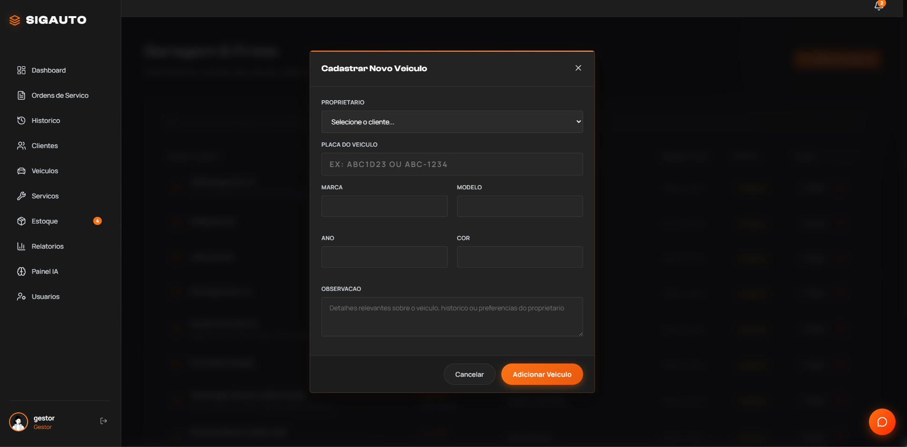

Fonte: elaborado pelo autor (2026).


#### 2.7.3 RF03 – Abrir ordem de serviço

A especificação a seguir detalha o requisito RF03, cuja ficha consta no Quadro 6.


##### 2.7.3.1 Breve descrição

Realiza a abertura de ordens de serviço, vinculando cliente, veículo, queixa informada, mecânico e atendente responsáveis, prioridade e quilometragem de entrada. A busca do cliente aceita nome, documento ou placa, e o cadastro rápido de cliente e de veículo pode ser feito na própria tela.


##### 2.7.3.2 Atores

•	Gestor

•	Atendente


##### 2.7.3.3 Fluxos de eventos

Os fluxos de eventos do RF03 compreendem o fluxo básico, os fluxos alternativos e os fluxos de exceção, descritos a seguir.


###### 2.7.3.3.1 Fluxo básico

1.	O usuário acessa Ordens de Serviço e seleciona a opção de nova ordem de serviço.

2.	O sistema apresenta o formulário de abertura.

3.	O usuário pesquisa o cliente por nome, CPF/CNPJ ou placa de veículo.

4.	O sistema exibe até oito clientes correspondentes, e o usuário seleciona o cliente.

5.	O sistema lista os veículos do cliente selecionado, e o usuário seleciona o veículo.

6.	O usuário informa a queixa, a prioridade e, quando necessário, o mecânico responsável, a quilometragem de entrada, a forma de pagamento prevista e observações internas; o atendente responsável vem preenchido com o funcionário vinculado ao usuário autenticado.

7.	O usuário confirma a abertura.

8.	O sistema valida cliente, veículo e queixa.

9.	O sistema grava a ordem de serviço com status Aberta, data e hora de abertura e usuário responsável pelo registro, e o banco de dados gera o número sequencial.

10.	O sistema exibe a confirmação com o número da ordem de serviço aberta.


###### 2.7.3.3.2 Fluxos alternativos

•	**Cadastro rápido de cliente**: o usuário opta por cadastrar novo cliente na própria tela, informando ao menos o nome; o cliente é criado e selecionado automaticamente.

•	**Cadastro rápido de veículo**: o usuário opta por cadastrar novo veículo, informando ao menos placa, marca e modelo; o veículo é criado para o cliente selecionado.

•	**Cliente não identificado**: o usuário seleciona o cadastro genérico Consumidor, e o atendimento é registrado sem identificação do cliente.

•	**Quilometragem não informada**: o sistema utiliza a quilometragem atual cadastrada no veículo, quando existente.


###### 2.7.3.3.3 Fluxos de exceção

•	**Cliente ausente**: o sistema exibe a mensagem “Selecione ou cadastre um cliente.”.

•	**Veículo ausente**: o sistema exibe a mensagem “Selecione ou cadastre um veículo.”.

•	**Queixa insuficiente**: o sistema exibe a mensagem “A descrição da queixa deve ter pelo menos 10 caracteres.”.

•	**Falha de gravação**: o sistema exibe a mensagem de erro retornada pelo banco de dados e mantém os dados preenchidos no formulário.


##### 2.7.3.4 Pré-condições

•	O usuário deve estar autenticado com perfil de gestor ou atendente.


##### 2.7.3.5 Pós-condições

•	A ordem de serviço é criada com número sequencial, status Aberta, data e hora de abertura.

•	A ordem de serviço fica disponível na listagem, no histórico e para atualização pela equipe responsável.


##### 2.7.3.6 Critérios de aceite

•	O sistema deve abrir a ordem de serviço quando cliente, veículo e queixa válida forem informados.

•	O sistema deve gerar número sequencial e registrar o status inicial Aberta.

•	O sistema deve permitir localizar o cliente pela placa do veículo.

•	O sistema deve permitir o cadastro rápido de cliente e de veículo durante a abertura.

•	O sistema deve impedir a abertura sem cliente, sem veículo ou com queixa inferior a 10 caracteres.


##### 2.7.3.7 Campos da tela

O Quadro 21 apresenta os campos, as informações exibidas e as ações disponíveis na tela do RF03.

Quadro 21 – Campos da tela do RF03 – Abrir ordem de serviço


| Campo | Valor padrão | Domínio de valores | Tipo | Obrigatório | Validação |
| --- | --- | --- | --- | --- | --- |
| Busca de cliente | – | Nome, CPF/CNPJ ou placa | Texto | Não | Exibe até oito resultados. |
| Cliente | – | Clientes ativos ou Consumidor | Seleção | Sim | Deve haver cliente selecionado. |
| Novo cliente | – | Nome, telefone, e-mail e CPF/CNPJ | Formulário | Não | Nome obrigatório. |
| Veículo | – | Veículos do cliente selecionado | Seleção | Sim | Deve haver veículo selecionado. |
| Novo veículo | – | Placa, marca, modelo, ano, cor e KM | Formulário | Não | Placa, marca e modelo obrigatórios. |
| Mecânico responsável | A definir | Funcionários com cargo mecânico | Seleção | Não | – |
| Atendente responsável | Funcionário do usuário autenticado | Funcionários com cargo atendente ou gestor | Seleção | Não | – |
| Queixa / descrição do problema | – | Texto livre | Área de texto | Sim | Mínimo de 10 caracteres. |
| Prioridade | Normal | Baixa, Normal, Alta ou Urgente | Seleção | Sim | – |
| KM de entrada | KM atual do veículo | Número inteiro maior ou igual a zero | Numérico | Não | – |
| Forma de pagamento | A definir | A definir, Dinheiro, Pix, Cartão de débito, Cartão de crédito, Transferência ou Boleto | Seleção | Não | – |
| Observações internas | – | Texto livre | Área de texto | Não | – |

Fonte: elaborado pelo autor (2026).


##### 2.7.3.8 Pontos de extensão

•	Abertura de ordem de serviço também a partir da tela de visão geral.

•	Inclusão de serviços e peças após a abertura (RF04).

•	Consulta do histórico de atendimentos do veículo (RF06).


##### 2.7.3.9 Protótipo

A Figura 4 apresenta a tela do RF03 implementada no sistema.

Figura 4 – Protótipo da tela Abrir ordem de serviço

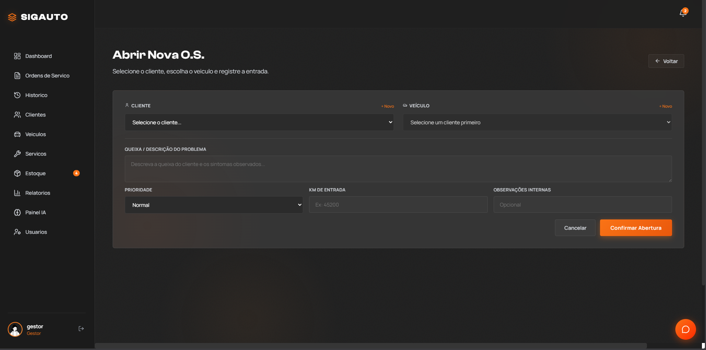

Fonte: elaborado pelo autor (2026).


#### 2.7.4 RF04 – Atualizar ordem de serviço

A especificação a seguir detalha o requisito RF04, cuja ficha consta no Quadro 7.


##### 2.7.4.1 Breve descrição

Realiza a atualização das ordens de serviço, permitindo lançar serviços do catálogo e peças do estoque, registrar o diagnóstico técnico e as observações, definir a equipe responsável e alterar o status. O sistema recalcula automaticamente os valores e as comissões a cada alteração.


##### 2.7.4.2 Atores

•	Gestor

•	Atendente

•	Mecânico


##### 2.7.4.3 Fluxos de eventos

Os fluxos de eventos do RF04 compreendem o fluxo básico, os fluxos alternativos e os fluxos de exceção, descritos a seguir.


###### 2.7.4.3.1 Fluxo básico

1.	O usuário acessa Ordens de Serviço.

2.	O sistema exibe a listagem com número, cliente e veículo, placa, prioridade, equipe, status, valores e data de abertura, com pesquisa por número, cliente ou placa e filtro por status.

3.	O usuário seleciona a ordem de serviço desejada.

4.	O sistema exibe os dados da ordem de serviço, o resumo de valores, a equipe, o status, a forma de pagamento, o diagnóstico, as observações e as seções de serviços e de peças.

5.	O usuário adiciona serviços, selecionando itens do catálogo e informando a quantidade.

6.	O usuário adiciona peças, selecionando itens ativos do estoque e informando a quantidade; o valor unitário é obtido do preço de venda do item.

7.	O usuário registra o diagnóstico técnico e as observações e ajusta equipe, status e forma de pagamento.

8.	O usuário aciona Salvar alterações.

9.	O sistema recalcula os totais de serviços, de peças e da ordem de serviço, calcula as comissões e grava a ordem de serviço e seus itens.

10.	O sistema exibe a confirmação de gravação.


###### 2.7.4.3.2 Fluxos alternativos

•	**Alterar status**: o usuário seleciona Aberta, Em andamento, Aguardando peça, Concluída ou Cancelada e salva a alteração.

•	**Remover item**: o usuário remove um serviço ou uma peça da ordem de serviço, e os valores são recalculados e gravados.

•	**Reabrir ordem de serviço**: em uma ordem de serviço concluída ou cancelada, o usuário aciona Reabrir O.S. e confirma; o status passa a Em andamento e a edição é liberada.

•	**Finalizar ordem de serviço**: o usuário aciona Finalizar O.S. e é direcionado ao encerramento (RF05).


###### 2.7.4.3.3 Fluxos de exceção

•	Saldo insuficiente: o sistema informa o item sem saldo e não conclui a ordem de serviço nem grava movimentos parciais.

•	**Ordem de serviço inexistente**: o sistema exibe a mensagem “Ordem de serviço não encontrada.”.

•	**Ordem de serviço bloqueada**: em ordens de serviço concluídas ou canceladas, as ações de edição ficam indisponíveis até a reabertura.

•	**Quantidade inválida**: o formulário não aceita quantidade menor que 0,01.

•	**Ordem de serviço de outro mecânico**: as políticas RLS impedem que o mecânico visualize ou altere ordens de serviço em que não figura como responsável.


##### 2.7.4.4 Pré-condições

•	O usuário deve estar autenticado.

•	A ordem de serviço deve existir e, no caso do mecânico, estar atribuída a ele.


##### 2.7.4.5 Pós-condições

•	A ordem de serviço é atualizada com os itens, valores, equipe e status informados.

•	Os serviços e as peças ficam registrados em tabelas próprias, vinculadas à ordem de serviço.

•	As peças vinculadas ao catálogo de estoque são baixadas automaticamente e de forma atômica quando a ordem de serviço é encerrada (RF05 e RF10).


##### 2.7.4.6 Critérios de aceite

•	O sistema deve permitir lançar serviços do catálogo e peças do estoque com quantidade e valor unitário.

•	O sistema deve recalcular os totais e as comissões a cada alteração.

•	O sistema deve bloquear a edição de ordens de serviço concluídas ou canceladas até a reabertura confirmada.

•	O sistema deve restringir o mecânico às ordens de serviço sob sua responsabilidade.


##### 2.7.4.7 Campos da tela

O Quadro 22 apresenta os campos, as informações exibidas e as ações disponíveis na tela do RF04.

Quadro 22 – Campos da tela do RF04 – Atualizar ordem de serviço


| Campo | Valor padrão | Domínio de valores | Tipo | Obrigatório | Validação |
| --- | --- | --- | --- | --- | --- |
| Número da O.S. | Gerado pelo sistema | Número sequencial | Exibição | – | Não editável. |
| Cliente e veículo | Dados da O.S. | Cliente, placa, marca e modelo | Exibição | – | – |
| Resumo de valores | Calculado | Serviços, peças e total | Monetário | – | Recalculado a cada alteração. |
| Mecânico responsável | Dados da O.S. | Funcionários com cargo mecânico | Seleção | Não | – |
| Atendente responsável | Dados da O.S. | Funcionários com cargo atendente ou gestor | Seleção | Não | – |
| Status | Status atual | Aberta, Em andamento, Aguardando peça, Concluída ou Cancelada | Seleção | Sim | Apenas status válidos. |
| Forma de pagamento | Dados da O.S. | Mesmas opções da abertura | Seleção | Não | – |
| Diagnóstico técnico | – | Texto livre | Área de texto | Não | – |
| Observações | – | Texto livre | Área de texto | Não | – |
| Serviços | Itens da O.S. | Descrição, quantidade, valor unitário e total | Tabela | Não | Total = quantidade × valor unitário. |
| Adicionar serviço | – | Serviços ativos do catálogo | Janela de busca | Não | Quantidade mínima de 0,01. |
| Peças e produtos | Itens da O.S. | Descrição, quantidade, valor unitário e total | Tabela | Não | Total = quantidade × valor unitário. |
| Adicionar peça | – | Itens ativos do estoque | Janela de busca | Não | Quantidade mínima de 0,01. |
| Salvar alterações | – | Ação de gravação | Botão | – | Indisponível em O.S. bloqueada. |
| Finalizar O.S. / Reabrir O.S. | – | Ação conforme o status | Botão | – | Reabertura exige confirmação. |

Fonte: elaborado pelo autor (2026).


##### 2.7.4.8 Pontos de extensão

•	Encerramento da ordem de serviço (RF05).

•	Consulta do histórico das movimentações automáticas e manuais do estoque (RF10).

•	Relatório de comissões por responsável (RF07).


##### 2.7.4.9 Protótipo

As Figura 5 e Figura 6 apresentam a tela do RF04 implementada no sistema.

Figura 5 – Protótipo da tela Atualizar ordem de serviço (parte 1)

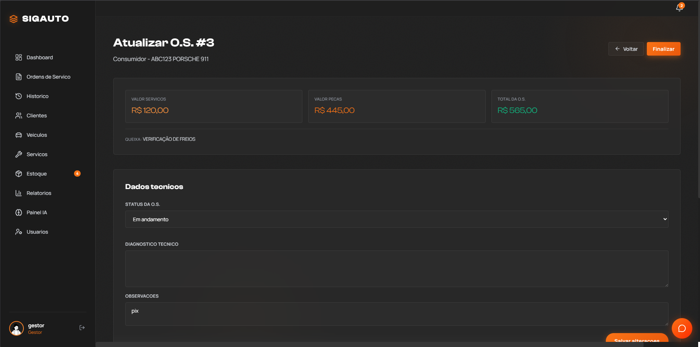

Fonte: elaborado pelo autor (2026).

Figura 6 – Protótipo da tela Atualizar ordem de serviço (parte 2)

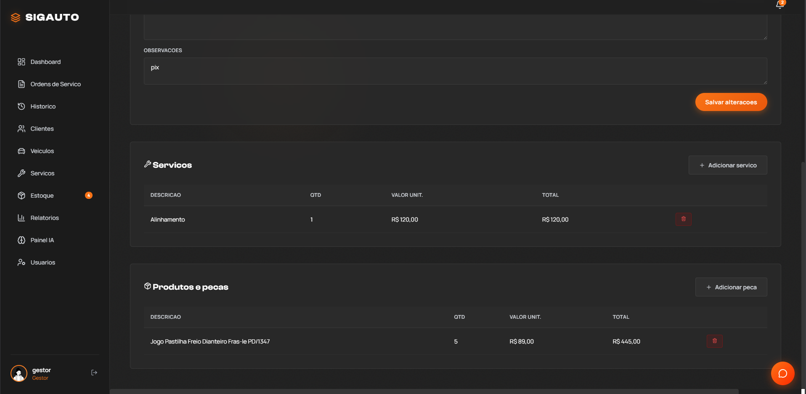

Fonte: elaborado pelo autor (2026).


#### 2.7.5 RF05 – Encerrar ordem de serviço

A especificação a seguir detalha o requisito RF05, cuja ficha consta no Quadro 8.


##### 2.7.5.1 Breve descrição

Realiza o encerramento das ordens de serviço, apresentando os serviços e as peças lançados, calculando o valor final com desconto opcional, exigindo a forma de pagamento e registrando a conclusão. O sistema mantém o cadastro único da oficina, com nome fantasia, razão social, CNPJ, telefone, e-mail, endereço estruturado, logotipo e texto de rodapé. Apenas o gestor pode alterar essa configuração; usuários autenticados podem consultá-la para emitir o documento da ordem de serviço. Em qualquer status, a ordem de serviço pode ser salva em PDF ou impressa.


##### 2.7.5.2 Atores

•	Gestor

•	Atendente

•	Mecânico, exclusivamente para emitir as ordens de serviço que pode visualizar.


##### 2.7.5.3 Fluxos de eventos

Os fluxos de eventos do RF05 compreendem o fluxo básico, os fluxos alternativos e os fluxos de exceção, descritos a seguir.


###### 2.7.5.3.1 Fluxo básico

1.	Na ordem de serviço, o usuário aciona Finalizar O.S.

2.	O sistema exibe os serviços e as peças lançados, com os respectivos subtotais, e os indicadores de serviços, peças e subtotal.

3.	O usuário informa, opcionalmente, o desconto em percentual ou em valor fixo.

4.	O sistema calcula o valor final.

5.	O usuário seleciona a forma de pagamento e registra, opcionalmente, as observações finais.

6.	O usuário aciona a finalização e confirma a operação.

7.	Em uma única transação, o sistema valida o saldo, registra as saídas das peças vinculadas ao estoque e altera o status para Concluída, gravando valores, tipo e valor do desconto, forma de pagamento, observações finais e data e hora de encerramento.

8.	O sistema exibe o valor cobrado, o desconto aplicado e a forma de pagamento, com as opções Ver Histórico, Visualizar PDF, Imprimir e Ordens de Serviço.


###### 2.7.5.3.2 Fluxos alternativos

•	Visualizar PDF: em qualquer status, o usuário autenticado com acesso à ordem de serviço abre o documento com os dados da oficina, do cliente, do veículo e da própria ordem de serviço; serviços e peças; valores, descontos e forma de pagamento; observações; e áreas de assinatura. O visualizador permite salvar o arquivo; se a nova guia for bloqueada, o sistema baixa o mesmo PDF.

•	Imprimir: em qualquer status, o sistema abre para impressão o mesmo documento produzido pela ação Visualizar PDF.

•	Configurar oficina: o gestor cria ou altera o único cadastro da oficina, informando nome fantasia, razão social, CNPJ, telefone, e-mail, endereço estruturado, logotipo e texto de rodapé.

•	**Reabrir ordem de serviço encerrada**: ao acessar o encerramento de uma ordem de serviço já concluída, o usuário pode confirmar a reabertura, que retorna o status para Em andamento.


###### 2.7.5.3.3 Fluxos de exceção

•	**Forma de pagamento não selecionada**: o sistema exibe a mensagem “Selecione a forma de pagamento.” e não conclui o encerramento.

•	**Perfil sem permissão**: o sistema exibe a tela de acesso negado para o perfil mecânico.

•	**Ordem de serviço inexistente**: o sistema exibe a mensagem “Ordem de serviço não encontrada.”.


##### 2.7.5.4 Pré-condições

•	Para encerrar a ordem de serviço, o usuário deve estar autenticado com perfil de gestor ou atendente.

•	A ordem de serviço deve existir e não estar concluída.

•	Para salvar ou imprimir o documento, o usuário deve estar autenticado e possuir permissão para visualizar a ordem de serviço, independentemente do status.

•	A configuração da oficina pode ser lida por usuários autenticados e alterada somente pelo gestor.


##### 2.7.5.5 Pós-condições

•	A ordem de serviço passa ao status Concluída, com desconto, observações finais, valor final, forma de pagamento e data e hora registrados; as peças vinculadas têm a baixa registrada no histórico do estoque.

•	A ordem de serviço permanece disponível no histórico.

•	O documento da ordem de serviço pode ser salvo em PDF ou impresso em qualquer status.


##### 2.7.5.6 Critérios de aceite

•	O sistema deve encerrar a ordem de serviço somente com forma de pagamento selecionada.

•	O sistema deve calcular o valor final com desconto percentual ou em valor fixo, sem resultar em valor negativo.

•	O sistema deve registrar automaticamente a data e a hora de encerramento.

•	O sistema deve disponibilizar Visualizar PDF e Imprimir em qualquer status, utilizando o mesmo documento e oferecendo download quando a nova guia for bloqueada.

•	O documento deve conter os dados da oficina, do cliente, do veículo e da ordem de serviço; serviços e peças; valores, descontos e forma de pagamento; e áreas de assinatura do cliente e do responsável pela oficina.

•	O sistema deve manter um único cadastro da oficina com nome fantasia e CNPJ obrigatórios, razão social, telefone, e-mail, endereço estruturado, logotipo e texto de rodapé.

•	Somente o gestor pode alterar a configuração da oficina; usuários autenticados podem consultá-la para emitir a ordem de serviço.


##### 2.7.5.7 Campos da tela

O Quadro 23 apresenta os campos, as informações exibidas e as ações disponíveis na tela do RF05.

Quadro 23 – Campos da tela do RF05 – Encerrar ordem de serviço


| Campo | Valor padrão | Domínio de valores | Tipo | Obrigatório | Validação |
| --- | --- | --- | --- | --- | --- |
| Serviços executados | Itens da O.S. | Descrição, quantidade, valor unitário e total | Tabela | – | Somente leitura. |
| Peças e produtos | Itens da O.S. | Descrição, quantidade, valor unitário e total | Tabela | – | Somente leitura. |
| Serviços, Peças e Subtotal | Calculado | Valores monetários | Indicadores | – | Somatório automático. |
| Tipo de desconto | % | % ou R$ | Botões de seleção | Não | – |
| Desconto | 0 | Número maior ou igual a zero | Numérico | Não | Até 100 quando percentual. |
| Valor final | Subtotal | Subtotal menos desconto | Monetário | – | Não pode ser negativo. |
| Forma de pagamento | Selecione... | Dinheiro, Pix, Cartão de débito, Cartão de crédito, Transferência ou Boleto | Seleção | Sim | Obrigatória para finalizar. |
| Observações finais | – | Texto livre | Área de texto | Não | – |
| Finalizar O.S. | – | Ação de encerramento | Botão | – | Exige confirmação. |
| Visualizar PDF | – | Ação de visualização e salvamento | Botão | – | Disponível em qualquer status; baixa o arquivo se a nova guia for bloqueada. |
| Imprimir | – | Ação de impressão | Botão | – | Disponível em qualquer status; usa o mesmo documento do PDF. |
| Configuração da oficina | Cadastro único | Nome fantasia, razão social, CNPJ, telefone, e-mail, endereço estruturado, logotipo e texto de rodapé | Formulário | Nome fantasia e CNPJ | Somente o gestor altera; usuários autenticados podem consultar para emitir a O.S. |

Fonte: elaborado pelo autor (2026).


##### 2.7.5.8 Pontos de extensão

•	Envio do resumo ao cliente por e-mail ou aplicativo de mensagens.

•	Emissão de documento fiscal.

•	Registro de assinatura digital do cliente.


##### 2.7.5.9 Protótipo

A Figura 7 apresenta a tela do RF05 implementada no sistema.

Figura 7 – Protótipo da tela Encerrar ordem de serviço

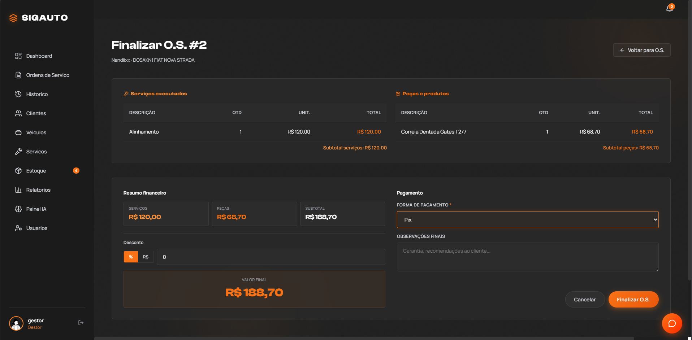

Fonte: elaborado pelo autor (2026).


#### 2.7.6 RF06 – Consultar histórico

A especificação a seguir detalha o requisito RF06, cuja ficha consta no Quadro 9.


##### 2.7.6.1 Breve descrição

Realiza a consulta do histórico de ordens de serviço da oficina, ordenado da mais recente para a mais antiga, com filtros combináveis e visualização detalhada de cada ordem de serviço.


##### 2.7.6.2 Atores

•	Gestor

•	Atendente

•	Mecânico


##### 2.7.6.3 Fluxos de eventos

Os fluxos de eventos do RF06 compreendem o fluxo básico, os fluxos alternativos e os fluxos de exceção, descritos a seguir.


###### 2.7.6.3.1 Fluxo básico

1.	O usuário acessa o módulo Histórico no menu lateral.

2.	O sistema exibe as ordens de serviço com número, cliente e veículo, placa, status, datas de abertura e encerramento e valor.

3.	O usuário informa os filtros desejados: texto de pesquisa, status, data inicial e data final.

4.	O sistema aplica os filtros de forma combinada e atualiza a listagem.

5.	O usuário seleciona a opção de visualização de uma ordem de serviço.

6.	O sistema exibe o detalhe da ordem de serviço selecionada.


###### 2.7.6.3.2 Fluxos alternativos

•	**Consulta sem filtros**: o sistema apresenta todas as ordens de serviço acessíveis ao perfil do usuário.

•	**Consulta pelo mecânico**: as políticas RLS limitam o resultado às ordens de serviço em que o mecânico figura como responsável.


###### 2.7.6.3.3 Fluxos de exceção

•	**Nenhum resultado**: o sistema informa que não há ordens de serviço correspondentes aos filtros.


##### 2.7.6.4 Pré-condições

•	O usuário deve estar autenticado.


##### 2.7.6.5 Pós-condições

•	A consulta é exibida sem alterar os dados das ordens de serviço.


##### 2.7.6.6 Critérios de aceite

•	O sistema deve pesquisar por nome do cliente, placa ou número da ordem de serviço.

•	O sistema deve filtrar por status e por período de abertura, inclusive as datas limite.

•	O sistema deve exibir o detalhe da ordem de serviço selecionada.


##### 2.7.6.7 Campos da tela

O Quadro 24 apresenta os campos, as informações exibidas e as ações disponíveis na tela do RF06.

Quadro 24 – Campos da tela do RF06 – Consultar histórico


| Campo | Valor padrão | Domínio de valores | Tipo | Obrigatório | Validação |
| --- | --- | --- | --- | --- | --- |
| Pesquisa | – | Cliente, placa ou número da O.S. | Texto | Não | – |
| Status | Todos | Todos, Concluída, Cancelada, Aberta ou Em andamento | Seleção | Não | – |
| Data inicial | – | Data | Data | Não | Compara com a data de abertura. |
| Data final | – | Data | Data | Não | Inclui o último dia informado. |
| Listagem | – | Número, cliente e veículo, placa, status, abertura, encerramento e valor | Tabela | – | Ordenada da mais recente para a mais antiga. |
| Ver | – | Detalhe da O.S. | Botão | – | – |

Fonte: elaborado pelo autor (2026).


##### 2.7.6.8 Pontos de extensão

•	Exportação do histórico em relatório (RF07).

•	Reabertura da ordem de serviço a partir do detalhe (RF04).


##### 2.7.6.9 Protótipo

A Figura 8 apresenta a tela do RF06 implementada no sistema.

Figura 8 – Protótipo da tela Consultar histórico

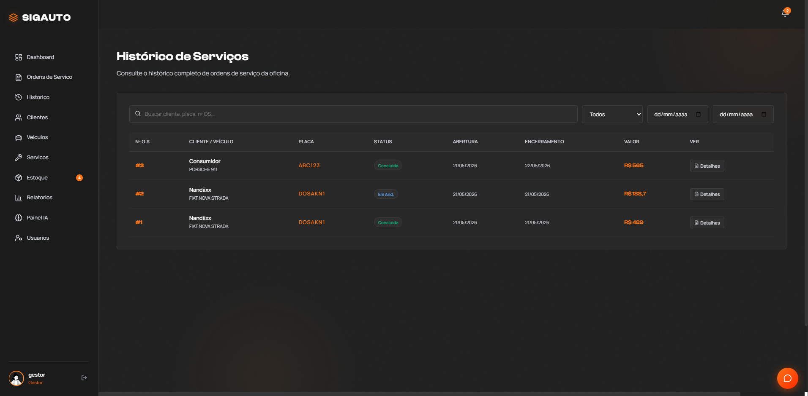

Fonte: elaborado pelo autor (2026).


#### 2.7.7 RF07 – Emitir relatórios

A especificação a seguir detalha o requisito RF07, cuja ficha consta no Quadro 10.


##### 2.7.7.1 Breve descrição

Realiza a geração de relatórios gerenciais a partir dos dados registrados, apresentando indicadores totais e a tabela detalhada de cada tipo de relatório, com exportação em arquivo CSV.


##### 2.7.7.2 Atores

•	Gestor


##### 2.7.7.3 Fluxos de eventos

Os fluxos de eventos do RF07 compreendem o fluxo básico, os fluxos alternativos e os fluxos de exceção, descritos a seguir.


###### 2.7.7.3.1 Fluxo básico

1.	O gestor acessa o módulo Relatórios no menu lateral.

2.	O sistema exibe os tipos de relatório disponíveis e o período padrão correspondente ao último mês.

3.	O gestor seleciona o tipo de relatório e ajusta as datas inicial e final.

4.	O sistema calcula e exibe os indicadores totais e a tabela do relatório.

5.	O gestor aciona Exportar CSV.

6.	O sistema gera o arquivo CSV com as colunas e linhas exibidas e inicia o download.


###### 2.7.7.3.2 Fluxos alternativos

•	**Troca de tipo ou de período**: a cada alteração do tipo ou das datas, o sistema recalcula o relatório.


###### 2.7.7.3.3 Fluxos de exceção

•	**Período sem registros**: o relatório é exibido com indicadores zerados e tabela vazia.

•	**Perfil sem permissão**: o sistema exibe a tela de acesso negado para perfis diferentes de gestor.


##### 2.7.7.4 Pré-condições

•	O usuário deve estar autenticado com perfil de gestor.


##### 2.7.7.5 Pós-condições

•	O relatório é exibido e, quando solicitado, exportado em CSV, sem alteração dos dados.


##### 2.7.7.6 Critérios de aceite

•	O sistema deve gerar os seis tipos de relatório para o período informado.

•	O sistema deve exportar em CSV exatamente o relatório exibido.

•	O sistema deve restringir o módulo ao perfil gestor.


##### 2.7.7.7 Campos da tela

O Quadro 25 apresenta os campos, as informações exibidas e as ações disponíveis na tela do RF07.

Quadro 25 – Campos da tela do RF07 – Emitir relatórios


| Campo | Valor padrão | Domínio de valores | Tipo | Obrigatório | Validação |
| --- | --- | --- | --- | --- | --- |
| Tipo de relatório | Faturamento | Faturamento, Atendimentos, Estoque, Serviços Frequentes, Clientes Frequentes ou Comissões | Cartões de seleção | Sim | – |
| Data início | Hoje menos um mês | Data | Data | Sim | – |
| Data fim | Data atual | Data | Data | Sim | – |
| Indicadores | Calculado | Totais do relatório | Exibição | – | – |
| Tabela do relatório | Calculado | Colunas conforme o tipo | Tabela | – | – |
| Exportar CSV | – | Ação de exportação | Botão | – | Codificação UTF-8. |

Fonte: elaborado pelo autor (2026).

O Quadro 26 detalha os indicadores e as colunas de cada tipo de relatório.

Quadro 26 – Tipos de relatório disponíveis no RF07


| Relatório | Indicadores | Colunas da tabela |
| --- | --- | --- |
| Faturamento | Total de O.S., O.S. concluídas, receita total e ticket médio | Nº da O.S., cliente, placa, status, valor e data |
| Atendimentos | Total no período e quantidade por status | Status, quantidade e percentual do total |
| Estoque | Total de itens, itens em alerta e itens zerados | Código, item, unidade, quantidade, mínimo e situação |
| Serviços Frequentes | Total de O.S. e serviços lançados | Serviço, quantidade de realizações e percentual |
| Clientes Frequentes | Total de clientes e clientes no período | Cliente, total de O.S. e percentual do período |
| Comissões | O.S. concluídas, profissionais, total de comissões, mecânicos e atendentes | Profissional, perfil, O.S., cliente, placa, bases, percentual, comissão e data |

Fonte: elaborado pelo autor (2026).


##### 2.7.7.8 Pontos de extensão

•	Exportação em PDF e em planilha XLSX.

•	Agendamento de envio periódico de relatórios.


##### 2.7.7.9 Protótipo

A Figura 9 apresenta a tela do RF07 implementada no sistema.

Figura 9 – Protótipo da tela Emitir relatórios

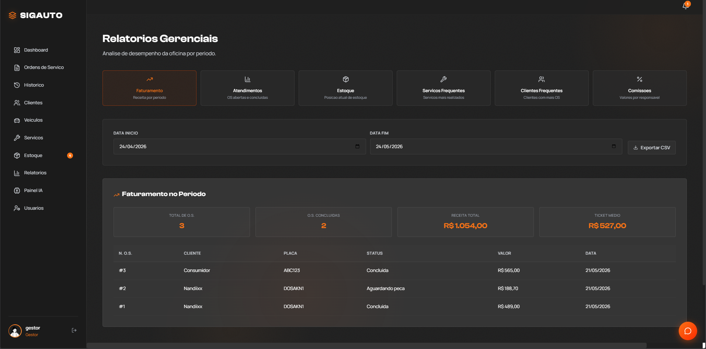

Fonte: elaborado pelo autor (2026).


#### 2.7.8 RF08 – Autenticar usuários

A especificação a seguir detalha o requisito RF08, cuja ficha consta no Quadro 11.


##### 2.7.8.1 Breve descrição

Realiza a autenticação dos usuários por meio do Supabase Auth, carrega o perfil de acesso cadastrado e direciona o usuário às funcionalidades permitidas, além de oferecer a recuperação de senha e o encerramento da sessão.


##### 2.7.8.2 Atores

•	Gestor

•	Atendente

•	Mecânico


##### 2.7.8.3 Fluxos de eventos

Os fluxos de eventos do RF08 compreendem o fluxo básico, os fluxos alternativos e os fluxos de exceção, descritos a seguir.


###### 2.7.8.3.1 Fluxo básico

1.	O usuário acessa o endereço do sistema e visualiza a tela de login.

2.	O usuário informa e-mail e senha e aciona a entrada.

3.	O sistema verifica se as tentativas estão bloqueadas no navegador.

4.	O sistema envia as credenciais ao Supabase Auth.

5.	O Supabase Auth valida as credenciais e emite a sessão com JWT.

6.	O sistema consulta o perfil e a situação do usuário na tabela de usuários.

7.	O sistema direciona o usuário à tela inicial e exibe no menu apenas os módulos permitidos ao perfil.


###### 2.7.8.3.2 Fluxos alternativos

•	**Exibir senha**: o usuário alterna a exibição da senha digitada.

•	**Recuperar senha**: o usuário aciona a recuperação, informa o e-mail cadastrado, e o sistema solicita ao Supabase Auth o envio do link de redefinição, exibindo sempre a confirmação de envio.

•	**Encerrar sessão**: o usuário aciona a saída, e o sistema encerra a sessão no Supabase Auth e retorna à tela de login.


###### 2.7.8.3.3 Fluxos de exceção

•	**Credenciais inválidas**: o sistema exibe a mensagem “E-mail ou senha incorretos.”.

•	**E-mail não confirmado**: o sistema informa que o e-mail ainda não foi confirmado e orienta a verificar a caixa de entrada.

•	**Tentativas esgotadas**: na quinta falha consecutiva, o sistema exibe “Muitas tentativas incorretas. Acesso bloqueado por 15 minutos.” e bloqueia novas tentativas no navegador.

•	**Acesso a módulo não permitido**: o sistema exibe a tela de acesso negado, informando o perfil do usuário.


##### 2.7.8.4 Pré-condições

•	O usuário deve estar cadastrado no Supabase Auth e na tabela de usuários.


##### 2.7.8.5 Pós-condições

•	O usuário autenticado acessa os módulos permitidos ao seu perfil.

•	As requisições ao banco e à API passam a carregar o JWT da sessão.


##### 2.7.8.6 Critérios de aceite

•	O sistema deve autenticar usuários com e-mail e senha válidos.

•	O sistema deve exibir mensagem genérica em caso de falha.

•	O sistema deve bloquear novas tentativas por 15 minutos após cinco falhas consecutivas.

•	O sistema deve enviar link de recuperação sem revelar se o e-mail existe.


##### 2.7.8.7 Campos da tela

O Quadro 27 apresenta os campos, as informações exibidas e as ações disponíveis na tela do RF08.

Quadro 27 – Campos da tela do RF08 – Autenticar usuários


| Campo | Valor padrão | Domínio de valores | Tipo | Obrigatório | Validação |
| --- | --- | --- | --- | --- | --- |
| E-mail | – | Formato usuario@dominio | Texto | Sim | Formato de e-mail. |
| Senha | – | Texto mascarado | Senha | Sim | Permite exibir ou ocultar. |
| Entrar | – | Ação de autenticação | Botão | – | Indisponível durante o bloqueio. |
| Esqueci minha senha | – | Abre a janela de recuperação | Link | – | – |
| E-mail cadastrado | – | Formato usuario@dominio | Texto | Sim | Usado apenas na recuperação. |

Fonte: elaborado pelo autor (2026).


##### 2.7.8.8 Pontos de extensão

•	Autenticação em dois fatores.

•	Bloqueio de tentativas controlado no servidor por e-mail.


##### 2.7.8.9 Protótipo

A Figura 10 apresenta a tela do RF08 implementada no sistema.

Figura 10 – Protótipo da tela Autenticar usuários

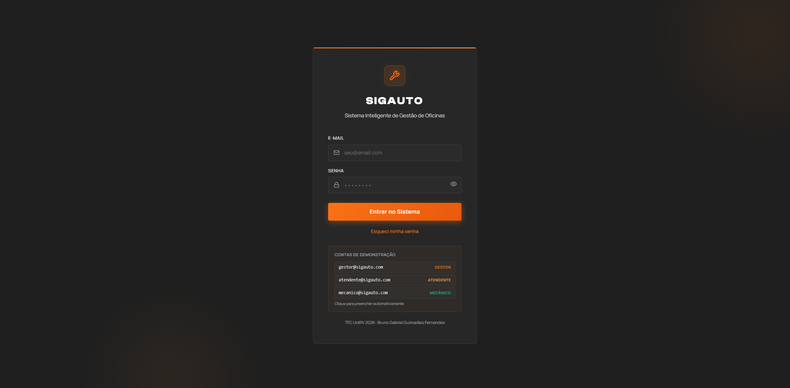

Fonte: elaborado pelo autor (2026).


#### 2.7.9 RF09 – Manter estoque

A especificação a seguir detalha o requisito RF09, cuja ficha consta no Quadro 12.


##### 2.7.9.1 Breve descrição

Realiza o controle dos itens de estoque da oficina, com cadastro e edição de peças, produtos e insumos, cálculo da margem e sinalização dos itens com saldo igual ou inferior ao mínimo.


##### 2.7.9.2 Atores

•	Gestor

•	Atendente


##### 2.7.9.3 Fluxos de eventos

Os fluxos de eventos do RF09 compreendem o fluxo básico, os fluxos alternativos e os fluxos de exceção, descritos a seguir.


###### 2.7.9.3.1 Fluxo básico

1.	O usuário acessa o módulo Estoque no menu lateral, que exibe a quantidade de itens em alerta.

2.	O sistema exibe a tela Controle de Estoque com código, item, unidade, quantidade, mínimo, alerta, preço unitário e ações.

3.	O usuário pode pesquisar por nome ou código e aplicar o filtro de itens com alerta.

4.	O usuário seleciona Novo Item.

5.	O sistema apresenta o formulário do item.

6.	O usuário informa código, unidade, nome, descrição, quantidade mínima, custo unitário e preço de venda.

7.	O sistema calcula e exibe a margem.

8.	O usuário confirma, e o sistema grava o item com quantidade inicial zero e atualiza a listagem.


###### 2.7.9.3.2 Fluxos alternativos

•	**Editar item**: o usuário aciona Editar, altera os dados do item e confirma; a quantidade atual não é alterada por esta operação.

•	**Filtrar itens em alerta**: o sistema exibe apenas os itens com quantidade atual menor ou igual à mínima.


###### 2.7.9.3.3 Fluxos de exceção

•	**Campos obrigatórios ausentes**: o formulário não é submetido sem código, nome e quantidade mínima.

•	**Código duplicado**: a restrição de unicidade do banco de dados rejeita a gravação, e o item não é persistido.


##### 2.7.9.4 Pré-condições

•	O usuário deve estar autenticado com perfil de gestor ou atendente.


##### 2.7.9.5 Pós-condições

•	O item é incluído ou atualizado.

•	O alerta de reposição reflete a relação entre quantidade atual e mínima.


##### 2.7.9.6 Critérios de aceite

•	O sistema deve cadastrar item com código único e quantidade inicial zero.

•	O sistema deve calcular a margem a partir do custo e do preço de venda.

•	O sistema deve sinalizar itens com quantidade menor ou igual à mínima na listagem e no menu.


##### 2.7.9.7 Campos da tela

O Quadro 28 apresenta os campos, as informações exibidas e as ações disponíveis na tela do RF09.

Quadro 28 – Campos da tela do RF09 – Manter estoque


| Campo | Valor padrão | Domínio de valores | Tipo | Obrigatório | Validação |
| --- | --- | --- | --- | --- | --- |
| Pesquisa | – | Nome ou código | Texto | Não | – |
| Somente com alerta | Desmarcado | Marcado ou desmarcado | Filtro | Não | – |
| Código | – | Texto com até 30 caracteres | Texto | Sim | Único no banco de dados. |
| Unidade | UN | UN, PC, LT, MT, KG ou CX | Seleção | Sim | – |
| Nome do item | – | Texto com até 100 caracteres | Texto | Sim | – |
| Descrição | – | Texto livre | Área de texto | Não | – |
| Qtd. mínima | 1 | Número inteiro maior que zero | Numérico | Sim | Restrição no banco de dados. |
| Custo unitário (R$) | – | Valor maior ou igual a zero | Monetário | Não | – |
| Preço de venda (R$) | – | Valor maior ou igual a zero | Monetário | Não | Usado como valor unitário na O.S. |
| Margem | Calculada | Relação entre preço e custo | Exibição | – | Destaque negativo quando preço inferior ao custo. |
| Tipo de movimentação | Entrada | Entrada, Saída ou Ajuste | Seleção | Sim | A baixa da O.S. usa Saída automática. |
| Quantidade | – | Número maior que zero, com até duas casas decimais | Numérico | Sim | Saída limitada ao saldo. |
| Motivo / observação | – | Texto com até 100 caracteres | Texto | Sim | Obrigatório; registrado no histórico. |
| Histórico de movimentações | 100 mais recentes | Data, item, tipo, quantidade, motivo, O.S. e responsável | Tabela | – | Somente leitura; movimentos são imutáveis. |

Fonte: elaborado pelo autor (2026).


##### 2.7.9.8 Pontos de extensão

•	Movimentação de entrada, saída e ajuste (RF10).

•	Relatório de posição de estoque (RF07).

•	Inativação de itens pela interface.


##### 2.7.9.9 Protótipo

As Figura 11 e Figura 12 apresentam a tela do RF09 implementada no sistema.

Figura 11 – Protótipo da tela Manter estoque

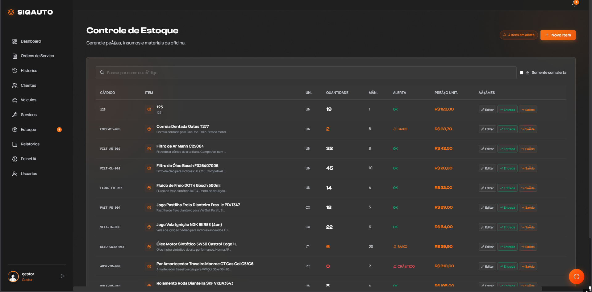

Fonte: elaborado pelo autor (2026).

Figura 12 – Protótipo da tela Novo item de estoque

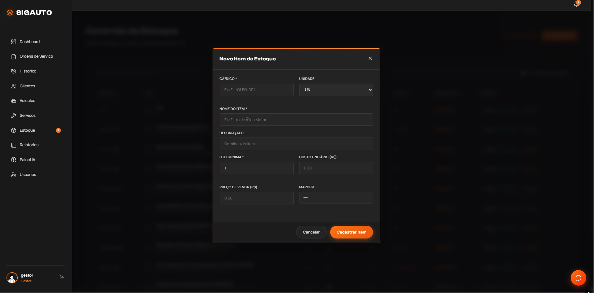

Fonte: elaborado pelo autor (2026).


#### 2.7.10 RF10 – Movimentar estoque

A especificação a seguir detalha o requisito RF10, cuja ficha consta no Quadro 13.


##### 2.7.10.1 Breve descrição

Registra entradas, saídas e ajustes manuais e as baixas automáticas das peças no encerramento da ordem de serviço, impedindo saldo negativo e mantendo histórico com motivo, usuário responsável e ordem de serviço.


##### 2.7.10.2 Atores

•	Gestor

•	Atendente


##### 2.7.10.3 Fluxos de eventos

Os fluxos de eventos do RF10 compreendem o fluxo básico, os fluxos alternativos e os fluxos de exceção, descritos a seguir.


###### 2.7.10.3.1 Fluxo básico

1.	Na listagem do estoque, o usuário aciona Entrada ou Saída na linha do item.

2.	O sistema apresenta a janela de movimentação com o tipo correspondente.

3.	O usuário informa a quantidade e, opcionalmente, o motivo ou observação.

4.	O usuário confirma a operação.

5.	O sistema valida a quantidade e, na saída, o saldo disponível.

6.	O sistema atualiza o saldo do item e a situação de alerta na listagem.


###### 2.7.10.3.2 Fluxos alternativos

•	**Ajuste de saldo**: o usuário seleciona o tipo Ajuste, e a quantidade informada passa a ser o novo saldo do item.

•	**Troca do tipo**: o usuário altera o tipo entre Entrada, Saída e Ajuste antes de confirmar.

•	Baixa automática: ao encerrar a ordem de serviço, o sistema agrega as peças por item, registra a saída vinculada à O.S. e ajusta somente a diferença em uma nova conclusão após reabertura.


###### 2.7.10.3.3 Fluxos de exceção

•	**Quantidade inválida**: o sistema exibe a mensagem “Quantidade inválida” para valores vazios, nulos ou negativos.

•	**Saldo insuficiente**: o sistema exibe a mensagem “Saldo insuficiente para saída.” e não altera o saldo.


##### 2.7.10.4 Pré-condições

•	O usuário deve estar autenticado com perfil de gestor ou atendente.

•	O item deve estar cadastrado e ativo.


##### 2.7.10.5 Pós-condições

•	O saldo do item é atualizado exclusivamente por uma movimentação registrada no histórico.

•	O histórico identifica data, tipo, quantidade, motivo, usuário responsável e ordem de serviço; o alerta de reposição é recalculado.


##### 2.7.10.6 Critérios de aceite

•	O sistema deve somar a quantidade nas entradas e subtraí-la nas saídas manuais ou automáticas.

•	O sistema deve definir o saldo informado nos ajustes.

•	O sistema deve impedir saídas superiores ao saldo e desfazer integralmente a operação que falhou.


##### 2.7.10.7 Campos da tela

O Quadro 29 apresenta os campos, as informações exibidas e as ações disponíveis na tela do RF10.

Quadro 29 – Campos da tela do RF10 – Movimentar estoque


| Campo | Valor padrão | Domínio de valores | Tipo | Obrigatório | Validação |
| --- | --- | --- | --- | --- | --- |
| Tipo de movimentação | Conforme o botão acionado | Entrada, Saída ou Ajuste | Seleção | Sim | – |
| Quantidade | – | Número inteiro maior que zero | Numérico | Sim | Na saída, não pode exceder o saldo. |
| Motivo / observação | – | Texto livre | Texto | Sim | Obrigatório; registrado no histórico. |

Fonte: elaborado pelo autor (2026).


##### 2.7.10.8 Pontos de extensão

•	Integração futura com pedidos de compra e fornecedores.


##### 2.7.10.9 Protótipo

A Figura 13 apresenta a tela do RF10 implementada no sistema.

Figura 13 – Protótipo da tela Movimentar estoque

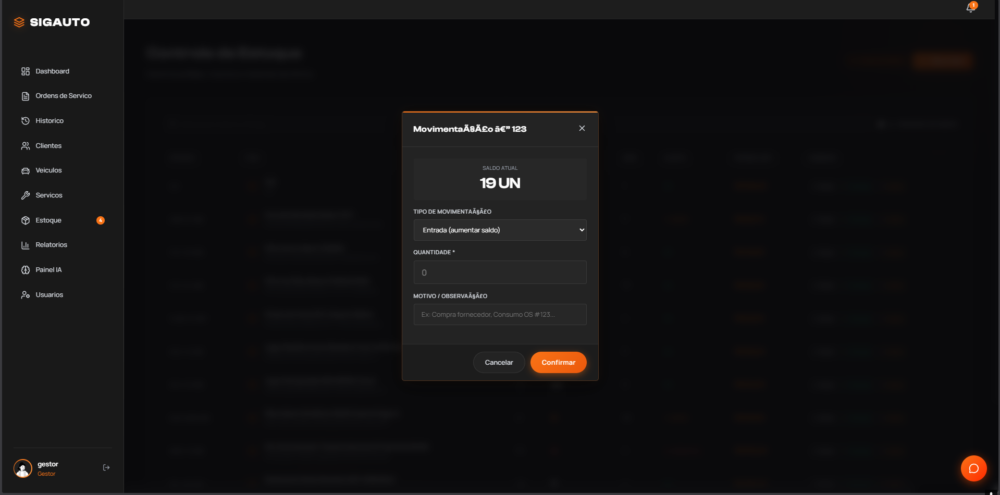

Fonte: elaborado pelo autor (2026).


#### 2.7.11 RF11 – Responder via chatbot

A especificação a seguir detalha o requisito RF11, cuja ficha consta no Quadro 14.


##### 2.7.11.1 Breve descrição

Realiza o atendimento conversacional ao usuário autenticado por meio do modelo de linguagem Google Gemini, com contexto agregado da oficina recortado conforme o perfil e respostas locais de contingência quando o modelo está indisponível.


##### 2.7.11.2 Atores

•	Gestor

•	Atendente

•	Mecânico


##### 2.7.11.3 Fluxos de eventos

Os fluxos de eventos do RF11 compreendem o fluxo básico, os fluxos alternativos e os fluxos de exceção, descritos a seguir.


###### 2.7.11.3.1 Fluxo básico

1.	O usuário aciona o botão flutuante do assistente, disponível em todas as telas.

2.	O sistema abre a janela do chatbot com a saudação inicial e as perguntas de resposta rápida.

3.	O usuário digita a pergunta e pressiona Enter, ou seleciona uma pergunta rápida.

4.	O sistema envia a pergunta e o histórico da conversa atual à API, com o JWT do usuário.

5.	A API valida o usuário, monta o contexto agregado da oficina e o recorta conforme o perfil.

6.	A API envia a pergunta, o histórico e o contexto ao modelo de linguagem, com instruções sobre os menus e fluxos reais do sistema.

7.	A API registra a pergunta e a resposta e devolve a resposta ao navegador.

8.	O sistema exibe a resposta formatada na janela.


###### 2.7.11.3.2 Fluxos alternativos

•	**Limpar conversa**: o usuário limpa a conversa, e a janela retorna à saudação inicial.

•	**Fechar janela**: o usuário fecha a janela pelo botão ou pela tecla Esc.


###### 2.7.11.3.3 Fluxos de exceção

•	**Modelo ou API indisponível**: o sistema responde com orientação local selecionada por palavras-chave sobre ordens de serviço, estoque, clientes, veículos, relatórios e usuários.

•	**Mensagem vazia**: a mensagem não é enviada.

•	**Excesso de requisições**: a API recusa novas mensagens acima do limite por minuto, e o sistema aplica a resposta local.


##### 2.7.11.4 Pré-condições

•	O usuário deve estar autenticado.


##### 2.7.11.5 Pós-condições

•	A resposta é exibida ao usuário.

•	Quando processadas pelo modelo, a pergunta e a resposta ficam registradas.


##### 2.7.11.6 Critérios de aceite

•	O sistema deve responder perguntas sobre o uso das funcionalidades.

•	O sistema não deve fornecer dados financeiros a perfis diferentes de gestor.

•	O sistema deve continuar respondendo com orientações locais quando o modelo estiver indisponível.


##### 2.7.11.7 Campos da tela

O Quadro 30 apresenta os campos, as informações exibidas e as ações disponíveis na tela do RF11.

Quadro 30 – Campos da tela do RF11 – Responder via chatbot


| Campo | Valor padrão | Domínio de valores | Tipo | Obrigatório | Validação |
| --- | --- | --- | --- | --- | --- |
| Botão do assistente | – | Abrir ou fechar a janela | Botão flutuante | – | – |
| Perguntas rápidas | Seis perguntas | Abrir OS, entrada de peça, encerrar OS, inativar cliente, cadastrar veículo e relatórios | Botões | Não | – |
| Mensagem | – | Texto livre | Texto | Sim | Não envia mensagem vazia. |
| Conversa | Saudação inicial | Mensagens do usuário e do assistente | Exibição | – | Conteúdo exibido com HTML escapado. |
| Limpar conversa | – | Ação | Botão | – | – |

Fonte: elaborado pelo autor (2026).


##### 2.7.11.8 Pontos de extensão

•	Consulta a dados de ordens de serviço específicas.

•	Execução assistida de ações, mediante confirmação do usuário.


##### 2.7.11.9 Protótipo

A Figura 14 apresenta a tela do RF11 implementada no sistema.

Figura 14 – Protótipo da janela do chatbot

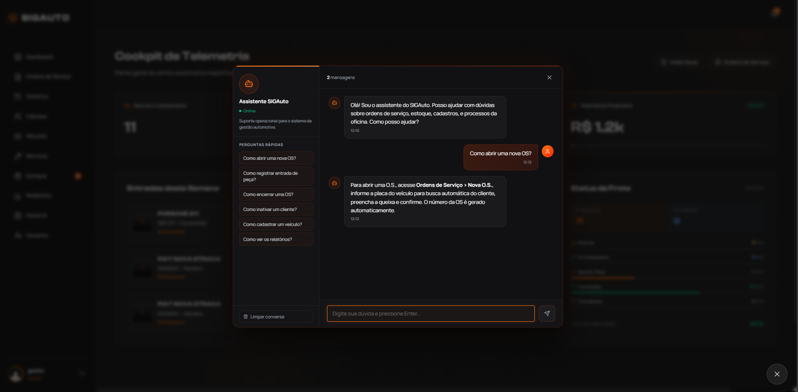

Fonte: elaborado pelo autor (2026).


#### 2.7.12 RF12 – Gerar recomendações da IA

A especificação a seguir detalha o requisito RF12, cuja ficha consta no Quadro 15.


##### 2.7.12.1 Breve descrição

Realiza a análise gerencial em quatro blocos: estoque inteligente, produtividade das ordens de serviço, comparação dos últimos 90 dias com os 90 dias anteriores e recomendações explicáveis. As métricas são calculadas pelo sistema, e as recomendações são priorizadas, fundamentadas em evidências e exclusivamente consultivas.


##### 2.7.12.2 Atores

•	Gestor


##### 2.7.12.3 Fluxos de eventos

Os fluxos de eventos do RF12 compreendem o fluxo básico, os fluxos alternativos e os fluxos de exceção, descritos a seguir.


###### 2.7.12.3.1 Fluxo básico

1.	O gestor acessa o Painel IA no menu lateral.

2.	O sistema exibe o aviso de caráter consultivo e a opção de análise.

3.	O gestor aciona a análise.

4.	O sistema envia a solicitação à API com o JWT do gestor.

5.	A API verifica o perfil, consulta as ordens de serviço dos últimos 180 dias, o estoque ativo e as movimentações e calcula as métricas de estoque inteligente, produtividade e comparação dos últimos 90 dias com os 90 dias anteriores.

6.	A API envia os dados agregados ao modelo de linguagem, que devolve resumo, recomendações e alertas em formato JSON.

7.	A API substitui as métricas pelas calculadas, grava a análise e devolve o resultado.

8.	O sistema exibe os blocos de estoque inteligente, produtividade e comparação de períodos, além das recomendações explicáveis, cada uma com prioridade, evidências e selo consultivo.


###### 2.7.12.3.2 Fluxos alternativos

•	**Nova análise**: o gestor aciona novamente a análise para obter um resultado atualizado.


###### 2.7.12.3.3 Fluxos de exceção

•	Falha da API ou do modelo: após esgotar as tentativas e os modelos alternativos, o sistema informa que a inteligência artificial está indisponível e não fabrica localmente análise, recomendação ou número.

•	**Dados insuficientes**: o sistema exibe a mensagem “Dados insuficientes para gerar recomendações. Registre mais ordens de serviço e retorne.”.

•	**Perfil sem permissão**: a API recusa a solicitação, e a tela exibe acesso negado para perfis diferentes de gestor.


##### 2.7.12.4 Pré-condições

•	O usuário deve estar autenticado com perfil de gestor.


##### 2.7.12.5 Pós-condições

•	A análise é exibida e registrada, sem nenhuma alteração nos dados operacionais.


##### 2.7.12.6 Critérios de aceite

•	O sistema deve exibir métricas calculadas deterministicamente para estoque inteligente, produtividade das ordens de serviço e comparação dos últimos 90 dias com os 90 dias anteriores.

•	O sistema deve apresentar recomendações explicáveis, identificadas como consultivas e acompanhadas de prioridade, período analisado, evidências, ação sugerida e impacto esperado qualitativo.

•	O sistema não deve inferir tempo por etapa ou por status, pois não existe histórico de transições de status.

•	Nenhuma recomendação deve executar ações ou alterar dados operacionais automaticamente.

•	Após esgotar as tentativas e os modelos alternativos, o sistema deve informar que a inteligência artificial está indisponível, sem fabricar localmente análise, recomendação ou número.


##### 2.7.12.7 Campos da tela

O Quadro 31 apresenta os campos, as informações exibidas e as ações disponíveis na tela do RF12.

Quadro 31 – Campos da tela do RF12 – Gerar recomendações da IA


| Campo | Valor padrão | Domínio de valores | Tipo | Obrigatório | Validação |
| --- | --- | --- | --- | --- | --- |
| Aviso consultivo | Fixo | Texto informativo | Exibição | – | – |
| Analisar | – | Ação de análise | Botão | – | Exibe indicador de carregamento. |
| Resumo | Gerado | Texto | Exibição | – | – |
| Estoque inteligente | Calculado | Saídas, consumo médio, itens críticos ou sem movimentação, cobertura e sugestão de reposição | Indicadores | – | Usa somente movimentações registradas; sugestão consultiva. |
| Produtividade das O.S. | Calculada | O.S. abertas, concluídas e canceladas, taxa de conclusão, tempos e resultados por mecânico | Indicadores | – | Não infere tempo por etapa ou status. |
| Comparação de períodos | 90 dias | Últimos 90 dias e 90 dias anteriores, com valores, diferenças e variações válidas | Indicadores | – | Base anterior zero é informada sem crescimento infinito. |
| Recomendações explicáveis | Geradas | Título, descrição, prioridade, categoria, período, evidências, ação sugerida e impacto qualitativo | Cartões | – | Caráter consultivo; não executa ações automaticamente. |

Fonte: elaborado pelo autor (2026).


##### 2.7.12.8 Pontos de extensão

•	Histórico das análises anteriores.

•	Recomendações de manutenção preventiva por veículo.


##### 2.7.12.9 Protótipo

As Figura 15 e Figura 16 apresentam a tela do RF12 implementada no sistema.

Figura 15 – Protótipo do painel analítico da IA

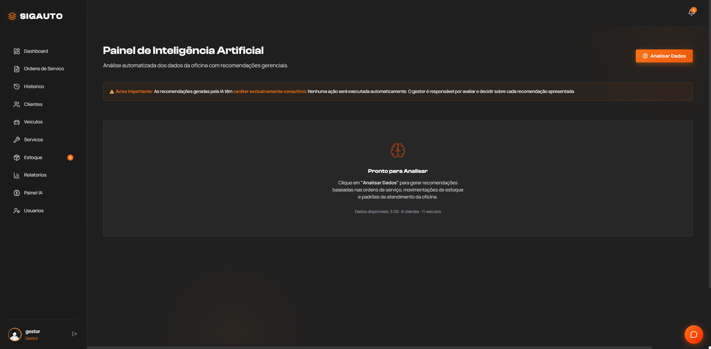

Fonte: elaborado pelo autor (2026).

Figura 16 – Protótipo do painel analítico da IA – vista detalhada

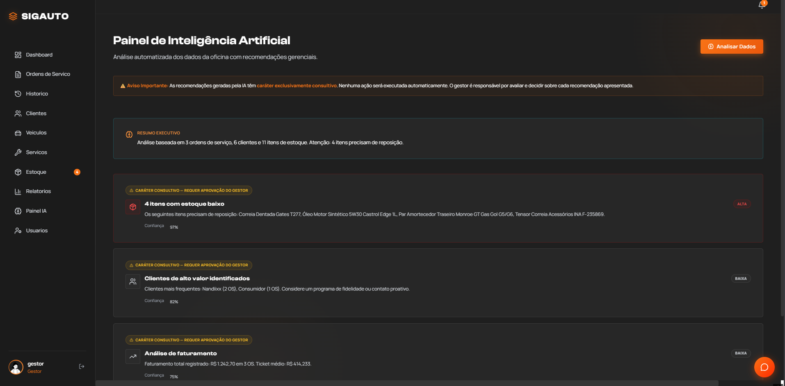

Fonte: elaborado pelo autor (2026).


#### 2.7.13 RF13 – Manter serviços

A especificação a seguir detalha o requisito RF13, cuja ficha consta no Quadro 16.


##### 2.7.13.1 Breve descrição

Realiza a manutenção do catálogo de serviços oferecidos pela oficina, cujos itens são utilizados no lançamento de serviços das ordens de serviço.


##### 2.7.13.2 Atores

•	Gestor

•	Atendente


##### 2.7.13.3 Fluxos de eventos

Os fluxos de eventos do RF13 compreendem o fluxo básico, os fluxos alternativos e os fluxos de exceção, descritos a seguir.


###### 2.7.13.3.1 Fluxo básico

1.	O usuário acessa o módulo Serviços no menu lateral.

2.	O sistema exibe o catálogo com serviço ou pacote, descrição técnica, preço base e ações.

3.	O usuário seleciona a opção de novo serviço.

4.	O usuário informa nome, preço base e descrição detalhada.

5.	O usuário confirma, e o sistema grava o serviço e atualiza o catálogo.


###### 2.7.13.3.2 Fluxos alternativos

•	**Editar serviço**: o usuário altera os dados do serviço e confirma.

•	**Pesquisar serviço**: o sistema filtra o catálogo por nome ou descrição.

•	**Remover serviço**: o usuário confirma a remoção, e o sistema inativa o serviço, que deixa de ser oferecido nas ordens de serviço.


###### 2.7.13.3.3 Fluxos de exceção

•	**Campos obrigatórios ausentes**: o formulário não é submetido sem nome e preço base.


##### 2.7.13.4 Pré-condições

•	O usuário deve estar autenticado com perfil de gestor ou atendente.


##### 2.7.13.5 Pós-condições

•	O serviço é incluído, atualizado ou inativado no catálogo.


##### 2.7.13.6 Critérios de aceite

•	O sistema deve cadastrar serviço com nome e preço base.

•	O sistema deve oferecer apenas serviços ativos no lançamento da ordem de serviço.


##### 2.7.13.7 Campos da tela

O Quadro 32 apresenta os campos, as informações exibidas e as ações disponíveis na tela do RF13.

Quadro 32 – Campos da tela do RF13 – Manter serviços


| Campo | Valor padrão | Domínio de valores | Tipo | Obrigatório | Validação |
| --- | --- | --- | --- | --- | --- |
| Pesquisa | – | Nome ou descrição | Texto | Não | – |
| Nome do serviço / pacote | – | Texto com até 120 caracteres | Texto | Sim | – |
| Preço base (R$) | – | Valor numérico | Monetário | Sim | – |
| Descrição detalhada | – | Texto livre | Área de texto | Não | – |

Fonte: elaborado pelo autor (2026).


##### 2.7.13.8 Pontos de extensão

•	Tempo estimado de execução por serviço.

•	Relatório de serviços frequentes (RF07).


##### 2.7.13.9 Protótipo

As Figura 17 e Figura 18 apresentam a tela do RF13 implementada no sistema.

Figura 17 – Protótipo da tela Manter serviços

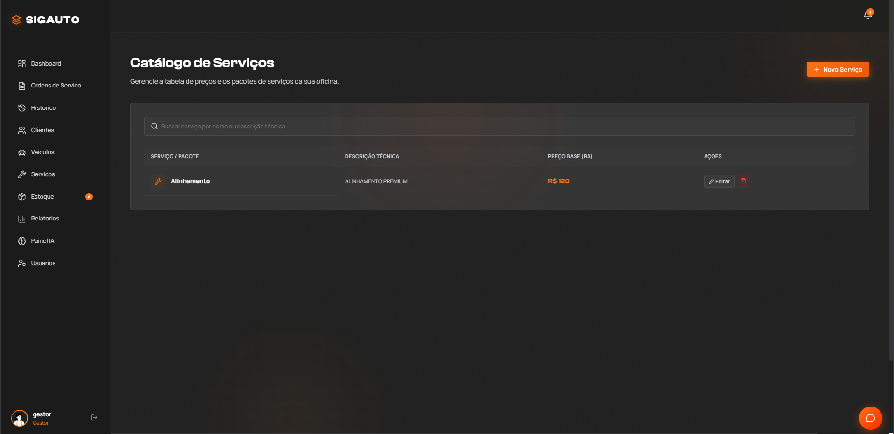

Fonte: elaborado pelo autor (2026).

Figura 18 – Protótipo da tela Manter serviços – novo serviço

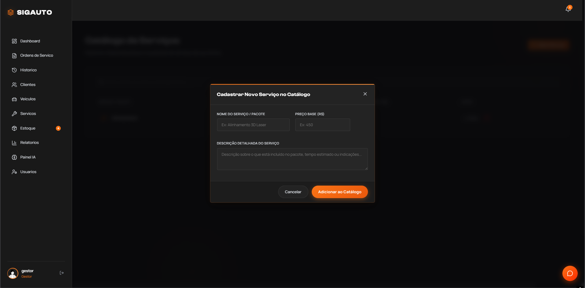

Fonte: elaborado pelo autor (2026).


#### 2.7.14 RF14 – Manter usuários

A especificação a seguir detalha o requisito RF14, cuja ficha consta no Quadro 17.


##### 2.7.14.1 Breve descrição

Realiza a gestão das contas de acesso ao sistema pelo gestor, criando a conta no Supabase Auth e o registro correspondente na tabela de usuários, com perfil de gestor, atendente ou mecânico.


##### 2.7.14.2 Atores

•	Gestor


##### 2.7.14.3 Fluxos de eventos

Os fluxos de eventos do RF14 compreendem o fluxo básico, os fluxos alternativos e os fluxos de exceção, descritos a seguir.


###### 2.7.14.3.1 Fluxo básico

1.	O gestor acessa o módulo Usuários no menu lateral.

2.	O sistema exibe os usuários com nome, e-mail, telefone, perfil, situação e ações.

3.	O gestor seleciona a opção de novo usuário.

4.	O gestor informa nome completo, e-mail, telefone, perfil de acesso e senha inicial.

5.	O gestor confirma o cadastro.

6.	O backend valida o perfil do gestor, cria a conta já confirmada no Supabase Auth, grava o perfil e vincula o funcionário correspondente, sem alterar a sessão do gestor.

7.	O sistema atualiza a listagem.


###### 2.7.14.3.2 Fluxos alternativos

•	**Editar usuário**: o gestor altera nome, telefone e perfil; o e-mail não pode ser alterado.

•	**Pesquisar usuário**: o sistema filtra por nome, e-mail ou perfil.

•	**Inativar usuário**: o gestor confirma a mensagem “Deseja inativar este usuário? Ele não poderá mais acessar o sistema.”, e o usuário é inativado.


###### 2.7.14.3.3 Fluxos de exceção

•	**Senha curta**: o sistema exibe “A senha deve ter pelo menos 8 caracteres.” e não cria a conta.

•	**E-mail já utilizado**: o sistema exibe no formulário a mensagem de erro retornada pelo Supabase Auth.

•	**Falha na inativação**: o sistema exibe “Não foi possível inativar o usuário.”.


##### 2.7.14.4 Pré-condições

•	O usuário deve estar autenticado com perfil de gestor.


##### 2.7.14.5 Pós-condições

•	A conta é criada já confirmada, atualizada ou inativada; no cadastro, o funcionário correspondente fica disponível para seleção nas ordens de serviço.

•	Usuários inativos perdem o acesso aos dados.


##### 2.7.14.6 Critérios de aceite

•	O sistema deve criar a conta de acesso com o perfil informado.

•	O sistema deve impedir senha inicial com menos de 8 caracteres.

•	O sistema deve impedir o acesso de usuários inativados.


##### 2.7.14.7 Campos da tela

O Quadro 33 apresenta os campos, as informações exibidas e as ações disponíveis na tela do RF14.

Quadro 33 – Campos da tela do RF14 – Manter usuários


| Campo | Valor padrão | Domínio de valores | Tipo | Obrigatório | Validação |
| --- | --- | --- | --- | --- | --- |
| Pesquisa | – | Nome, e-mail ou perfil | Texto | Não | – |
| Nome completo | – | Texto com até 120 caracteres | Texto | Sim | – |
| E-mail | – | Formato usuario@dominio | Texto | Sim | Não editável após o cadastro. |
| Telefone | – | Texto com até 20 caracteres | Texto | Não | – |
| Perfil de acesso | Atendente | Gestor, Atendente ou Mecânico | Seleção | Sim | – |
| Senha inicial | – | Texto mascarado | Senha | Sim, no cadastro | Mínimo de 8 caracteres. |

Fonte: elaborado pelo autor (2026).


##### 2.7.14.8 Pontos de extensão

•	Redefinição de senha iniciada pelo gestor.

•	Convite por e-mail para o usuário definir a própria senha inicial.


#### 2.7.15 RF15 – Manter funcionários

A especificação a seguir detalha o requisito RF15, cuja ficha consta no Quadro 18.


##### 2.7.15.1 Breve descrição

Realiza o cadastro dos colaboradores da oficina, separado do cadastro de usuários, definindo o cargo, o vínculo opcional com uma conta de acesso e a regra de comissão aplicada nas ordens de serviço.


##### 2.7.15.2 Atores

•	Gestor


##### 2.7.15.3 Fluxos de eventos

Os fluxos de eventos do RF15 compreendem o fluxo básico, os fluxos alternativos e os fluxos de exceção, descritos a seguir.


###### 2.7.15.3.1 Fluxo básico

1.	O gestor acessa o módulo Funcionários no menu lateral.

2.	O sistema exibe os funcionários com nome, cargo, comissão, login vinculado e ações.

3.	O gestor seleciona a opção de novo funcionário.

4.	O gestor informa nome, cargo, login vinculado (opcional), percentual de comissão e base de cálculo.

5.	O gestor confirma, e o sistema grava o funcionário e atualiza a listagem.


###### 2.7.15.3.2 Fluxos alternativos

•	**Editar funcionário**: o gestor altera os dados e confirma.

•	**Pesquisar funcionário**: o sistema filtra por nome ou cargo.

•	**Inativar funcionário**: o gestor confirma a mensagem “Deseja inativar este funcionário?”, e o funcionário deixa de ser oferecido nas ordens de serviço.


###### 2.7.15.3.3 Fluxos de exceção

•	**Falha na inativação**: o sistema exibe “Não foi possível inativar.”.

•	**Percentual fora do intervalo**: o percentual é limitado ao intervalo de 0 a 100 antes da gravação.


##### 2.7.15.4 Pré-condições

•	O usuário deve estar autenticado com perfil de gestor.


##### 2.7.15.5 Pós-condições

•	O funcionário é incluído, atualizado ou inativado.

•	Funcionários ativos ficam disponíveis como mecânico ou atendente nas ordens de serviço.


##### 2.7.15.6 Critérios de aceite

•	O sistema deve cadastrar funcionário com cargo e regra de comissão.

•	O sistema deve permitir vincular o funcionário a um usuário.

•	O sistema deve restringir a visualização da comissão ao gestor e ao próprio funcionário.


##### 2.7.15.7 Campos da tela

O Quadro 34 apresenta os campos, as informações exibidas e as ações disponíveis na tela do RF15.

Quadro 34 – Campos da tela do RF15 – Manter funcionários


| Campo | Valor padrão | Domínio de valores | Tipo | Obrigatório | Validação |
| --- | --- | --- | --- | --- | --- |
| Pesquisa | – | Nome ou cargo | Texto | Não | – |
| Nome completo | – | Texto com até 120 caracteres | Texto | Sim | – |
| Cargo | – | Mecânico, Atendente ou Gestor | Seleção | Sim | – |
| Login vinculado | Sem login | Usuários cadastrados | Seleção | Não | Um usuário por funcionário. |
| Percentual (%) | 0 | 0 a 100, com duas casas decimais | Numérico | Não | Restrição no banco de dados. |
| Base de cálculo | Nenhuma | Serviços e/ou peças | Caixas de seleção | Não | – |

Fonte: elaborado pelo autor (2026).


##### 2.7.15.8 Pontos de extensão

•	Relatório de comissões por período (RF07).

•	Controle de produtividade por mecânico.

### 2.8 REQUISITOS NÃO FUNCIONAIS

Os requisitos não funcionais definem características de qualidade que o SIGAuto deve atender, complementando os requisitos funcionais. Esses requisitos impactam a experiência do usuário, a manutenibilidade, a segurança e a confiabilidade do sistema.


#### 2.8.1 Requisitos de aparência

•	RNF-AP01: a interface deve adotar identidade visual consistente em todas as telas, com tema escuro, cor de destaque laranja e tipografia Manrope.

•	RNF-AP02: o layout deve ser responsivo, adaptando-se a resoluções de 1280×768 a 1920×1080 sem comprometer a legibilidade.

•	RNF-AP03: o status das ordens de serviço, os alertas de estoque e as prioridades devem ser diferenciados visualmente por cor e rótulo.


#### 2.8.2 Requisitos de usabilidade e humanidade

•	RNF-US01: o usuário deve concluir os fluxos de abertura e de consulta de ordem de serviço sem auxílio externo após o uso inicial.

•	RNF-US02: as mensagens de erro devem ser redigidas em linguagem clara e objetiva, informando a causa do problema.

•	RNF-US03: os formulários devem indicar os campos obrigatórios, aplicar máscaras a CPF/CNPJ, telefone, placa e CEP e validar os dados antes da gravação.

•	RNF-US04: todos os campos devem possuir rótulos visíveis, com contraste adequado entre texto e fundo.

•	RNF-US05: a abertura de ordem de serviço deve permitir localizar o cliente por nome, documento ou placa do veículo.


#### 2.8.3 Requisitos de desempenho

•	RNF-DS01: as consultas de listagem de clientes, veículos e ordens de serviço devem retornar resultados em até 2 segundos em rede estável.

•	RNF-DS02: as operações de gravação devem ser concluídas em até 3 segundos em condições normais de rede e carga.

•	RNF-DS03: o sistema deve suportar até 20 usuários simultâneos sem degradação perceptível do tempo de resposta.

•	RNF-DS04: os dados principais devem ser carregados uma vez por sessão e compartilhados entre as telas, de modo que a navegação não repita as consultas ao banco de dados.

•	RNF-DS05: o painel da IA pode apresentar latência superior a 3 segundos e deve exibir indicador visual de carregamento durante o processamento.


#### 2.8.4 Requisitos operacionais e ambientais

•	RNF-OP01: o sistema deve ser operado por navegador em computadores conectados à internet, sem instalação de aplicativo nativo.

•	RNF-OP02: o sistema deve funcionar nos navegadores Google Chrome e Microsoft Edge em suas versões estáveis mais recentes.

•	RNF-OP03: o sistema depende de conexão com a internet para comunicação com o Supabase e com o serviço de IA.

•	RNF-OP04: a aplicação deve ser hospedada na Vercel, com publicação automática a partir do ramo principal do repositório.


#### 2.8.5 Requisitos de manutenibilidade e suporte

•	RNF-MT01: o código deve ser organizado em módulos, com separação entre páginas, componentes, contextos, utilitários e serviço de API.

•	RNF-MT02: as alterações no esquema do banco devem ser realizadas por scripts SQL numerados, transacionais e idempotentes, sem reescrever scripts já aplicados.

•	RNF-MT03: as regras de cálculo e de validação devem estar isoladas em funções utilitárias cobertas por testes automatizados.

•	RNF-MT04: o código deve ser versionado com Git, com ramos por funcionalidade e integração ao ramo principal por pull request.

•	RNF-MT05: a integração contínua deve executar análise estática, empacotamento e testes automatizados a cada envio ao repositório.


#### 2.8.6 Requisitos de segurança

•	RNF-SE01: o acesso deve ocorrer exclusivamente por e-mail e senha, via Supabase Auth, com sessão baseada em JWT.

•	RNF-SE02: todas as tabelas devem possuir RLS habilitado, com políticas distintas para gestor, atendente e mecânico.

•	RNF-SE03: as senhas devem ser armazenadas pelo Supabase Auth com algoritmo de hash, nunca em texto plano.

•	RNF-SE04: a tela de login deve bloquear novas tentativas por 15 minutos após cinco falhas consecutivas.

•	RNF-SE05: a chave administrativa do banco e a chave do modelo de linguagem devem existir apenas no serviço em Node.js; o frontend utiliza somente a chave pública.

•	RNF-SE06: a API deve aplicar cabeçalhos de segurança HTTP, CORS restrito à origem do frontend e limites de requisições de 100 por minuto nas rotas gerais e de 10 por minuto nas rotas de IA e chatbot.

•	RNF-SE07: as respostas do chatbot devem ter o conteúdo HTML escapado antes da exibição.


#### 2.8.7 Requisitos legais

•	RNF-LG01: o sistema deve tratar os dados pessoais de clientes em conformidade com os princípios da LGPD (Brasil, 2018), especialmente os de finalidade, necessidade e segurança.

•	RNF-LG02: o sistema não deve coletar dados pessoais além dos necessários ao atendimento da oficina.

•	RNF-LG03: o acesso a dados pessoais e às regras de comissão deve ser restrito por perfil por meio das políticas RLS.

### 2.9 ESPECIFICAÇÃO TÉCNICA

Esta seção apresenta os casos de uso, as fronteiras do produto e os modelos UML e de dados que descrevem a solução.


#### 2.9.1 Fronteiras do produto

O SIGAuto interage com os seguintes elementos externos:

•	atores humanos: gestor, atendente e mecânico, usuários diretos do sistema;

•	Supabase: Supabase Auth para autenticação, PostgREST para a API de dados e PostgreSQL para armazenamento;

•	Google Gemini API: processamento de linguagem natural do chatbot e do painel de recomendações;

•	ViaCEP: consulta de endereço a partir do CEP;

•	Vercel: hospedagem da interface e execução do serviço em Node.js;

•	cliente final da oficina: beneficiário indireto, sem acesso ao sistema.


#### 2.9.2 Diagramas de casos de uso

Os casos de uso foram modelados em um diagrama por ator, e cada caso de uso é identificado pelo requisito funcional correspondente. A Figura 19 apresenta os casos de uso do gestor, que possui acesso a todas as funcionalidades; a Figura 20, os do atendente; e a Figura 21, os do mecânico, restrito às ordens de serviço sob sua responsabilidade. O Supabase Auth e o Google Gemini participam como sistemas adjacentes.

Figura 19 – Diagrama de casos de uso – gestor

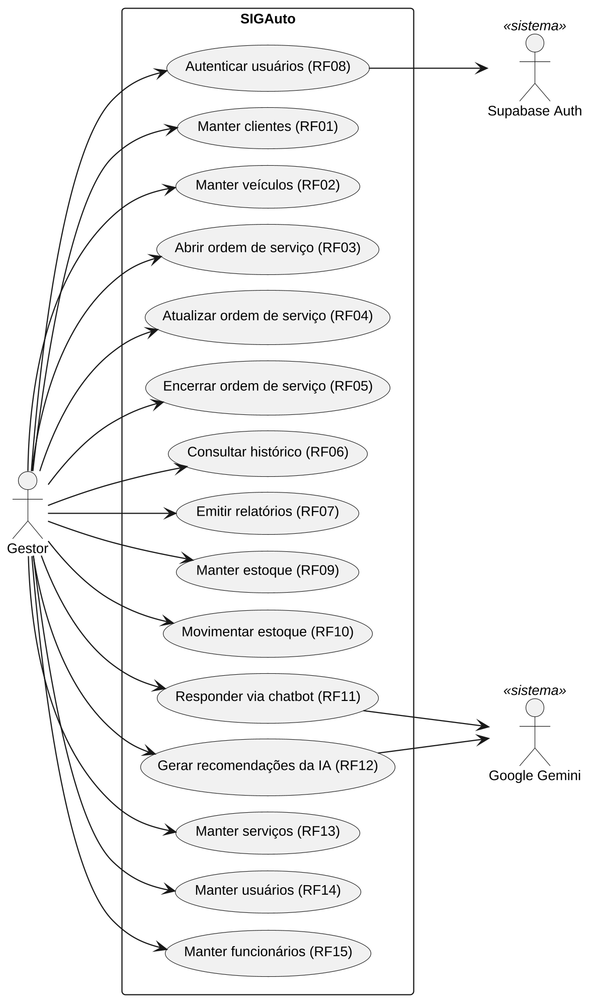

Fonte: elaborado pelo autor (2026).

Figura 20 – Diagrama de casos de uso – atendente

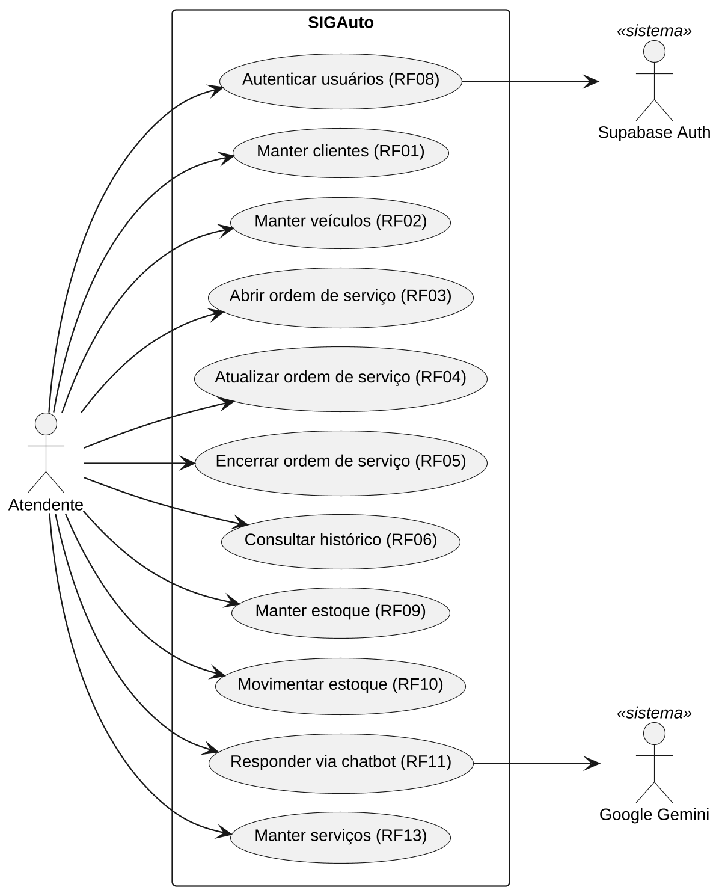

Fonte: elaborado pelo autor (2026).

Figura 21 – Diagrama de casos de uso – mecânico

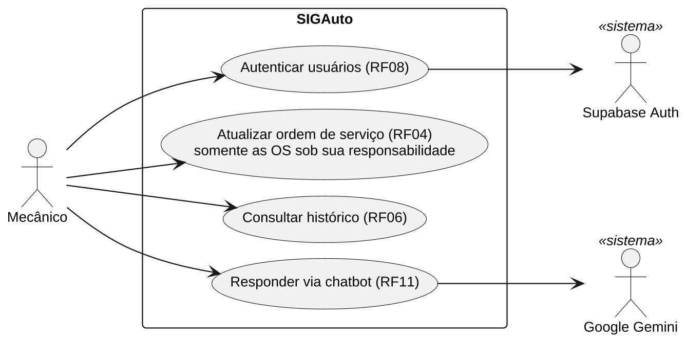

Fonte: elaborado pelo autor (2026).


#### 2.9.3 Diagramas de sequência

Os diagramas de sequência modelam a interação entre os atores e os componentes do sistema nos casos de uso mais representativos: a abertura de ordem de serviço (Figura 22), a autenticação de usuário (Figura 23) e a geração de recomendações da IA (Figura 24).

Figura 22 – Diagrama de sequência – abertura de ordem de serviço

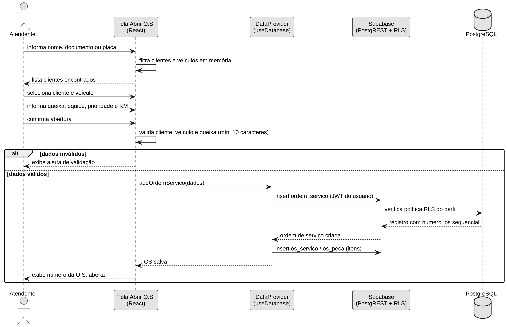

Fonte: elaborado pelo autor (2026).

Figura 23 – Diagrama de sequência – autenticação de usuário

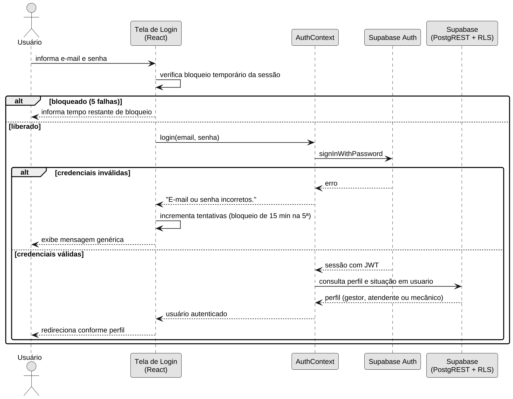

Fonte: elaborado pelo autor (2026).

Figura 24 – Diagrama de sequência – geração de recomendações da IA

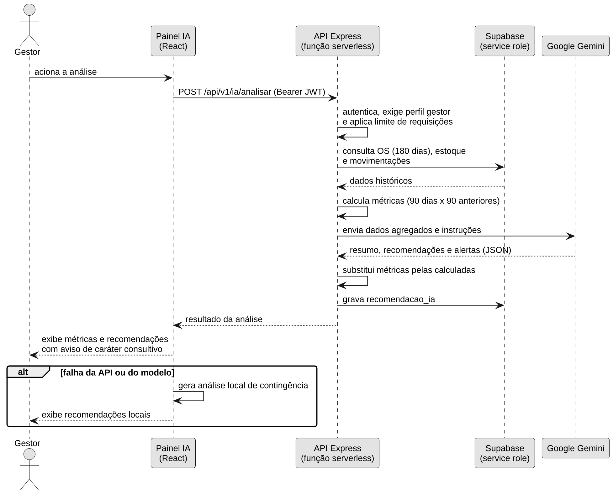

Fonte: elaborado pelo autor (2026).


#### 2.9.4 Diagrama de classes

A Figura 25 apresenta o diagrama de classes do domínio. As classes principais são Cliente, Endereco, Veiculo, OrdemServico, OSServico, OSPeca, ServicoCatalogo, ItemEstoque, Funcionario, Usuario, MensagemChatbot e RecomendacaoIA, e seus relacionamentos refletem as regras de negócio definidas na seção 2.4.2.

Figura 25 – Diagrama de classes

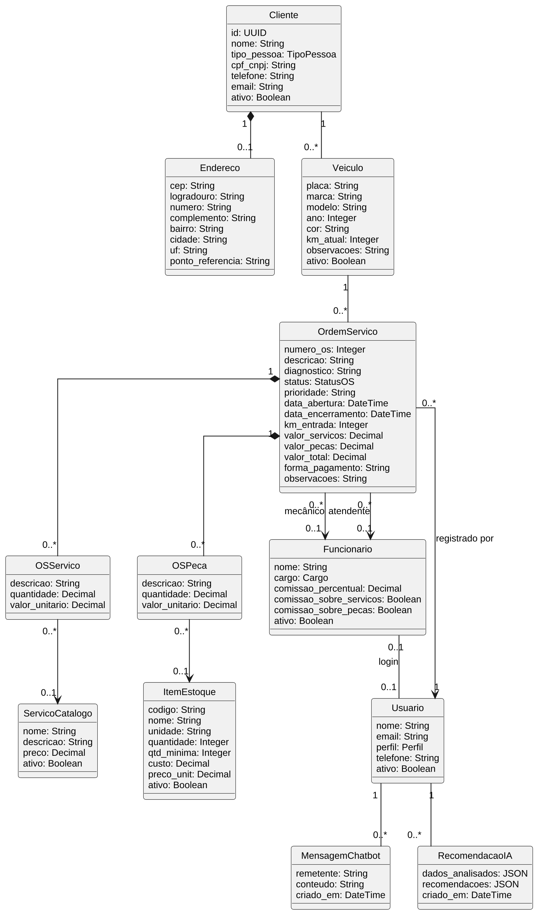

Fonte: elaborado pelo autor (2026).


#### 2.9.5 Modelo dos dados

A Figura 26 apresenta o modelo entidade-relacionamento implementado no PostgreSQL. Os serviços e as peças de cada ordem de serviço são registrados nas tabelas os_servico e os_peca, vinculadas ao catálogo de serviços e aos itens de estoque; o endereço do cliente ocupa tabela própria; e as regras de comissão pertencem à entidade funcionario, separada da conta de acesso.

Figura 26 – Modelo entidade-relacionamento

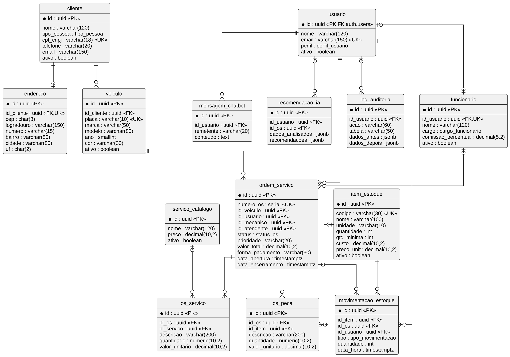

Fonte: elaborado pelo autor (2026).


#### 2.9.6 Diagrama de componentes

A Figura 27 apresenta o diagrama de componentes do SIGAuto. A aplicação React concentra as páginas, os componentes de interface, o contexto de autenticação, o provedor de dados e os utilitários, e se comunica diretamente com o Supabase. O serviço em Node.js com Express reúne as rotas, os middlewares, os controladores e o serviço de integração com o Google Gemini.

Figura 27 – Diagrama de componentes do SIGAuto

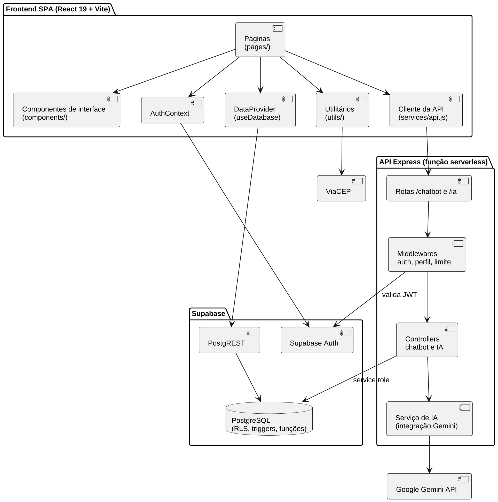

Fonte: elaborado pelo autor (2026).

### 3.1 REQUISITOS FUNCIONAIS

Durante o desenvolvimento, desafios técnicos e a validação das telas com o fluxo real de uma oficina resultaram em adaptações do escopo inicialmente especificado. O DERS apresentado no Capítulo 2 já incorpora essas adaptações, e o Quadro 35 mapeia as alterações, inclusões e restrições em relação à especificação inicial, com as respectivas justificativas técnicas.

Quadro 35 – Alterações nos requisitos funcionais em relação à especificação inicial


| RF | Alteração | Justificativa técnica |
| --- | --- | --- |
| RF01 | O endereço em texto livre foi substituído por endereço estruturado, com preenchimento automático pelo CEP. | Padronizar os dados e permitir a pesquisa de clientes por bairro, cidade e CEP. |
| RF03 | Inclusão do cliente genérico Consumidor, da busca por placa e da equipe composta por mecânico e atendente, selecionados entre os funcionários; a queixa passou a exigir no mínimo 10 caracteres. | Adequar a abertura ao atendimento de balcão, no qual o atendente costuma ter em mãos a placa ou o documento, e vincular a OS à regra de comissão da equipe. |
| RF04 | Inclusão da baixa automática e atômica das peças vinculadas ao estoque no encerramento da O.S., com ajuste por diferença após reabertura. | Evitar divergência entre as peças efetivamente utilizadas e o saldo disponível, sem duplicar a baixa em novas conclusões. |
| RF05 | Inclusão do cadastro único da oficina e da emissão personalizada da ordem de serviço, com Salvar PDF e Imprimir em qualquer status, além do desconto e da forma de pagamento obrigatória no encerramento. | Identificar a oficina e disponibilizar um documento completo e consistente durante todo o ciclo da O.S. |
| RF07 | Inclusão do relatório de comissões; a exportação passou a ocorrer em CSV. | O formato CSV é aberto por qualquer editor de planilhas e atende à necessidade de exportação dos seis relatórios. |
| RF08 | O bloqueio após cinco tentativas passou a ser controlado pela tela de login, no navegador. | O login é realizado diretamente no Supabase Auth, e não mais por rota do serviço em Node.js. |
| RF09 | Inclusão do custo unitário, do preço de venda e da margem; a inativação de itens não foi disponibilizada na interface. | Apoiar a formação de preço das peças lançadas nas ordens de serviço. |
| RF10 | Inclusão do histórico imutável de movimentações, com motivo, usuário e O.S., e integração com a baixa automática. | Garantir rastreabilidade operacional do saldo e permitir explicar cada entrada, saída ou ajuste. |
| RF11 | O contexto enviado ao modelo passou a ser recortado por perfil, com respostas locais de contingência. | Evitar que perfis sem permissão obtenham dados financeiros por meio do chatbot. |
| RF12 | Organização do painel em estoque inteligente, produtividade, comparação de 90 dias com os 90 dias anteriores e recomendações explicáveis; as métricas são calculadas pelo sistema. | Garantir números determinísticos e verificáveis e recomendações consultivas apoiadas em evidências. |
| RF14 | O cadastro passou a ser executado pelo backend com conta confirmada e vínculo automático ao funcionário. | Preservar a sessão do gestor, manter a chave administrativa fora do navegador e tornar o colaborador selecionável na O.S. |
| RF15 | Requisito incluído para o cadastro de funcionários e de regras de comissão. | Separar o colaborador da conta de acesso, já que nem todo funcionário utiliza o sistema. |

Fonte: elaborado pelo autor (2026).

Além das alterações nos requisitos funcionais, a trilha de auditoria por operação e a documentação da API no padrão OpenAPI deixaram de integrar o escopo desta versão, uma vez que as operações de cadastro passaram a ser realizadas diretamente no Supabase, sob controle das políticas RLS, e o serviço em Node.js passou a expor apenas as rotas de chatbot e de inteligência artificial.
