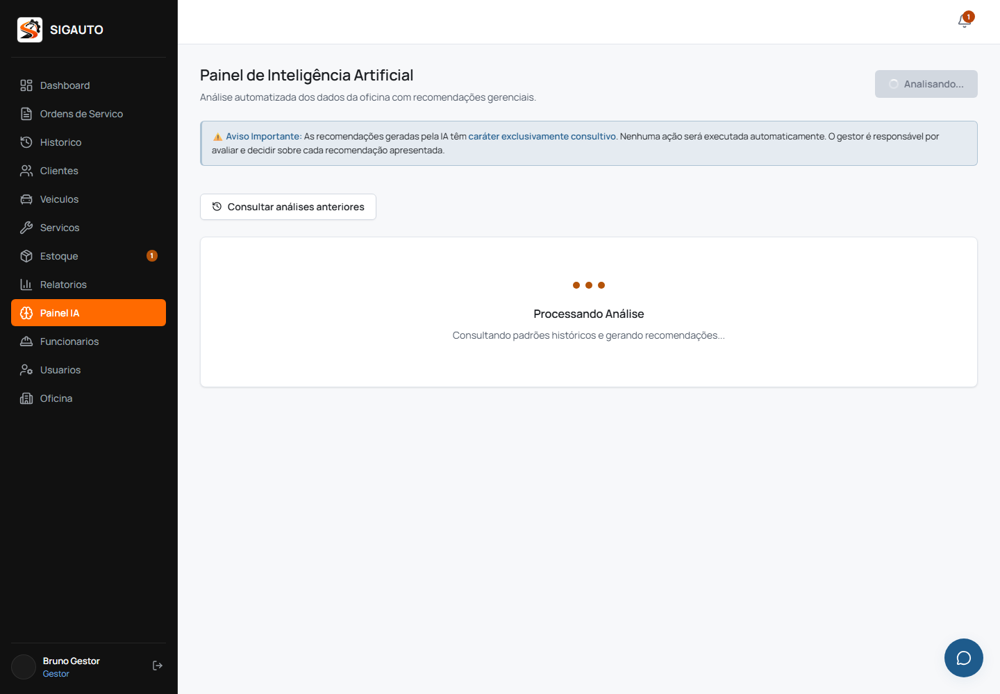

# Evidência de RNF-DS04 e RNF-DS05 — 26/10/2026

## Escopo e ambiente

- Execução local em `26/10/2026 13:40 BRT` (`2026-10-26T16:40:04.073Z`).
- Código medido no commit `bc76346`, branch `melhorias/login-desempenho-historico-os`.
- Frontend servido a partir do build de produção em `http://127.0.0.1:4174`.
- Backend isolado em `http://127.0.0.1:3102` e Supabase efêmero em `http://127.0.0.1:54321`.
- Navegador Chromium headless controlado pelo Playwright.
- Nenhuma chamada foi enviada à produção ou ao Gemini; credenciais, tokens e dados pessoais não foram registrados.

## RNF-DS04 — carga compartilhada por sessão

O navegador autenticou uma conta sintética, aguardou a carga inicial e contabilizou
as respostas `GET` do PostgREST para `cliente`, `veiculo` e `ordem_servico`. Em seguida,
navegou sem recarga por `/clientes`, `/veiculos`, `/ordens-servico`, `/historico`, `/`,
`/clientes` e `/ordens-servico`. Por fim, executou uma recarga completa para confirmar
o início de uma nova sessão de carregamento.

| Momento | `cliente` | `veiculo` | `ordem_servico` |
|---|---:|---:|---:|
| Carga inicial | 1 | 1 | 1 |
| Chamadas extras em 7 navegações SPA | 0 | 0 | 0 |
| Carga após recarga completa | 1 | 1 | 1 |

Todas as respostas contabilizadas retornaram HTTP 200. O resultado **aprova DS04 no
ambiente local**: os dados principais foram carregados uma vez pelo `DataProvider` e
compartilhados durante a navegação; uma recarga completa iniciou corretamente uma nova
sessão de carga.

## RNF-DS05 — indicador para espera acima de três segundos

A rota `/api/v1/ia/analisar` foi interceptada somente no navegador de ensaio e recebeu
uma resposta sintética após atraso configurado de 4.200 ms. Isso isolou o comportamento
visual e evitou consumo ou dependência externa do Gemini.

| Medida | Resultado |
|---|---:|
| Requisições de análise | 1 |
| Atraso configurado | 4.200 ms |
| Resposta liberada após | 4.694 ms |
| Duração total observada | 5.072 ms |
| Botão `Analisando...` aos 3.200 ms | Visível |
| Painel `Processando Análise` aos 3.200 ms | Visível |
| Indicadores após a resposta | Ausentes |

O resultado **aprova DS05 no ambiente local**: ambos os indicadores permaneceram
visíveis depois de três segundos, desapareceram ao final e a ação não gerou segundo
envio.

## Limites da evidência

Esta rodada comprova o comportamento do build de produção contra serviços locais e
isolados. Ela não mede rede pública, infraestrutura ou dados de produção e não deve ser
apresentada como benchmark do ambiente publicado.
